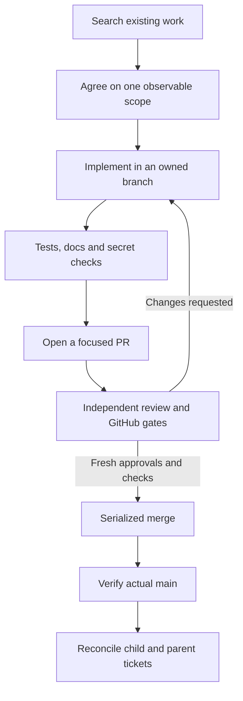

# Contributing to MALT

MALT is a local software factory for subscription-authenticated coding agents. Help with correctness, recovery, accessibility, documentation and focused features is welcome. Read the [code of conduct](CODE_OF_CONDUCT.md) and use the [security policy](SECURITY.md) for vulnerabilities.

## Find the right work

Search open and relevant closed issues and [Discussions](https://github.com/Division4Studios/malt/discussions) first. Ask usage questions in Q&A, discuss substantial proposals in Ideas, and file reproducible defects with the bug form. Related tickets should be linked. Do not close or consolidate existing tickets as duplicates without the maintainer's explicit decision.

Agree on scope before a substantial change. A feature can have 20+ native child issues, but every child should deliver a meaningful independently verifiable outcome. Prefer **1–500 changed text lines per PR**, including additions, deletions, tests and documentation. Record the reason and review strategy for an indivisible exception; never omit tests, compress code or hide changes to meet a count. The selected project's configured publication ceiling still applies.

Dependencies name real prerequisites. Independent slices can merge separately. Keep main usable after every merge with compatible scaffolding or expand/migrate/contract sequences. Separate unrelated refactoring and generated churn.

## Local development

Use Node.js **24.15.0 or later within the supported 24.x line**, npm, Git and an available native shell. Docker is required only for container verification; real Codex/Claude subscriptions and GitHub credentials are not required for fixture tests.

```sh
npm ci --ignore-scripts
npm run check
```

The gate runs strict TypeScript for backend/browser/service worker, ESLint with zero warnings, Prettier, reproducible browser compilation and Node regression tests. Use `npm run format` for formatting and rerun checks after meaningful changes. `npm run test:docker` builds and exercises isolated disposable container state when Docker is available. Do not point fixture tests at a live project or spend paid model turns to test scheduling.

CI uses a documentation fast path only when every changed path is a human-facing Markdown file under `docs/` or a conventional root document (README, CONTRIBUTING, SECURITY, CODE_OF_CONDUCT, CHANGELOG, SUPPORT or THIRD_PARTY_NOTICES). Formatting and all security checks still run. Existing required platform and Docker checks report an explicit documentation-only success without installing dependencies or running their suites. Agent instructions (`AGENTS.md`, `CLAUDE.md`), skills (`SKILL.md` and `resources/`), prompts, workflows, assets, source and mixed changes retain the full gate. Renames inspect both paths; unknown events, unavailable history and empty diffs also use the full gate. Manual CI runs always run everything. No workflow-level path filter can leave required checks pending.

Classification executes the classifier from the immutable base commit, never from the proposed PR checkout. Missing base classifiers use full CI, including the initial introduction of this optimization. A PR changing the classifier cannot use its proposed classifier to exempt itself from validation.

Frontend production dependencies are zero: native TypeScript, semantic HTML, browser APIs and CSS. The backend has exactly three runtime packages, each kept for one contained role: Zod (input validation), the MCP SDK (stdio protocol for agent sessions) and the pinned `node-pty` (scratch terminals only), alongside built-in `node:sqlite`. Do not add runtime packages; new code validates with hand-written checks where no Zod boundary exists. Runtime packages must use an MIT-compatible license (MIT, ISC, BSD-2-Clause, BSD-3-Clause, Apache-2.0 or 0BSD), which the Security gate enforces. Keep exact version pins, install with `npm ci --ignore-scripts` and never import a development package at runtime. See the [dependency policy](docs/dependency-policy.md) for why each package stays and how they are locked down. Do not add frameworks, browser libraries, runtime package downloads or broad lint suppressions. Validate external input and preserve existing strict checks.

### Console text

Every operator-visible string in `web/src` goes through the message catalog. Write the English text itself as the key: `t('Pause factory')`, with `{name}` placeholders named for what they hold (`t('Instruct {role}', { role })`, never `{value}`), and English fallbacks inside parameters translated too and ICU plural branches for counts (`t('{count, plural, one {# file} other {# files}}', { count })`). Never build a sentence from translated fragments or English plural endings. Text in a table evaluated at module load is marked with `phrase('…')` and the table wrapped in `translated(…)`, so it follows a language change. Add the Simplified Chinese translation to the `web/src/catalog-zh-*.ts` file for that console area. `test/i18n.test.ts` fails when a message has no translation, a translation changes its placeholders, a translation outlives its message, or a view sets visible text from a hard-coded English literal; `node scripts/i18n-keys.ts` lists every message it checks.

## Native test resources

`npm test` runs every regression through `scripts/test.ts`. Windows schedules one test file at a time because native Job Object / ConPTY cases include cold PowerShell compilation and resource ceilings; other platforms schedule two files. This bounds cross-file machine contention without removing scenario-level concurrency, cancellation, timeout or descendant-cleanup assertions. Explicit test-runner flags can be supplied with `npm test -- --test-name-pattern=...`.

## Pull requests



Review covers the current source and base. A change to either can invalidate earlier approval; closing a ticket follows verification, not merely opening a PR.

1. Branch from current main and implement the agreed scope in an isolated checkout/worktree.
2. Include meaningful failure-path and regression coverage. Update affected guides and API contracts.
3. Run `npm run check`; explain the exact checks, platform, fixtures and any unverified external boundary.
4. Use a Conventional Commit pull request title (`feat:`, `fix:`, `docs:`, a `(security)` or `(deps)` scope, …): `CHANGELOG.md` is generated from squash-merge subjects by `node scripts/changelog.ts`, and the `skip-changelog` label leaves a pull request out. Do not edit `CHANGELOG.md` by hand.
5. Check `git diff --check`, the complete staged diff and secret-scan results. Never include `.malt`, `.mlt`, provider homes, `.env`, credentials or private logs.
6. Open a focused PR using the template. Link its issue, prerequisites, acceptance criteria and any size exception. Refresh current main and obtain fresh independent review when source or base changes.

Maintainers require passing quality/security gates, resolved conversations and authenticated GitHub reviews under repository protection. AI-authored changes have the same requirements. The [documented solo-maintainer exception](docs/github-controls.md) currently requires zero authenticated GitHub approvals; the intended two-reviewer/code-owner policy resumes when trusted collaborators join. Independent factory QA and final verification remain separate gates. Reviewers reproduce and report findings; the responsible author repairs them. Do not use administrator bypass or represent model comments as protected-branch approvals.

Keep review requests respectful. No automatic stale bot will close an unresolved report merely because time passed. Maintainers may defer or reject scope with a written reason.

## Licensing and provenance

Contributions are offered under the repository's [MIT license](LICENSE), except explicitly identified third-party material that retains its upstream license. Submit only material you have the right to contribute. Credit borrowed designs, code and skills, preserve copyright notices, and document source commits and license compatibility in [third-party notices](THIRD_PARTY_NOTICES.md). No CLA, mandatory personal-email disclosure or contributor certification is implied by this guide.
