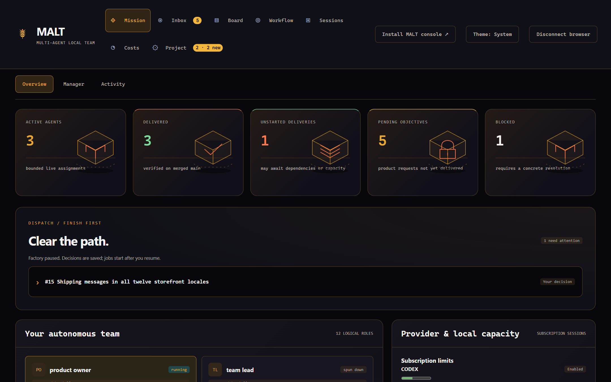

# MALT — Multi-Agent Local Team


[](https://github.com/Division4Studios/malt/actions/workflows/ci.yml)
[](https://github.com/Division4Studios/malt/actions/workflows/security.yml)
[](LICENSE)
[](https://nodejs.org/)
[](https://github.com/Division4Studios/malt/stargazers)
[](https://github.com/Division4Studios/malt/forks)
[](https://github.com/Division4Studios/malt/graphs/contributors)
[](https://github.com/sponsors/Division4Studios)

**Your local team of coding agents. Small deliveries. Independent review. One mission control.**

[Get started](docs/getting-started.md) · [Use it on your project](docs/using-malt-in-your-project.md) · [Documentation](docs/README.md) · [Discussions](https://github.com/Division4Studios/malt/discussions) · [Contribute](CONTRIBUTING.md) · [Report privately](SECURITY.md) · [Sponsor](https://github.com/sponsors/Division4Studios)

MALT turns the Claude Code, Codex and GitHub Copilot CLIs you already pay for into a coordinated delivery team on your own machine. You describe an outcome. A product owner and a team lead plan it into small deliveries, developers work in their own Git worktrees, two independent reviewers check each change, and MALT merges only the exact reviewed commit and then verifies the result on main. You watch and steer everything from a local web console.

MALT is for a developer who wants agent help on a real repository without giving up review, Git history or control of their machine. It runs on Windows, macOS and Linux. Each managed job uses a provider CLI's own subscription login; MALT never uses an inference API key. The only external services are those subscriptions and GitHub, and GitHub only if you choose GitHub delivery or Codex Cloud tasks.

> [!IMPORTANT]
> MALT is pre-1.0. Agents run with the permissions you grant under your OS account. Start on a disposable project, review its validation commands and resource limits, and read [Safety and limits](#safety-and-limits) first.


The **broker** is one local service that owns each project's state in `.malt/`. Its **supervisor** schedules bounded assignments and spends no model tokens while it waits. Roles that have no work have no running process. The **console** is an installable web app (PWA) served on `127.0.0.1`. A **bridge** connects one agent session to the broker over MCP.



## What works today

Everything below is merged on `main` and covered by automated tests. Inference and GitHub are fixtures in those tests; [Safety and limits](#safety-and-limits) lists what has not been proven live yet. The [capability map](docs/current-status.md) has the details.

### Coordination

- **Project-local memory.** Messages, claims, decisions and history live in SQLite under the project's private `.malt/` and survive restarts.
- **One team per folder.** One broker serves many projects. Sessions in one repository never see another repository's team.
- **Bounded messaging.** Sends and broadcasts accept an idempotency key, identical broadcasts are deduplicated within a window, and acknowledged messages and old events are pruned after a retention window.
- **Cooperative attached sessions.** Claude Code and Codex sessions you start yourself can join as lead or worker, and a worker waits for an explicit decision without waking the model on every empty poll.

### Factory delivery

- **Planned, atomic work.** An objective goes to a product owner and a team lead, who plan dependency-ordered deliveries, each with acceptance criteria.
- **Workflows.** Five built-in workflows (`malt-assured` by default, `pull-request`, `direct`, `full-assurance`, `quick`), an editor with revision history, per-objective and per-delivery step overrides, typed step outputs and optional brief revalidation.
- **Independent review.** Two reviewers check the exact head and base. Defects return to the original developer. A final check precedes the merge.
- **Gated merges.** MALT merges only the reviewed head, through a merge, the merge queue, auto-merge or a precise handoff to you. It always passes `--match-head-commit` and never `--admin`. It then verifies the merged main.
- **Repair rounds.** A failed CI check or a merge conflict returns to the developer with bounded, redacted evidence.
- **Liveness checkpoints.** Productive assignments are extended, stalled ones stop, and a hard ceiling bounds them all. Extensions require verified quota headroom and no machine pressure. Otherwise the Inbox asks you to continue or wait.
- **Preflight and diagnostics.** A zero-model preflight runs before every paid attempt, a baseline of main's own test results reaches every assignment, and a failure after a successful agent turn is recorded exactly in `failure.json`.
- **Two delivery modes.** Deliver through GitHub issues, pull requests and Projects, or through a protected local hub that needs no hosted service. Developer work can optionally run as Codex Cloud tasks with local review.
- **Recovery.** External merges are adopted, reviewed PRs are refreshed onto an advanced main, `factory-reconcile-github` reconciles the ledger with GitHub without paid jobs, one host or container owns the worktrees at a time (`factory-worktrees-adopt`), and `factory-prune` safely removes orphaned worktrees and snapshots.

### Console

- **Mission:** overview with definitions of done, the persistent delivery **Manager** you talk to, and the Activity stream.
- **Inbox:** agent questions, approvals and checkpoint decisions in **Needs reply**, **Notices** and **Answered** lanes, with opt-in browser notifications.
- **Board:** deliveries by stage, objectives with definitions of done and progress logs, and **Schedules & triggers** for cron schedules and loopback webhook triggers. A delivery's page shows its steps, liveness, findings and a **Changes** diff.
- **Workflow:** live map, team and organization, workflow library, roles editor and the local **Pull requests** view.
- **Sessions:** every attempt's transcript, files and cost, worker logs, and interactive **Scratch terminals**.
- **Costs:** spend from recorded usage, with USD spend caps per project, objective and delivery.
- **Project:** setup and capacity, settings, recommendations, learning and skills, an encrypted secrets vault, connector capabilities and the **Get started** guide.
- English and Simplified Chinese, light and dark themes, and a layout that works on a phone.

### Connectors

- **GitHub:** discovery, credential handles, verified connection sections, labels, milestones, views, fields and Project creation, all gated by a per-principal capability policy that is enforced where MALT executes GitHub operations and edited in **Project → Capabilities**.
- **MCP tool bindings:** connector MCP servers are bound only after a human approves their exact hash.
- **Local hub:** issues, pull requests and squash merges with an expected-base check, kept in `.malt/`.
- **Providers:** Claude Code and Codex, plus opt-in GitHub Copilot.
- **Jira:** not yet available. A read-only library exists, but it is not wired into connections, the console or the factory.

### Safety

- **Human decisions.** Skill changes, ticket recommendations, size exceptions and any plan or merge gate you enable wait for your explicit decision.
- **Least privilege.** Reviewers cannot write. Developers are confined to their worktree unless you grant full access. Per-role tool policies only narrow what a seat has.
- **Private by default.** `.malt/` is Git-ignored and dispatch refuses an index that contains it. Secrets are sealed with AES-256-GCM and reach only the role types you grant.
- **Loopback only.** The console binds to `127.0.0.1`, requires pairing and rejects cross-site requests. The broker rejects browser-origin RPC.

<table>
  <tr>
    <td></td>
    <td></td>
  </tr>
  <tr>
    <td></td>
    <td></td>
  </tr>
</table>

## Requirements

| Need                   | Version or detail                                                                                                              |
| ---------------------- | ------------------------------------------------------------------------------------------------------------------------------ |
| Node.js and npm        | 24.15.0 or later in the 24.x line. The audited container uses 24.22.0. See the [dependency policy](docs/dependency-policy.md). |
| Git                    | Any current release.                                                                                                           |
| At least one provider  | Claude Code or Codex CLI, logged in with a subscription account. GitHub Copilot CLI is optional.                               |
| GitHub CLI (`gh`)      | Only for GitHub delivery, authenticated with access to the repository and its Project.                                         |
| Docker with Compose v2 | Only for the container alternative.                                                                                            |
| A browser              | A current browser on the same machine. Installing the console as an app needs a browser that supports PWA installation.        |

Fixture tests need no provider subscription and no GitHub account.

## Quick start

The [getting started guide](docs/getting-started.md) walks through each step, explains every `doctor` check and covers stopping, upgrading and backups.

### Start natively

```sh
git clone https://github.com/Division4Studios/malt.git
cd malt
npm ci --ignore-scripts
npm run build:web
node src/cli.ts doctor --project /absolute/path/to/your/project
node src/cli.ts ui --with-broker --project /absolute/path/to/your/project --port 4318
```

On Windows, quote absolute paths, for example `--project "C:\work\your-project"`.

`doctor` reports each check as **PASS**, **FAIL** or **FIX-IT** with a fix line, and changes nothing. `ui --with-broker` starts the broker and the console in one process and prints a pairing code. Open `http://127.0.0.1:4318/`, enter the code, and the **Get started** guide opens. Run `npm run build:web` again after every pull.

### Start with Docker

```sh
export AGENTMESH_HOME_ROOT=/absolute/path/to/broker-home
export AGENTMESH_WORKSPACE_ROOT=/absolute/path/to/your/projects
docker compose up -d --build --wait
docker compose exec broker node src/cli.ts pairing-code --project /data
```

In PowerShell, set the variables with `$env:AGENTMESH_HOME_ROOT = 'E:\broker-home'`. Create both folders first. Then log in to the providers inside the container and open `http://127.0.0.1:4318/`. See [Docker as an alternative](docs/getting-started.md#docker-as-an-alternative).

## Use MALT on your own project

[Use MALT on your own project](docs/using-malt-in-your-project.md) covers what MALT adds to a repository, how to choose validation commands and a delivery mode, how to connect GitHub, and how to run and review the first objectives.

## Connect Claude Code and Codex sessions

There are two ways agents take part:

- **Managed roles** are launched and retired by the supervisor for each assignment. You need nothing beyond the quick start.
- **Attached sessions** are Claude Code or Codex sessions you open yourself. They connect through an MCP bridge, join the team of the folder they started in when you ask them to, and then follow a cooperative check-in and wait loop with a lead.

Register the bridge once, then run `/mcp__agentmesh__lead` or `/mcp__agentmesh__worker` in Claude Code, or `$agentmesh-lead` or `$agentmesh-worker` in Codex. [Connect an attached session](docs/getting-started.md#connect-an-attached-claude-code-or-codex-session) has the exact configuration for native and Docker brokers, and the [workflow guide](docs/workflow.md) explains the wait and resume states.

## The delivery loop


1. You submit an objective: one observable outcome.
2. The product owner and team lead plan it into atomic deliveries with acceptance criteria and genuine dependencies only. Independent deliveries run in parallel.
3. A developer implements each delivery in its own worktree and branch, and the project's test commands run on the exact head.
4. Two independent reviewers check that head and base. A defect goes back to the same developer, and any new head needs fresh reviews.
5. A final check approves the exact head. MALT merges that commit only if the base is still the one that was reviewed.
6. MALT verifies the merged main, closes the issue and retires the worktree.

Model reviews and GitHub's protected-branch reviews are separate gates; one never satisfies the other. Each project sets a publication-size ceiling (`maxFiles`, `maxDiffLines`). A delivery over it stops, and you can approve a one-delivery exception for its exact head and base. See the [software factory guide](docs/software-factory.md).

## Safety and limits

MALT is a tool for a **trusted local user**. Anyone with access to your OS account or to Docker can read `.malt/`, its SQLite databases and its secrets. It is not a sandbox for hostile agents and not a multi-tenant service. Managed developers run native commands under your account, and resource limits are admission thresholds, not hard kernel ceilings on every OS.

Keep `.malt/`, provider credential folders, pairing codes and backups private. Do not expose the console or broker ports beyond loopback. Installing the PWA does not install or start the broker.

Not verified yet, and tracked for 1.0 on [milestone 1](https://github.com/Division4Studios/malt/milestone/1):

- a live end-to-end delivery through a protected GitHub branch with paid agents (#259);
- the installed-PWA lifecycle and a hands-on accessibility audit (#261);
- runs on fresh machines (#258);
- live Copilot assignments and live Codex Cloud tasks;
- a release, distribution and the v1.0.0 tag (#260).

Also open: a worktree prune command (#411), the connector console with separate work-tracker and source-control sections (#84), Jira, and CodeQL alert #3 (#245).

## Community and support

| Need                        | Start here                                                                                                 |
| --------------------------- | ---------------------------------------------------------------------------------------------------------- |
| Setup or a question         | [Q&A](https://github.com/Division4Studios/malt/discussions/categories/q-a) and [support guide](SUPPORT.md) |
| Bug or feature              | [Issue forms](https://github.com/Division4Studios/malt/issues/new/choose); search related work first       |
| Contribute code or docs     | [Contribution process](CONTRIBUTING.md) and [PR template](.github/PULL_REQUEST_TEMPLATE.md)                |
| Security disclosure         | [Private reporting policy](SECURITY.md)                                                                    |
| Community decisions         | [Governance](GOVERNANCE.md) and [code of conduct](CODE_OF_CONDUCT.md)                                      |
| License and upstream skills | [MIT](LICENSE) and [third-party notices](THIRD_PARTY_NOTICES.md)                                           |
| Funding                     | [Sponsorship](SPONSORING.md): funds subscriptions, verification and security work; it buys no SLA          |

Count badges come from Shields.io and GitHub. Build badges describe hosted workflow results, not a guarantee that every provider, OS or deployment works. No OpenSSF certification or coverage score is claimed.

## Documentation map

The [documentation index](docs/README.md) lists every page by goal. The most used:

| To                                        | Read                                                                                                                                                                   |
| ----------------------------------------- | ---------------------------------------------------------------------------------------------------------------------------------------------------------------------- |
| Install, pair and run the first objective | [Getting started](docs/getting-started.md)                                                                                                                             |
| Adopt MALT on your repository             | [Use MALT on your own project](docs/using-malt-in-your-project.md)                                                                                                     |
| Operate the console                       | [Mission control](docs/operator-console.md) and [delivery manager](docs/delivery-manager.md)                                                                           |
| Deliver without GitHub                    | [Local delivery, Copilot and cloud sessions](docs/local-delivery.md)                                                                                                   |
| Understand the factory                    | [Project coordination and learning](docs/software-factory.md) and [architecture](docs/architecture.md)                                                                 |
| Configure Docker and environment settings | [Docker as an alternative](docs/getting-started.md#docker-as-an-alternative) and [Docker startup](docs/operator-console.md#docker-startup-and-provider-authentication) |
| Read logs and fix problems                | [Logging and troubleshooting](docs/logging-and-troubleshooting.md)                                                                                                     |
| Back up, restore and upgrade              | [Compatibility and running revision](docs/compatibility.md)                                                                                                            |
| Look up CLI commands                      | [CLI reference](docs/cli-reference.md)                                                                                                                                 |
| Look up MCP tools and RPC                 | [API reference](docs/api.md) and [workflow](docs/workflow.md)                                                                                                          |
| Develop MALT itself                       | [Contributing](CONTRIBUTING.md) and [dependency policy](docs/dependency-policy.md)                                                                                     |

The public product and command are **MALT** (`malt`). Existing `agentmesh` MCP registrations and tool names stay compatible; see the [branding and storage migration](docs/rebranding.md).
