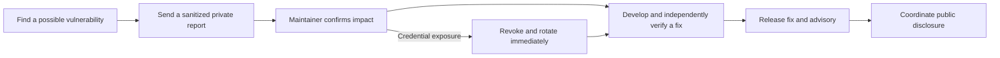

# Security policy

## Report privately

Use [GitHub's private vulnerability reporting form](https://github.com/Division4Studios/malt/security/advisories/new). Include the affected commit/version, platform, impact, minimal reproduction and suggested mitigation. Use synthetic credentials and disposable repositories. Never attach real provider credentials, pairing codes, `.malt` archives or unredacted transcripts.

If the private form is unavailable, open a minimal issue requesting a private security channel **without vulnerability details or secrets**. Do not disclose exploitable details in Discussions or public issues. GitHub platform abuse can be [reported directly to GitHub](https://docs.github.com/en/communities/maintaining-your-safety-on-github/reporting-abuse-or-spam).

Maintainers aim to acknowledge reports within seven days and provide a triage update within fourteen days. These are response goals for a volunteer project, not a support contract. Coordinate disclosure after a fix and advisory are available; a report should not be withheld indefinitely without a status update. There is no funded bounty program.

## Supported code

Credential rotation must not wait for a cleanup commit. The diagram describes the disclosure process, not a promise that every report is a vulnerability.

MALT is pre-1.0. Security work targets the latest `main` commit and the latest tagged release when one exists. No older release line has a backport guarantee. Reproduce against current source and use a supported Node.js 24 patch release. The presence of a version in `package.json` does not mean a release artifact has been published.

## Trust boundaries

- The broker and PWA control service bind locally by default. Do not expose them through a public reverse proxy or tunnel. Browser access uses local pairing, bounded HttpOnly sessions, origin/host validation and a restrictive CSP.
- `.malt/` contains private project operations, authentication material for the local broker, logs and model context. Keep the entire directory out of Git and public archives. Provider subscription credentials remain in provider-supported stores; project memory is not a credential vault.
- Managed developer permissions can allow arbitrary code execution under the native OS account. This is a trusted local-user tool, not a hostile-agent sandbox. Review permission modes, target-project code and validation commands before enabling dispatch.
- Independent QA, exact-commit gates and GitHub protections reduce delivery risk; they do not make untrusted code safe to run. Model approvals do not satisfy GitHub's authenticated review rules.
- Tools, MCP servers and upstream skills are executable or behavioral supply-chain inputs. Pin sources, retain provenance/licenses, review changes and require human approval for exact project skill revisions.
- Runtime npm code runs with the same access as MALT. The backend is limited to three exactly pinned packages (Zod, the MCP SDK and `node-pty`), installed from integrity-checked lockfiles with install scripts disabled, audited at every severity and license-checked on every pull request. See the [dependency policy](docs/dependency-policy.md).
- Windows owned processes use Job Objects; other platforms use process groups and admission checks. Admission limits are not universal hard OS ceilings. Never terminate unrelated processes to recover a job.

## Before sharing artifacts

Stop the broker before making a private backup. Inspect the exact files being exported and run secret scanning on both the current tree and Git history. Redaction protects known credentials; it cannot guarantee removal of every secret generated by third-party tools. Rotate any real exposed credential immediately, even if it is later deleted from Git. A public history rewrite requires coordinated remediation, not a routine cleanup commit.

See [public release readiness](docs/open-source-readiness.md) for evidence, limits and maintenance checks. No scan or badge is a guarantee of security.

## Verified controls and reporting limits

The [GitHub control inventory](docs/github-controls.md) records current scanning, protected-merge settings and the temporary solo-maintainer review exception. CodeQL configuration and a passing PR do not establish that the repository has no open alerts. Supported-pattern secret scanning and push protection are enabled; generic-pattern and validity checks are not verified enabled. Treat scanner findings as evidence to investigate and never submit secrets to public issues, Discussions or sponsorship messages.
