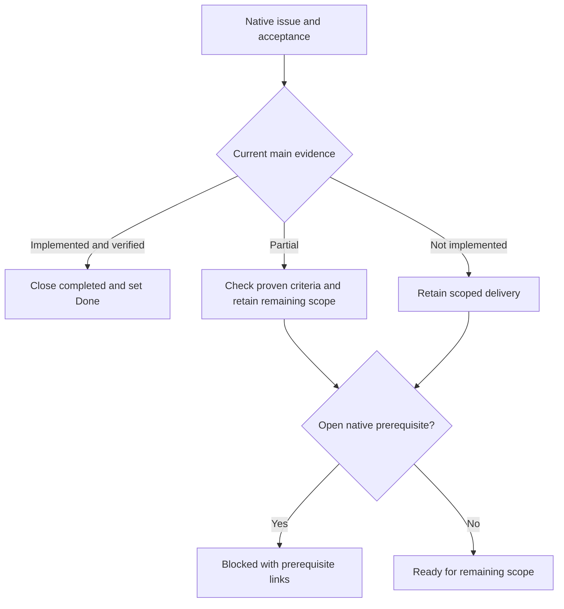

# What MALT implements today

Reviewed against main `0325f63` on 2026-10-15. This is a capability map, not a declaration that the full factory roadmap is complete. The [95-issue audit](issue-audit-2026-10-15.md) records individual scopes and merged PR evidence. Live issues and the selected Project remain authoritative for subsequent changes.

Terminal update on 2026-10-16: [feature #101's native Stack #155](https://github.com/Division4Studios/malt/pull/153) adds the connected operator scratch-terminal path described below. This source revision is ahead of the historical main audit; merge and restart matching services before treating it as deployed. The original audit remains a dated record, not a reason to redispatch duplicate terminal implementation.

## Capability map

| Area                    | Implemented                                                                                                                                      | Still open                                                                                                                                                                                                                                                                                                                                                                                                            |
| ----------------------- | ------------------------------------------------------------------------------------------------------------------------------------------------ | --------------------------------------------------------------------------------------------------------------------------------------------------------------------------------------------------------------------------------------------------------------------------------------------------------------------------------------------------------------------------------------------------------------------- |
| Coordination and memory | Project-local `.malt`, SQLite messages/claims, instructions, bounded context and restart recovery                                                | A file existing is not evidence it was supplied to a model                                                                                                                                                                                                                                                                                                                                                            |
| Managed delivery        | Owned worktrees/processes, atomic claims, two QA roles, defect return, publication checkpoints, expected-head merge and actual-main verification | Complete live delivery under protected-review identities remains unverified                                                                                                                                                                                                                                                                                                                                           |
| Operator queue          | All unfinished objectives, durable ordering, focus, blocked-objective recovery and existing-delivery clearance                                   | Priority does not bypass dependencies or unblock work automatically                                                                                                                                                                                                                                                                                                                                                   |
| Dispatcher              | Safe formatted reports, exact-revision decisions, bounded lead diagnosis, repair/review/verify and one-delivery size exceptions                  | General ticket consolidation approval is a separate unfinished feature                                                                                                                                                                                                                                                                                                                                                |
| Activity                | Authenticated bounded backward event API and live recent events                                                                                  | Client paging model and Older/Return to recent controls: [#14](https://github.com/Division4Studios/malt/issues/14), [#15](https://github.com/Division4Studios/malt/issues/15)                                                                                                                                                                                                                                         |
| Handoffs                | Durable settlement provenance and read-only peer conversations                                                                                   | Unified report/message feed and meaningful Mission previews: [#19](https://github.com/Division4Studios/malt/issues/19), [#20](https://github.com/Division4Studios/malt/issues/20)                                                                                                                                                                                                                                     |
| Provider/local capacity | Observed quota windows/freshness, cooldowns, cached CPU/memory, owned PID measurements and broker-wide admission                                 | Sample-only redraw repair, legacy Claude windows, subscription-first layout, admission UI and overlap fixtures: [#28](https://github.com/Division4Studios/malt/issues/28), [#23](https://github.com/Division4Studios/malt/issues/23), [#24](https://github.com/Division4Studios/malt/issues/24), [#30](https://github.com/Division4Studios/malt/issues/30), [#31](https://github.com/Division4Studios/malt/issues/31) |
| Models and skills       | Reviewed per-role tier/effort, risk/rework floors, provider model profiles and focused skills                                                    | Revisioned allowed model/effort combinations, enforcement and editor: [#32](https://github.com/Division4Studios/malt/issues/32)                                                                                                                                                                                                                                                                                       |
| Project connectors      | Existing GitHub Project form, tracker/source records, typed-key expand migration, capability store and connection-bound issue recovery           | Discovery console, universal capability enforcement, labels/milestones/views and Jira: [#72](https://github.com/Division4Studios/malt/issues/72)                                                                                                                                                                                                                                                                      |
| Project management      | Recommendation state store and deterministic duplicate/related classifier                                                                        | Corpus freshness, decision routes/pane, intake/execution/notifications: [#50](https://github.com/Division4Studios/malt/issues/50)                                                                                                                                                                                                                                                                                     |
| Learning                | Evidence/provenance, lead review, human exact-revision skill decisions and local overrides                                                       | Recommendation-to-skill integration is not supplied by skill approval alone                                                                                                                                                                                                                                                                                                                                           |
| Interactive terminals   | Connected operator-only native PTY service, owned scratch worktrees, browser screen/input, bounded replay and native cleanup/restart tests       | Managed-assignment attachment/resume excluded; complete real-provider inference and untested architectures remain unverified. [Support contract](interactive-terminals.md)                                                                                                                                                                                                                                            |

## Evidence and its limits

Audited main passed `npm ci --ignore-scripts` and `npm run check`: three TypeScript targets, zero-warning ESLint, Prettier, the browser build and **236 tests**. The merged dependency/CI stack passed Windows, Linux, macOS, Docker/MCP/PWA restart smoke, secret scanning, dependency audit/review and CodeQL. Documentation-only CI uses trusted immutable base source, retains required check names, runs formatting/security, and falls back to full checks when classification is unavailable.

Model/GitHub regression boundaries use fixtures. Local Git/worktrees, validation processes and loopback broker/UI behavior are real. Fixtures do not verify live account quotas, a real PTY, distinct protected-review identities, every installed-PWA lifecycle or complete accessibility. No paid agent turn was used for this audit.

The later terminal stack separately exercises actual native PTYs, loopback controls, input/resize/reconnect, foreign-origin/project/agent rejection, timeout/cancel, forced wrapper-crash descendant cleanup and restart. Windows local and Docker Linux checks ran without inference; required CI covers Windows/Linux/macOS fixture execution. Real Windows Codex startup/resize/Quit and Claude startup/idle timeout were inspected without trusting the folders or submitting model prompts. These checks do not verify a full provider inference turn. See the [evidence-scoped terminal matrix](interactive-terminals.md#executed-support-evidence) and the stack tip's final check receipt.

The pinned container reports Node **24.22.0** LTS; CI tracks Node 24. TypeScript 6.0.3 matches the lint-tool peer contract. The backend uses MCP SDK 1.32.1 and Zod 4.6.7 through `zod/v3` compatibility. Browser production dependencies remain zero. See [dependency policy](dependency-policy.md).

## Reading the board

Old blocked comments are historical evidence, not proof a defect persists. A merged foundation also does not complete its parent's integrations. Never invent QA approvals, force local ledgers to Done, overwrite edits or claim a running broker was redeployed. Use [the operator guide](operating-malt-on-itself.md) for recovery and deliberate restart.
