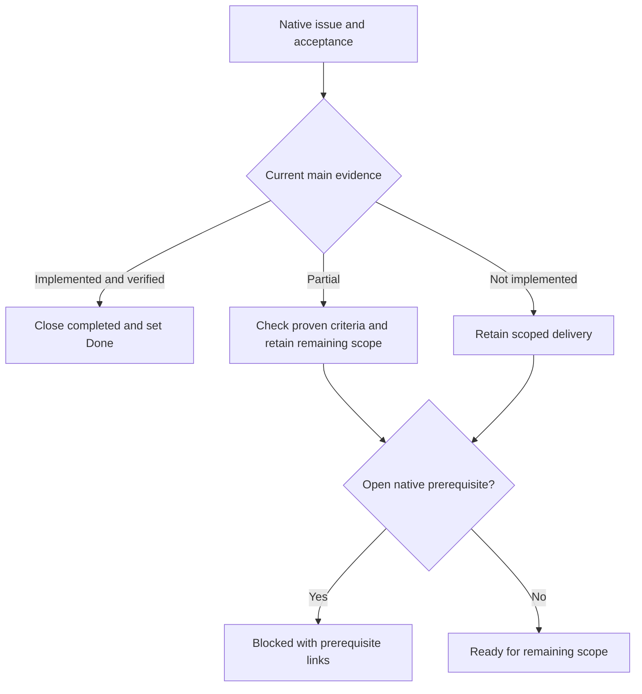

# What MALT implements today

Updated on 2026-10-16 against merged main `4ee09aa`, with prepared Stack #251 source described separately below. The baseline includes recovery/Activity, handoffs, stable unused-provider capacity, runtime dependency-license policy and unpaid operator adoption/retirement. This is a capability map, not a declaration that the full factory roadmap is complete. The [95-issue audit](issue-audit-2026-10-15.md) remains historical; the [merged-main reconciliation](wiki/Current-status.md) and live Project describe subsequent work.

All 50 PRs in feature #101's native Stack #155 are merged into main `187dc5a`; that main's tree equals the final terminal stack source. Recovery/Activity [Stack #213, starting at PR #210](https://github.com/Division4Studios/malt/pull/210) adds the closed-issue dispatch guard, external-merge adoption, shared admission repair, stable capacity sampling and bounded Activity browsing. All 15 PRs are merged into `ee75c10`, whose tree exactly equals the checked stack tip `de9c5e6`. The fresh full main check passed 342 tests. See the [scope, ticket and verification reconciliation](merged-source-reconciliation.md). Deliberately restart matching services before treating this revision as deployed; merging source does not upgrade a running broker.

Merged handoff source: [feed #230](https://github.com/Division4Studios/malt/pull/230) and [Mission previews #232](https://github.com/Division4Studios/malt/pull/232) are on main `6aadf99`. Its tree exactly equals reviewed stack tip `7aa0fa6`; a fresh full `npm run check` on this unchanged main passed **347 tests**, strict types/lint/format and browser compilation. The task-backed regression checks the durable source job rather than the team-wide reporting instruction. Actual Chrome checks cover native disclosure/focus, hostile text, stale/project states and compact layout. Separate independent role-review clauses and deliberate rollout remain unverified; a source merge does not satisfy them.

## Prepared stack source, not a runtime rollout

[Stack #251](https://github.com/Division4Studios/malt/stack/251) contains twenty implementation slices plus a focused provisioning-recovery repair and documentation wrap-up: subscription-first capacity and admission evidence, revisioned model/effort policy with frozen reviewed choices, and the connected recommendation read/submission/decision/notice/intake foundation. An earlier eleven-slice source check at `4672e04` passed **374 tests**; the final combined receipt is recorded with the batch handoff. Real local Git/worktrees/checks and paired loopback delivery use fixture inference/GitHub effects. These PRs remain operator-review/merge work; the selected production factory is paused and has not been redeployed.

The #53/#320 reader/checkpoint retains explicit coverage and original scoped cursors. Actual authenticated GitHub smokes fetched/reread one issue with matching identity/revision and exercised the production intake checkpoint on a ten-issue page, with continuation present, verified source agreement, zero jobs and zero effects. Private fixture SQLite held that checkpoint; production coordination was not changed. Native/local observations remain outside ordinary model context.

Before integration of the later main changes, combined implementation source `c6846ef` passed **392 tests**, all three TypeScript checks, zero-warning ESLint, Prettier and browser compilation on Windows. The isolated Docker smoke passed actual MCP messaging/restart, paired PWA durable controls and Linux native PTY input/resize/reconnect/timeout/descendant cleanup. Inference and GitHub effects were fixtures; these checks do not certify a paid live delivery or an installed-app accessibility audit. Documentation-only wrap-up changes have separate formatting and local-link verification.

After integration of main `4ee09aa`, the full check passed **398 tests** with no failures, cancellations or skips, plus strict types, zero-warning lint, formatting and browser compilation. Stack tree `95e4ba4` exactly matches checked tree `a6c905c`; moving the unchanged recommendation extraction earlier preserves independently checkable intermediate PRs without changing the final tree. Docker MCP/PWA persistence and Linux PTY cleanup also passed against the integrated main source. Later receipt edits change only documentation, with separate formatting and local-link checks.

Managed product/lead proposals enter an unread human queue. Paired owner-only decisions recheck exact native/local revisions and persist one inert approval intent. Compact notices reach relevant fresh assignments without patching running contexts. Unpaid #57 intake reuses interrupted native operations, suppresses unchanged rejected advice, and holds only dependent new planning/provisioning; unrelated deliveries remain eligible. Pending objective cards explain collection progress or the exact recommendation needing disposition.

The dedicated Project-management UI (#62/#63), remote effect executor (#59), safe graph/ownership transfer (#60), recommendation-to-inactive-skill bridge (#61), and their complete loop (#64) remain unfinished. An approved intent does not close tickets or activate skills. Full live protected delivery and comprehensive installed-window/offline/accessibility certification also remain unverified; the service-worker update lifecycle, the API `no-store` boundary and the offline/degraded status are covered by automated tests (#307), not by a real installed browser. The table below describes the merged baseline, not these pending-source additions.

## Capability map (merged baseline)

| Area                    | Implemented                                                                                                                                           | Still open                                                                                                                                                                                                                                                                                                                               |
| ----------------------- | ----------------------------------------------------------------------------------------------------------------------------------------------------- | ---------------------------------------------------------------------------------------------------------------------------------------------------------------------------------------------------------------------------------------------------------------------------------------------------------------------------------------- |
| Coordination and memory | Project-local `.malt`, SQLite messages/claims, instructions, bounded context and restart recovery                                                     | A file existing is not evidence it was supplied to a model                                                                                                                                                                                                                                                                               |
| Managed delivery        | Owned worktrees/processes, atomic claims, two QA roles, defect return, bounded CI and conflict repair, expected-head merge, actual-main verification  | Complete live delivery under protected-review identities remains unverified                                                                                                                                                                                                                                                              |
| Operator queue          | All unfinished objectives, durable ordering, focus, blocked-objective recovery and existing-delivery clearance                                        | Priority does not bypass dependencies or unblock work automatically                                                                                                                                                                                                                                                                      |
| Dispatcher              | Safe formatted reports, exact-revision decisions, closed-issue preflight, external merge adoption, bounded diagnosis and one-delivery size exceptions | Adoption queues actual-main verification; it does not invent approvals. Ticket consolidation is a separate unfinished feature                                                                                                                                                                                                            |
| Activity                | Authenticated backward API, bounded live/page state, Older/Retry/Return-to-recent controls and project-generation fences                              | Complete installed-window/accessibility audit remains unverified; source: [#222](https://github.com/Division4Studios/malt/pull/222), [#224](https://github.com/Division4Studios/malt/pull/224)                                                                                                                                           |
| Handoffs                | Durable settlement provenance, bounded unified feed, read-only peer conversations and six Mission previews                                            | Merged #230/#232; remaining independent role verification and deliberate rollout: [#19](https://github.com/Division4Studios/malt/issues/19), [#20](https://github.com/Division4Studios/malt/issues/20)                                                                                                                                   |
| Provider/local capacity | Observed quota windows/freshness, cooldowns, CPU/memory, owned PID measurements, broker-wide admission and sample-stable controls                     | Legacy Claude windows, subscription-first layout, complete admission UI and overlap fixtures: [#23](https://github.com/Division4Studios/malt/issues/23), [#24](https://github.com/Division4Studios/malt/issues/24), [#30](https://github.com/Division4Studios/malt/issues/30), [#31](https://github.com/Division4Studios/malt/issues/31) |
| Models and skills       | Reviewed per-role tier/effort, risk/rework floors, provider model profiles and focused skills                                                         | Revisioned allowed model/effort combinations, enforcement and editor: [#32](https://github.com/Division4Studios/malt/issues/32)                                                                                                                                                                                                          |
| Project connectors      | Existing GitHub Project form, tracker/source records, typed-key expand migration, capability store and connection-bound issue recovery                | Discovery console, universal capability enforcement, labels/milestones/views and Jira: [#72](https://github.com/Division4Studios/malt/issues/72)                                                                                                                                                                                         |
| Project management      | Recommendation state store and deterministic duplicate/related classifier                                                                             | Corpus freshness, decision routes/pane, intake/execution/notifications: [#50](https://github.com/Division4Studios/malt/issues/50)                                                                                                                                                                                                        |
| Learning                | Evidence/provenance, lead review, human exact-revision skill decisions and local overrides                                                            | Recommendation-to-skill integration is not supplied by skill approval alone                                                                                                                                                                                                                                                              |
| Interactive terminals   | Connected operator-only native PTY service, owned scratch worktrees, browser screen/input, bounded replay and native cleanup/restart tests            | Managed-assignment attachment/resume excluded; complete real-provider inference and untested architectures remain unverified. [Support contract](interactive-terminals.md)                                                                                                                                                               |
| Local delivery          | Protected local hub, validated issue/PR ledger, expected-base squash merges, checkout sync, console Pull requests view, lead/CLI controls             | Live paid runs through the local hub; see [local delivery](local-delivery.md)                                                                                                                                                                                                                                                            |
| Providers and cloud     | Codex, Claude Code and opt-in GitHub Copilot CLIs; optional Codex Cloud developer sessions with journaled resume and local review                     | Live Copilot assignments and live Codex Cloud tasks; Claude cloud sessions are not automated                                                                                                                                                                                                                                             |

The [persistent delivery manager #211](https://github.com/Division4Studios/malt/issues/211) is implemented in pull-request source, not yet merged. It provides one conversational Claude Code or Codex session per project with acknowledged messages, urgent and digest reports, operator decisions and gated steering tools; see [delivery manager](delivery-manager.md). [Progress-aware checkpoints #209](https://github.com/Division4Studios/malt/issues/209) remain queued and are being built separately. Neither feature counts as delivered until it is merged and verified on main. On the anneal-parity branch, [progress-aware checkpoints #209](https://github.com/Division4Studios/malt/issues/209) has its liveness contract (#302) and meaningful-progress decoder (#303) implemented with fake-clock, real-Git and captured-stream tests, plus retry backoff by failure class; quota and resource gates on extension (#304), operator continue/wait decisions (#305) and the dedicated console presentation (#306) remain open. No paid model turn has exercised an extension.

## Evidence and its limits

The historical `0325f63` audit passed **236 tests**. Merged terminal main `187dc5a` passed a clean `npm ci --ignore-scripts` and `npm run check` with **312 tests**; Activity PR #224's combined source passed **341 tests**. The fresh check on merged main `ee75c10` passed **342 tests**, three TypeScript targets, zero-warning ESLint, Prettier and the browser build. The merged stack passed Windows, Linux, macOS, Docker/MCP/PWA restart smoke, secret scanning, dependency audit/review and CodeQL. Documentation-only CI uses trusted immutable base source, retains required check names, runs formatting/security, and falls back to full checks when classification is unavailable.

Model/GitHub regression boundaries use fixtures. Local Git/worktrees, validation processes and loopback broker/UI behavior are real. These inference/remote fixtures do not verify live account quotas, distinct protected-review identities, every installed-PWA lifecycle or complete accessibility. No paid agent turn was used for this audit.

The later terminal stack separately exercises actual native PTYs, loopback controls, input/resize/reconnect, foreign-origin/project/agent rejection, timeout/cancel, forced wrapper-crash descendant cleanup and restart. Windows local and Docker Linux checks ran without inference; required CI covers Windows/Linux/macOS fixture execution. Real Windows Codex startup/resize/Quit and Claude startup/idle timeout were inspected without trusting the folders or submitting model prompts. These checks do not verify a full provider inference turn. See the [evidence-scoped terminal matrix](interactive-terminals.md#executed-support-evidence) and the stack tip's final check receipt.

The pinned container reports Node **24.22.0** LTS; CI tracks Node 24. TypeScript 6.0.3 matches the lint-tool peer contract. The backend uses MCP SDK 1.32.1, Zod 4.6.7 through `zod/v3` compatibility and the pinned `node-pty@1.2.0-beta.15`; no other runtime packages are permitted. Browser production dependencies remain zero. Since 2026-10-16 the Security gate also rejects runtime packages outside the MIT-compatible license allowlist. See [dependency policy](dependency-policy.md).

## Reading the board

Old blocked comments are historical evidence, not proof a defect persists. A merged foundation also does not complete its parent's integrations. Never invent QA approvals, force local ledgers to Done, overwrite edits or claim a running broker was redeployed. Use [the operator guide](operating-malt-on-itself.md) for recovery and deliberate restart.
