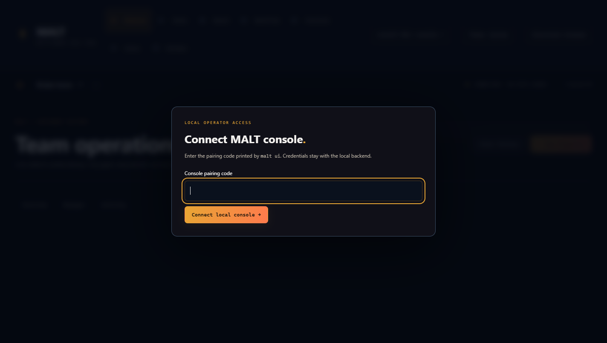
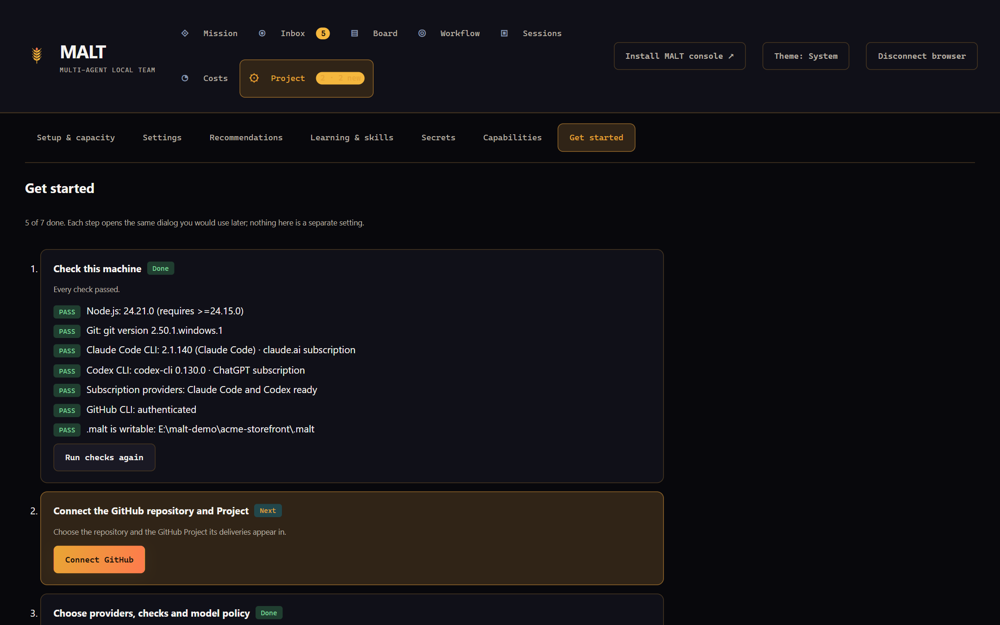

# Getting started

This guide takes you from a fresh clone to a paired console and a first objective on a disposable project. Plan for about 30 minutes, most of it installing and logging in to the provider CLIs.

When you finish, you will have:

- the MALT broker and console running on your machine;
- a browser paired with that console;
- a factory policy for a throwaway repository;
- one small objective planned, reviewed and merged by managed roles.

[Back to README](../README.md) · [Documentation index](README.md) · [Use MALT on your own project](using-malt-in-your-project.md)

## Before you begin

MALT needs these tools on the machine that runs the broker:

| Tool                    | Why MALT needs it                                                              | Get it                                                                   |
| ----------------------- | ------------------------------------------------------------------------------ | ------------------------------------------------------------------------ |
| Node.js 24.15.0+ (24.x) | Runs the broker, the CLI and the build of the console. npm comes with it.      | [nodejs.org](https://nodejs.org/) or your platform's Node 24 LTS package |
| Git                     | Owned worktrees, branches, merges and the local hub.                           | [git-scm.com](https://git-scm.com/)                                      |
| Claude Code CLI         | One of the two providers that `doctor` checks. At least one must be logged in. | `npm install -g @anthropic-ai/claude-code`                               |
| Codex CLI               | The other checked provider.                                                    | `npm install -g @openai/codex`                                           |
| GitHub Copilot CLI      | Optional third provider, off by default. `doctor` does not check it.           | `npm install -g @github/copilot`                                         |
| GitHub CLI (`gh`)       | Only for GitHub delivery: issues, pull requests, Projects and merges.          | [cli.github.com](https://cli.github.com/)                                |

Log in to each provider with the **subscription** account you want MALT to use. MALT refuses API-key authentication for managed jobs.

```sh
claude auth login
codex login
gh auth login --scopes repo,project   # only for GitHub delivery
```

For Copilot, run `copilot` and then `/login` inside it.

Platform notes:

- **Windows.** Use PowerShell or Windows Terminal, and reopen the terminal after installing a tool so `PATH` updates. Quote paths that contain spaces. If a provider is installed somewhere `PATH` does not reach, set its native `.exe` path in the factory policy. See [managed agent permissions on Windows](software-factory.md#managed-agent-permissions).
- **macOS.** The Node.js installer or a Node 24 package from your package manager works. Make sure the global npm `bin` folder is on `PATH` so `claude` and `codex` resolve.
- **Linux.** Use a Node 24 build from nodejs.org or your distribution. Distribution packages are often older than 24.15.0; `doctor` tells you.

Some Node 24 releases print `ExperimentalWarning: SQLite is an experimental feature` once at startup. It is harmless; see [compatibility](compatibility.md#the-nodesqlite-warning).

## 1. Install MALT

```sh
git clone https://github.com/Division4Studios/malt.git
cd malt
npm ci --ignore-scripts
npm run build:web
```

`npm ci --ignore-scripts` installs the three locked runtime packages without running any install scripts. `npm run build:web` compiles the console into the Git-ignored `web/dist/`. Run it again after every `git pull`.

All commands below run from this `malt` folder. If you run `npm link`, the same commands are available as `malt` (or the compatibility alias `agentmesh`) instead of `node src/cli.ts`.

## 2. Make a disposable project

Your first run should use a repository you can throw away. MALT writes into the project you select:

- it creates a private `.malt/` folder and adds `.malt/` to `.gitignore`;
- it adds a marked block to `AGENTS.md` and `CLAUDE.md` that points agents at `.malt/`;
- managed developers create branches, worktrees and commits.

Create a tiny repository with one passing test, outside the `malt` folder:

```sh
mkdir malt-sandbox
cd malt-sandbox
git init -b main
```

Create `package.json`:

```json
{ "name": "malt-sandbox", "private": true, "type": "module", "scripts": { "test": "node --test" } }
```

Create `math.js`:

```js
export const add = (a, b) => a + b;
```

Create `math.test.js`:

```js
import assert from 'node:assert/strict';
import test from 'node:test';
import { add } from './math.js';

test('add', () => {
  assert.equal(add(2, 3), 5);
});
```

Commit it, then return to the `malt` folder:

```sh
npm test
git add .
git commit -m "Initial commit"
cd ../malt
```

The examples below use `/absolute/path/to/malt-sandbox`. On Windows that looks like `"C:\work\malt-sandbox"`.

## 3. Check the machine with `doctor`

```sh
node src/cli.ts doctor --project /absolute/path/to/malt-sandbox
```

`doctor` never creates `.malt/` or changes the project. Its write probe is a uniquely named file that it removes at once. A healthy machine prints:

```text
PASS   Node.js: 24.21.0 (requires >=24.15.0)
PASS   Git: git version 2.50.1.windows.1
PASS   Claude Code CLI: 2.1.303 (Claude Code) · claude.ai subscription
PASS   Codex CLI: codex-cli 0.162.1 · ChatGPT subscription
PASS   Subscription providers: Claude Code and Codex ready
PASS   GitHub CLI: authenticated
PASS   Broker port 4317: free
PASS   Console port 4318: free
PASS   Project folder is writable: C:\work\malt-sandbox

Ready. Next: node src/cli.ts ui --with-broker
```

Each line is one of three results:

- **PASS**: nothing to do.
- **FIX-IT**: worth fixing, but MALT can run. A `fix:` line follows.
- **FAIL**: MALT cannot run until you fix it. `doctor` exits with a non-zero code.

A failure looks like this:

```text
FAIL   Project folder is writable: C:\nonexistent-malt-probe could not be written
       fix: Create C:\nonexistent-malt-probe or pass --project with an existing folder.

1 check failed. Fix them and run doctor again.
```

| Check                    | What it means                                                                                | If it does not pass                                                                                                                          |
| ------------------------ | -------------------------------------------------------------------------------------------- | -------------------------------------------------------------------------------------------------------------------------------------------- |
| Node.js                  | The running Node satisfies `engines` in `package.json` (`>=24.15.0`).                        | **FAIL.** Install Node 24.15.0 or later. If you use a version manager, make sure this terminal uses it.                                      |
| Git                      | `git --version` runs.                                                                        | **FAIL.** Install Git and reopen the terminal.                                                                                               |
| Claude Code CLI          | The `claude` executable exists and its subscription login is verified, without a model turn. | **FIX-IT.** Install it, or run `claude auth login`. On Windows you can instead set the native `.exe` path in the factory policy.             |
| Codex CLI                | The same for `codex`.                                                                        | **FIX-IT.** Install it, or run `codex login`.                                                                                                |
| Subscription providers   | At least one of Claude Code and Codex is ready.                                              | **FAIL.** Fix one of the two lines above.                                                                                                    |
| GitHub CLI               | `gh` exists and `gh auth status` succeeds.                                                   | **FIX-IT.** Needed only for GitHub delivery. Install `gh`, then `gh auth login` with the `repo` and `project` scopes.                        |
| Broker port 4317         | The broker port is free, or a MALT broker already answers on it.                             | **FAIL** if another program uses it. Stop that program. If a MALT broker is already running, `doctor` suggests `ui` without `--with-broker`. |
| Console port 4318        | The console port is free. `--port` changes which port is checked.                            | **FAIL.** Stop the other program, or start the console with `ui --port <free port>`.                                                         |
| Project folder / `.malt` | The project folder (or its `.malt/` once it exists) is writable.                             | **FAIL.** Create the folder or give your user write access to it.                                                                            |

`doctor --json` prints the same report as one JSON document (`{ ok, checks: [{ id, label, status, detail, fix }] }`) for scripts. The console runs the same checks, except the ports, inside the broker in **Get started → Check this machine**.

## 4. Start the broker and console

```sh
node src/cli.ts ui --with-broker --project /absolute/path/to/malt-sandbox --port 4318
```

`--with-broker` runs the broker and the console in one process. That process also holds the memory-only authority that scratch terminals and recommendation decisions need, so use it unless you have a reason to run them separately. The first start initializes `.malt/` in the project.

The command stays in the foreground and prints one JSON document with the console URL and a pairing code:

```json
{
  "url": "http://127.0.0.1:4318",
  "pairingCode": "…",
  "note": "Pair locally; browser installation does not install the native daemon. Re-show it with pairing-code."
}
```

The project you pass here is the broker's **home project**. You can open other repositories later from the project switcher in the console header.

## 5. Pair your browser

Open `http://127.0.0.1:4318/`. The console asks for the code.



1. Enter the code in **Console pairing code**.
2. Select **Connect local console →**.

The pairing code is a credential. It is stored owner-only in `.malt/console-pairing.json` and survives restarts. Browser sessions live only in the broker's memory, so after a restart you pair again with the same code.

```sh
node src/cli.ts pairing-code --project /absolute/path/to/malt-sandbox            # show it again
node src/cli.ts pairing-code --project /absolute/path/to/malt-sandbox --rotate   # issue a new one
```

After `--rotate`, a running console accepts only the new code. Browsers that are already paired keep their sessions. **Disconnect browser** in the navigation rail signs this browser out.

## 6. Follow the Get started guide

On a new project the console opens **Project → Get started** by itself.



Each step opens the same dialog you would use later, so there is no separate setup screen:

| Step                                      | Button                                           | What it does                                                                     |
| ----------------------------------------- | ------------------------------------------------ | -------------------------------------------------------------------------------- |
| Check this machine                        | none                                             | Runs the `doctor` checks inside the broker and shows each fix line.              |
| Connect the GitHub repository and Project | **Connect GitHub**                               | Opens the connection dialog. Skip it for local delivery.                         |
| Choose providers, checks and model policy | **Configure factory**, **Model & effort policy** | Opens the factory policy and the model and effort policy.                        |
| Pick how objectives are delivered         | **Open workflow library**                        | Names the default workflow. New objectives use it.                               |
| Submit a first objective                  | **New objective**                                | Opens the objective editor.                                                      |
| Start the factory                         | **Start factory**                                | Starts dispatch. Nothing runs while the factory is paused.                       |
| See the first role start                  | **Open Board**                                   | Names the first role, stage and provider, or the exact reason nothing can start. |

**Hide guide** hides it for this project in this browser. Reopen it from **Project → Get started**.

With local delivery the GitHub step stays marked as not done. That is expected; the other steps work without it.

## 7. Choose local or GitHub delivery

The **delivery mode** decides where issues, pull requests and merges live.

| Mode              | Where work lives                                                                                                     | You need                                                                                           | Read                                                   |
| ----------------- | -------------------------------------------------------------------------------------------------------------------- | -------------------------------------------------------------------------------------------------- | ------------------------------------------------------ |
| Local (`local`)   | A protected bare hub at `.malt/local/hub.git` and a ledger in `.malt/local/`. Shown in **Workflow → Pull requests**. | Nothing beyond Git. The hub rejects direct pushes to the base branch.                              | [Local delivery](local-delivery.md)                    |
| GitHub (`github`) | GitHub issues, sub-issues, pull requests and a GitHub Project.                                                       | `gh` logged in, a repository you can push to, a Project, and branch protection on the base branch. | [Software factory](software-factory.md#connect-github) |

Start with local delivery for this first run. Nothing leaves your machine except the model turns.

For GitHub delivery, open **Project → Setup & capacity → Configure connection**. Enter the repository (`owner/name`), the URL of an existing GitHub Project and the workflow field. The form never creates a Project. GitHub merges require branch protection on the base branch by default (`requireBranchProtection: true`), and MALT never changes protection.

## 8. Configure the factory

The **factory policy** names your validation commands, providers, resource limits and delivery mode. Validation commands are required: MALT runs them on every delivery's exact head.

1. Make sure the factory is paused. The **Start factory** / **Pause factory** button is in the page header.
2. Open **Project → Setup & capacity → Configure factory policy**, or select **Configure factory** in Get started.
3. Save a policy like this one for the sandbox:

```json
{
  "delivery": "local",
  "remote": "malt-hub",
  "testCommands": [{ "file": "npm", "args": ["test"] }],
  "endToEndCommands": [{ "file": "npm", "args": ["test"] }]
}
```

The same file works from a terminal:

```sh
node src/cli.ts factory-setup --project /absolute/path/to/malt-sandbox --file policy.json
```

Saving with `"delivery": "local"` creates the hub, pushes your base branch into it and registers it as the `malt-hub` remote. Settings you leave out keep their defaults, for example two concurrent jobs, Claude Code and Codex enabled, and Copilot disabled. The full schema is in `src/factory/schema.ts`; the [operator console guide](operator-console.md) explains the policy fields shown in the console.

## 9. Run the first objective safely

1. **Cap spending.** Open **Costs → Spend caps** and set a small cap for the project. A reached cap stops new attempts while running ones finish.
2. **Submit a small objective.** Select **＋ New objective** and describe one observable outcome, for example: "Add a `subtract(a, b)` function to `math.js` with a test." The product owner and team lead plan it into deliveries.
3. **Start the factory.** Select **Start factory**. The last Get started step names the first role that starts, or why none can.
4. **Watch it.** **Board** shows each delivery's stage. **Sessions → Attempts & transcripts** shows what each attempt read, ran, changed and cost. **Mission → Activity** is the committed event stream.
5. **Answer the Inbox.** Agent questions, gates and checkpoint decisions appear in **Inbox → Needs reply**.
6. **Bring the result into your checkout.** In **Workflow → Pull requests**, select **Sync my checkout**, or run `git pull malt-hub main` in the sandbox.

**Pause factory** stops managed processes and new dispatch at any time. Edits in owned worktrees are kept.

The same steps are available from a terminal, for example `node src/cli.ts factory-request --project <path> --body "…"`, `factory-start` and `factory-pause`. Run `node src/cli.ts --help` for the full list.

## Install the console as an app

The console is a progressive web app (PWA). Installing it gives you its own window; it does not install or start the broker.

1. Start the broker and console as in step 4.
2. Select **Install MALT console ↗** in the navigation rail, or use your browser's install control. The button appears only when the browser offers installation.
3. When a newer console is available, **Update MALT console** appears in the rail.

If the broker is not running, the installed app shows its cached shell with controls disabled until you start the broker and reconnect. The installed-app lifecycle has not been audited in real browsers yet (#261).

## Docker as an alternative

Docker runs the broker, the console and the Claude Code and Codex CLIs in one hardened container. Agents then run Linux commands, so your validation commands must work on Linux. The image does not include the Copilot CLI.

1. Install Docker with Compose v2 and start its Linux engine.
2. Create two host folders: a **broker home** for MALT's own state, and a **workspace root** that contains your projects.
3. From the `malt` folder, start the container:

   ```sh
   export AGENTMESH_HOME_ROOT=/absolute/path/to/broker-home
   export AGENTMESH_WORKSPACE_ROOT=/absolute/path/to/projects
   docker compose up -d --build --wait
   ```

   In PowerShell:

   ```powershell
   $env:AGENTMESH_HOME_ROOT = 'E:\malt\broker-home'
   $env:AGENTMESH_WORKSPACE_ROOT = 'E:\projects'
   docker compose up -d --build --wait
   ```

4. Log in inside the container. Host credentials are not copied in.

   ```sh
   docker compose exec broker claude auth login
   docker compose exec broker codex login --device-auth
   docker compose exec broker gh auth login        # only for GitHub delivery
   docker compose exec broker gh auth setup-git    # only for GitHub delivery
   docker compose exec broker git config --global user.name 'Your Name'
   docker compose exec broker git config --global user.email 'you@example.com'
   ```

5. Show the pairing code and open `http://127.0.0.1:4318/`:

   ```sh
   docker compose exec broker node src/cli.ts pairing-code --project /data
   ```

6. Open a project under the workspace root with **＋** next to the project switcher. Inside the container it appears under `/workspaces/`.

| Setting                                  | Default           | Meaning                                                                              |
| ---------------------------------------- | ----------------- | ------------------------------------------------------------------------------------ |
| `AGENTMESH_HOME_ROOT`                    | the `malt` folder | Host folder mounted at `/data`. Holds the broker home's `.malt/`.                    |
| `AGENTMESH_WORKSPACE_ROOT`               | the `malt` folder | Host folder mounted at `/workspaces`. Project state is written into each project.    |
| `AGENTMESH_PORT`                         | `4317`            | Host loopback port for the broker.                                                   |
| `AGENTMESH_UI_PORT`                      | `4318`            | Host loopback port for the console. Change it if a native console already uses 4318. |
| `AGENTMESH_PROJECT_NAME`                 | `agentmesh`       | Display name saved when the home project is first created. It never renames a store. |
| `AGENTMESH_LOG_LEVEL`                    | `debug`           | `debug`, `info`, `warn`, `error` or `silent`.                                        |
| `AGENTMESH_GITHUB_TOKEN`                 | empty             | Passed to `gh` in the container as `GH_TOKEN`.                                       |
| `MALT_DOCKER_UID`, `MALT_DOCKER_GID`     | `1000`            | User the container runs as.                                                          |
| `MALT_DOCKER_MEMORY`, `MALT_DOCKER_CPUS` | `4g`, `2.0`       | Container memory and CPU limits.                                                     |

Set these in your shell or an untracked `.env` file next to `compose.yaml`. Ports are published on `127.0.0.1` only.

Never run a native broker and a container broker against the same `.malt/` at the same time. For provider details, Git ownership errors and Linux preparation commands, see [Docker startup and provider authentication](operator-console.md#docker-startup-and-provider-authentication).

## Connect an attached Claude Code or Codex session

Managed roles need none of this. Attach a session when you want to work alongside the team in your own Claude Code or Codex window.

An attached session connects through a **bridge**, a small `mcp` process that exposes MALT's tools to the session. A bridge started without a name joins nothing until you ask the session to join. It then joins the team of the folder the session started in, under a generated name such as `claude-code-1a2b3c4d`.

### Claude Code

Register the bridge once at user scope. For a native broker:

```sh
claude mcp add-json -s user agentmesh '{"type":"stdio","command":"node","timeout":3600000,"args":["/absolute/path/to/malt/src/cli.ts","mcp","--project","/absolute/path/to/broker-home","--provider","anthropic","--runtime","claude-code"]}'
```

`--project` is the broker's home project, the one you passed to `ui --with-broker`. The bridge reads the broker's address and token from it. For the Docker broker, use the entry in [`examples/claude-mcp.json`](../examples/claude-mcp.json), which runs the bridge with `docker compose exec -T`. Keep `-T`; terminal formatting would corrupt the protocol.

Claude Code reports the session's folder through MCP roots, so every session joins its own folder's team. Run `/mcp__agentmesh__lead` or `/mcp__agentmesh__worker` to join. Register the server in one place only: two registrations start two bridges.

### Codex

Codex does not report MCP roots, so the bridge needs the folder some other way:

- **Docker broker:** merge [`examples/codex.config.toml`](../examples/codex.config.toml) into your Codex configuration. Its launcher, `src/docker-mcp.ts`, passes the folder Codex started in to the container. It needs Node 24 on the host.
- **Native broker:** pass the folder explicitly:

  ```toml
  [mcp_servers.agentmesh]
  command = "node"
  args = ["/absolute/path/to/malt/src/cli.ts", "mcp", "--project", "/absolute/path/to/broker-home", "--workspace", "/absolute/path/to/your/project", "--provider", "openai", "--runtime", "codex-cli"]
  startup_timeout_sec = 30
  tool_timeout_sec = 3600
  ```

Copy the folders in [`examples/codex-skills`](../examples/codex-skills) into `~/.codex/skills/`, then invoke `$agentmesh-lead` or `$agentmesh-worker`.

### Check the connection

Before joining, `mesh_whoami` returns `NOT_JOINED`, while `mesh_team_status` and `mesh_list_agents` already show the folder's team. After joining as lead, the `mesh_join` result shows `participant: orchestrator`. A worker shows `phase: AWAITING_LEAD`.

Joining as lead fails with `LEAD_ACTIVE` while another lead is connected; join as a worker instead, or replace the lead with `node src/cli.ts lead --project <home> --workspace <folder> --name <agent>`.

The timeouts in these examples allow one wait to last up to an hour. The broker caps each internal wait at 25 seconds, and the bridge renews empty waits without involving the model. A bridge cannot make a model continue after its host ends the turn.

**Fixed identities.** `mcp --name NAME` registers a durable identity that keeps its inbox across restarts. Give each simultaneous session its own name: a second session using the same name fails with `AGENT_ACTIVE`, which Claude Code reports only as "Connection closed".

The [workflow guide](workflow.md) explains every wait state, and [troubleshooting](logging-and-troubleshooting.md#a-session-cannot-connect-or-join) covers connection errors.

## Broker settings

These environment variables are read when the broker starts. Set them in the shell that runs `ui --with-broker` or `start`.

| Variable                           | Default | Meaning                                                                                                 |
| ---------------------------------- | ------- | ------------------------------------------------------------------------------------------------------- |
| `AGENTMESH_LOG_LEVEL`              | `info`  | Diagnostic level on stderr: `debug`, `info`, `warn`, `error` or `silent`. `--verbose` sets `debug`.     |
| `AGENTMESH_MESSAGE_DEDUP_MS`       | `60000` | Window in which an identical broadcast from the same sender collapses into the first. `0` turns it off. |
| `AGENTMESH_MESSAGE_RETENTION_DAYS` | `14`    | Age after which acknowledged messages are deleted. Unread messages to live identities are kept.         |
| `AGENTMESH_EVENT_RETENTION_DAYS`   | `30`    | Age after which events are folded into daily counts.                                                    |

`compose.yaml` passes only `AGENTMESH_LOG_LEVEL` of these into the container. See [logging and troubleshooting](logging-and-troubleshooting.md) for reading diagnostics.

## Stop, upgrade and back up

**Stop.** Select **Pause factory** so owned processes stop and new dispatch ends, then press Ctrl+C in the terminal running `ui --with-broker`. With Docker, run `docker compose down`. It keeps project data and the provider credential volume. `docker compose down --volumes` also deletes the credential volume.

**Back up.** A backup is a consistent snapshot of `.malt/`, taken even while the broker runs:

```sh
node src/cli.ts backup --project /absolute/path/to/malt-sandbox --dir /absolute/path/to/new-backup-folder
node src/cli.ts restore --project /absolute/path/to/malt-sandbox --dir /absolute/path/to/backup-folder
```

Restore refuses while the broker runs, and it moves the current `.malt/` aside instead of deleting it. Backups contain tokens, identities and the secrets vault key, so keep them private. See [back up, restore and roll back](compatibility.md#back-up-restore-and-roll-back).

**Upgrade.**

1. Pause the factory and wait for running attempts to finish.
2. Take a backup.
3. Stop the console.
4. Update and rebuild:

   ```sh
   git pull
   npm ci --ignore-scripts
   npm run build:web
   ```

5. Start `ui --with-broker` again and pair with the same code.
6. Check **Project → Settings → Build**: it shows the source revision the broker and console are running.

Merging or pulling new source never upgrades a running broker; only a restart does. With Docker, run `docker compose up -d --build --wait`, then reconnect any attached MCP sessions. A database migrated by a newer release cannot be opened by an older one, which is why the backup comes first.

## Next steps

- [Use MALT on your own project](using-malt-in-your-project.md): move from the sandbox to a real repository.
- [Mission control](operator-console.md): every console section in detail.
- [Delivery manager](delivery-manager.md): talk to one persistent session that runs the mission with you.
- [Logging and troubleshooting](logging-and-troubleshooting.md): when something does not start.
