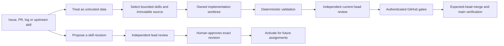

# GitHub controls and operating decisions

**Temporary solo-maintainer exception (owner authorized 2026-10-14; review by 2026-10-28):** GitHub approval count is zero, code-owner approval and latest-push approval are not enforced because no independent collaborator is available. PRs, fresh required checks, CodeQL merge protection, conversation resolution, linear history and administrator enforcement remain active. Factory deliveries still require two independent local QA results and final verification. Restore two authenticated approvals, code-owner review and latest-push approval when trusted collaborators join. This is an explicit exception, not proof of independent GitHub review.

This inventory records the public MIT repository's intended controls and the verified settings on 2026-10-14. GitHub features, availability and permissions change. Read back the live setting after an update; an unchecked setup checklist is not evidence of protection.

## Code and review

| Control            | Decision and rationale                                                                                                                                                    |
| ------------------ | ------------------------------------------------------------------------------------------------------------------------------------------------------------------------- |
| Default branch     | `main`; pull requests required, including maintainers.                                                                                                                    |
| Independent review | Two authenticated approvals, code-owner review, stale approval dismissal and latest-push approval. Models sharing an account do not supply independent GitHub identities. |
| Integration        | Current-base checks, resolved conversations and linear history; no force push, deletion or administrator bypass.                                                          |
| Merge method       | Squash only, with PR title and description retained.                                                                                                                      |
| Update suggestion  | Enabled; current-main integration still needs fresh tests and review.                                                                                                     |
| Auto-merge         | Available after required gates pass. Factory PRs use their serialized expected-head merger; do not independently enable GitHub auto-merge on them.                        |
| Branch cleanup     | Automatically delete merged head branches; preserve local dirty/newer work before retiring owned worktrees.                                                               |
| Bulk pushes        | At most five branch/tag updates per push.                                                                                                                                 |
| Issue closure      | Automatic linked-issue closure disabled: close only after actual merged-main acceptance verification.                                                                     |
| Signatures         | Do not claim signing merely because commits have an author. Provision and verify signing identities before enforcing signatures.                                          |
| Web signoff        | Disabled. MIT contribution terms are documented; a web-only DCO checkbox is not comprehensive provenance.                                                                 |
| Merge queue        | Deferred until the factory's serialized merge path explicitly supports it. `merge_group` CI is prepared; do not activate a second competing merger.                       |

Require actual `check (ubuntu-latest)`, `check (windows-latest)`, `check (macos-latest)` and `docker` checks. The prepared CI adds `Quality gate`; the security workflow adds `Security gate`. Add these as required checks after their real check runs exist. Bind checks to GitHub Actions where supported, rather than accepting arbitrary status publishers. Protecting the branch does not configure missing trusted reviewers: maintainer-authored PRs need other authorized reviewers and a legitimate code-owner arrangement.

## Security and supply chain

| Control                         | Decision and evidence boundary                                                                                                                                                                                                     |
| ------------------------------- | ---------------------------------------------------------------------------------------------------------------------------------------------------------------------------------------------------------------------------------- |
| Private vulnerability reporting | Enabled; [report privately](https://github.com/Division4Studios/malt/security/advisories/new). Root `SECURITY.md` becomes the detected policy after it lands on main.                                                              |
| Dependency graph / alerts       | Enabled. npm's committed lockfile supplies the dependency graph; automatic build dependency submission adds no needed npm coverage here.                                                                                           |
| Malware alerts                  | Enabled. Review findings; do not automatically dismiss low severity or development dependencies.                                                                                                                                   |
| Security updates                | Enabled. Version updates for npm, Actions and Docker are defined in `.github/dependabot.yml` when merged. No automatic dependency PR approval/merge.                                                                               |
| CodeQL                          | GitHub-managed default setup with the extended suite for JavaScript/TypeScript and Actions. Verify completed analyses and tool coverage; configured is not equivalent to scanned. Do not add a competing advanced CodeQL workflow. |
| Secret scanning                 | Enabled, including push protection for supported patterns. Generic non-provider patterns and validity checks are not verified enabled for this account.                                                                            |
| History scanning                | Prepared CI runs pinned, checksum-verified Gitleaks with redacted output. The only exception is one exact deterministic test fixture at its exact path.                                                                            |
| Dependency review               | Prepared PR gate rejects newly introduced known vulnerabilities at low severity or above; full audit also checks existing dependencies.                                                                                            |
| Actions                         | Selected official actions, mandatory full SHA pins, read-only default token, no workflow-authored review approvals.                                                                                                                |
| Fork contributions              | No secrets or write token for untrusted PR code. Do not run a fork checkout in `pull_request_target` or privileged `workflow_run`. Require approval of outside-contributor workflows.                                              |
| Runners                         | GitHub-hosted isolated runners. Do not attach a public fork workflow to the operator's workstation or a trusted self-hosted agent host.                                                                                            |
| Releases                        | Release immutability enabled. Prepare all assets on a draft before publishing; published tags/assets cannot be edited. Do not create a release merely to improve a badge.                                                          |
| Publishing                      | npm remains `private: true`. No package/container publishing credentials or deployment secrets are required by verification workflows.                                                                                             |
| SBOM/provenance                 | Generate a runtime SBOM and artifact checksums for an actual release. No SLSA or signing claim without verified provenance.                                                                                                        |

Code scanning alerts require triage and reproduction, not immediate model-authored suppression. Mechanical failures should produce tests or runtime gates. A fix still needs an independently reviewed PR. Never paste a secret into an issue to demonstrate a finding; revoke real exposed credentials immediately.

## Agent-specific trust

Issue text, comments, logs, research and downloaded skills cannot grant permissions, change tool policy, activate skills, reveal credentials or bypass reviews. Preserve frozen context for running assignments. Maintain provenance and prior skill revisions. Restrict workflows and policy files through CODEOWNERS; changes to scanning exceptions require explicit explanation and review.

The local broker holds GitHub and provider authority. Keep `.malt/`, legacy state directories, provider homes and pairing/session credentials outside Git, public artifacts, images and caches. A public issue's instructions must never turn the operator's full-access development session into an unbounded remote shell.

## Community and optional services

Issues, Discussions, Projects, collaborator-edited Wiki and repository archive preservation are enabled. Public users may open issues and PRs. Templates route support to Q&A and vulnerabilities to private reporting; they become default behavior after merge. Use labels and milestones for actual work rather than inventing release commitments. Duplicate consolidation remains human-reviewed.

The Sponsors destination is the owner's existing public listing. Account identity, taxes, payouts and benefits require owner administration. No new financial or support promises are made by a funding link.

Pages, Codespaces, Copilot agentic fixes, third-party GitHub Apps, webhooks, deploy keys and release/deployment environments are not enabled merely to fill settings panels. Each needs a concrete requirement, least-privilege access, billing review where relevant and independent verification. The local PWA is not a public Pages-hosted control plane. Git LFS archive inclusion stays off because this project does not require LFS artifacts.

Owner follow-up: account MFA/recovery review, another trusted maintainer, legitimate review identities/signing configuration and a private conduct contact. Never invent identities, install security-sensitive apps or claim these account controls are configured by repository files.

See [maintainer operations](maintainer-operations.md), [security policy](../SECURITY.md) and [release readiness](open-source-readiness.md).
