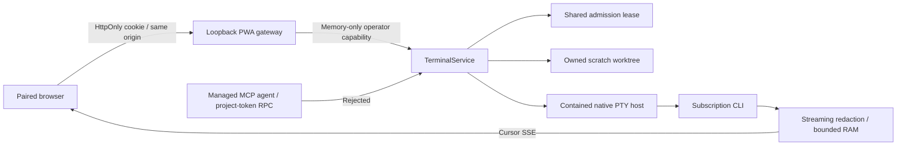

# Interactive scratch terminals

The implementation for [feature #101](https://github.com/Division4Studios/malt/issues/101) is prepared in native Stack #155, starting with [PR #153](https://github.com/Division4Studios/malt/pull/153). This guide describes that stack, not a claim that an older running broker has been upgraded. Merge, install locked dependencies, build the browser shell and restart matching broker/UI services before expecting these controls in a deployed console.

## Three separate channels

| Channel                        | Purpose                                                     | Persistence and authority                                                                                |
| ------------------------------ | ----------------------------------------------------------- | -------------------------------------------------------------------------------------------------------- |
| Worker logs                    | Inspect actual managed assignment output and check evidence | Project-local artifacts; read-only browser view                                                          |
| Conversations and instructions | Durable role/task coordination and operator guidance        | Project SQLite; assignment receipts distinguish queued, delivered, acknowledged and applied              |
| Scratch terminal               | Type directly into an explicitly started native CLI         | Separate scratch worktree; transient redacted output; no managed-agent credentials or delivery approvals |

A scratch terminal is not an attachment to a developer or QA assignment. It cannot resume, fork or queue input into managed sessions. Terminal branches, commits and output cannot satisfy publication, QA, skill approval, final verification or merge gates. A later attachment/resume feature needs a separate human decision; this boundary preserves independent reviews.

## Start and use

Install Node 24, Git and the intended subscription-authenticated provider CLI. From the MALT checkout:

```powershell
npm ci --ignore-scripts
npm run build:web
node src/cli.ts ui --with-broker --project "C:\work\target" --port 4318
```

Pair at `http://127.0.0.1:4318/` using the code printed by `malt ui`. Configure the target repository's actual GitHub connection, base branch and enabled providers using [the operator guide](operator-console.md). On Windows use the actual native `.exe` path, not an npm `.cmd` shim; administrator elevation is not required. Typical installed paths are `C:\Users\<user>\AppData\Local\Programs\OpenAI\Codex\bin\codex.exe` and `C:\Users\<user>\.local\bin\claude.exe`; verify your installation instead of copying another user's path.

Run `codex login status` or `claude auth status` in your normal provider environment. MALT repeats subscription readiness checks before launch. Credentials stay in the providers' supported stores; API keys, GitHub tokens and MALT credentials are removed from the native environment. No inference API fallback exists.

Open **Workers → Scratch terminals**, select an enabled provider and explicitly choose **Start scratch terminal**. Opening a page, refreshing, reconnecting or viewing an idle role never starts a CLI. Admission may refuse startup when capacity, authentication, provider cooldown, base fetch or retained-worktree policy is not ready. Inspect the reported reason rather than repeatedly clicking Start.

- Enable **Capture keyboard** to send native keystrokes. Escape releases capture; Tab leaves the input through normal browser focus navigation. **Send Tab** and **Send Escape** send those keys explicitly. Meta shortcuts and Ctrl+L/T/W/N/R/V remain with the browser. Other Ctrl combinations, including Ctrl+F/P/S, go to the CLI while capture is focused; release capture before using those browser actions.
- Paste is normalized incrementally and control sequences are stripped; UTF-8 input including bracketed-paste framing must fit 16 KiB. A separate 1 MiB raw-character ceiling bounds clipboard scanning before normalization. Ambiguous writes are reported and never retried automatically.
- Apply explicit columns/rows or opt into **Fit to pane**. It measures the displayed monospace font and padding, debounces resize and disables fitting after an unconfirmed resize. Choose compact/standard/tall pane height. At most two panes are open.
- **Reconnect output** resumes the bounded safe replay cursor without replaying input. Hidden/offline/rescoped views stop readers and input; reconnect does not recapture the keyboard. Closing a pane is distinct from closing its native session.
- **Close session** retires only the owned process tree. Ended output is read-only while retained in memory. After backend restart the pane labels metadata as recorded state and explicitly reports unavailable replay.

Installing the PWA does not install/start the broker or provider executables. The [Docker setup](operator-console.md#docker-startup-and-provider-authentication) launches Linux CLIs inside the container, with its own supported credential mounts; a Windows host CLI is not executed from Linux. Never run native and container brokers against the same `.malt` store.

## Native launch contract

The server constructs the executable, arguments, environment and owned scratch CWD. The browser supplies only a provider and bounded initial geometry. Shells, arbitrary paths/arguments/environment, resume flags and model-agent credentials are rejected.

| Provider    | Inspected version | Interactive descriptor                                                                                                                                                                                            |
| ----------- | ----------------- | ----------------------------------------------------------------------------------------------------------------------------------------------------------------------------------------------------------------- |
| Codex       | 0.162.1           | `--sandbox workspace-write --ask-for-approval on-request --cd <scratch> --no-daemon --disable plugins --disable apps --disable multi_agent`, fixed ChatGPT/OpenAI login provider and `history.persistence="none"` |
| Claude Code | 2.1.296           | `--restricted --strict-mcp-config --permission-mode manual`, fixed `CLAUDE_CODE_SKIP_PROMPT_HISTORY=1`                                                                                                            |

These interactive permissions differ from bounded managed assignments. Neither terminal uses blanket bypass flags. Claude restricted mode excludes shell tools and confines file access; relaxing it is a separate reviewed decision. Codex runs without its shared daemon. Its unpaid MCP inspection and TUI launch use identical feature exclusions, then disable validated ordinary MCP server names. Virtual plugin servers must not be converted into invalid root transport tables. Inspection failure gates startup; the user's global configuration is not rewritten.

See the official [Codex CLI contract](https://learn.chatgpt.com/docs/developer-commands), [Codex configuration reference](https://learn.chatgpt.com/docs/config-file/config-reference) and [Claude CLI reference](https://code.claude.com/docs/en/cli-reference). Installed help is checked for the pinned versions. Codex interactive mode has no supported `--ephemeral` equivalent; provider-owned session records/settings/diagnostics may remain in its home. Claude's prompt-history exclusion does not promise that the vendor writes no diagnostics. MALT does not copy provider credentials or vendor session histories into project memory.

The combined `--with-broker` lifetime is required for native terminal controls. When switching from separate services, stop both the existing broker for this store and the UI occupying port 4318 before starting it. A separate UI still supports factory/log views but has no terminal capability. Docker already colocates these services.

Opening a selected workspace creates its durable project state and uses the existing bounded two-minute project-operation deadline on client and broker. Ordinary RPC retains its five-second client deadline; request-body/header security limits are unchanged. Slow Windows storage must not turn a successfully created workspace into an ordinary-RPC timeout.

## Ownership, limits and recovery

The backend's `terminals` policy is separate from subscription quota:

```json
{
  "terminals": { "max": 1, "idleMs": 300000, "maximumMs": 1800000 }
}
```

These are fields of the existing factory policy, not a second configuration file. Pause the factory before policy changes. `max` is 0–2 (0 disables startup), idle is 1 second–30 minutes, and maximum duration is 1 second–2 hours. Output and resize do not reset the input-only idle clock. Defaults are one live terminal, five minutes idle and thirty minutes absolute lifetime.

Every terminal reserves the actual broker-wide admission pool alongside managed jobs and respects provider concurrency/cooldown and sampled CPU/free-memory pressure. Windows Job Objects apply configured aggregate memory/CPU/process ceilings (`resources.jobProcessLimit`, default 32, includes host, ConPTY, CLI and tools). A lower configured ceiling may make native startup impossible; the error does not grant extra capacity. POSIX process groups provide owned cleanup, not hard CPU/memory ceilings. A descendant that deliberately creates another session can escape POSIX groups; container ceilings are additional containment, not a claim that native groups are cgroups.

Each start fetches/resolves the configured remote base into a new private worktree and `malt/terminal/<uuid>` branch. It never falls back to stale local main or pushes the scratch branch. At most three scratch worktrees are retained. Dirty/newer work is preserved; clean retained history is archived before safe pruning. If only dirty trees remain at the cap, startup refuses with a useful reason.

Publication requires exact delivery-scoped receipts for new supervisor-created commits, anchored at the actual fetched main or a previously validated durable publication checkpoint. A terminal checkout cannot taint legitimate managed source, and reset/rebase/reflog expiry cannot grant an operator commit a receipt. Developers leave edits uncommitted for the supervisor, as required by their lifecycle skill. Unknown commits fail closed with their branch/edits preserved for the original developer; a receipt-write failure likewise prevents publication. More than 256 new commits requires bounded-history review. The local `refs/malt/delivery/` receipts retain source history and are not pushed by MALT; keep them with safe local backups rather than publishing a repository mirror. These receipts establish source ownership, never replace validation, QA or merge gates.

Close, idle/absolute timeout, pause, resource pressure, broker shutdown and loss of the owned wrapper terminate the relevant tree. Windows starts the host suspended, assigns it to a kill-on-close Job and resumes it; a private OS-lifetime pipe lets the Job owner detect even a wrapper crash. POSIX cleanup addresses both the host group and the CLI's separate PTY group, escalating TERM to KILL. MALT never blanket-kills PowerShell, Node or provider processes.

SQLite retains session metadata and counters, not keystrokes or transcripts. Graceful shutdown records cancellation; orphan active records are fenced as failed after restart. Restart does not reattach or spawn anything. Generated `.malt/README.md` includes terminal counts and the transient boundary; a failed derived README write cannot undo a committed session transition.

## Authenticated streaming boundary



The existing browser-origin broker RPC rejection remains intact. Terminal controls require a paired operator, authorized project, exact session and validated schemas. All ordinary terminal RPC is rejected, including project-token calls with omitted agent credentials. The owning broker supplies a nonserializable project-scoped function capability to its colocated gateway, revoked on shutdown. It is never persisted or sent to the browser. These operations are absent from MCP tools. Host, Origin and Fetch Metadata checks, private `no-store` responses, restrictive CSP and project fences apply. The service worker caches only public shell assets, never authenticated API responses or output.

| Boundary          | Enforced limit                                                       |
| ----------------- | -------------------------------------------------------------------- |
| Native frame body | 64 KiB                                                               |
| Redacted replay   | 256 KiB / 4096 chunks per buffer; live plus last three ended buffers |
| Read page         | 64 KiB text and 128 entries; long poll at most 25 seconds            |
| Subscribers       | Two polls/session; eight terminal SSE streams globally, two/session  |
| SSE connection    | 120-second lifetime, bounded write/drain and reconnect backoff       |
| Native input      | 16 KiB UTF-8/write; 16 KiB/second with 64 KiB burst                  |
| Native resize     | 20/second; 1–500 columns and 1–200 rows                              |

Input/output never enters request logs, SQLite, browser storage or service-worker caches. Numeric counts and state transitions are durable. Streaming redaction covers known credential values and split secret patterns, but cannot identify every arbitrary secret a user types or a provider prints: treat the local screen as private. ANSI controls are parsed as a bounded subset, not executed as HTML or browser commands. Title/clipboard/device/image controls do not grant browser authority; links permit validated HTTP(S) only.

Evicted output produces an explicit gap warning. Backend restart produces replay-unavailable metadata. Neither is a complete terminal recording; repaint after a gap/resize may require native redraw. Unicode width is approximate; this renderer is not full xterm/grapheme/mouse/device emulation. Emoji ZWJ families and skin-tone sequences can occupy more columns than the provider expects; use ordinary text when precise alignment matters. Two panes, capture controls and read-only recent scrollback are supported; attaching to managed jobs, persistent transcripts and arbitrary remote shells are excluded.

## Executed support evidence

Evidence applies to the stack revisions, not every provider version or architecture. [PR #179](https://github.com/Division4Studios/malt/pull/179) supplies real loopback input/resize/reconnect/auth/timeout/cancel tests; [#180](https://github.com/Division4Studios/malt/pull/180) proves forced wrapper-crash cleanup; [#182](https://github.com/Division4Studios/malt/pull/182) proves actual same-project restart without replay or new inference. Each PR's Checks tab records immutable CI runs.

| Runtime                                               | Real PTY / loopback / cleanup                                                                                                                       | Codex TUI                                                                                             | Claude TUI                                                                                    |
| ----------------------------------------------------- | --------------------------------------------------------------------------------------------------------------------------------------------------- | ----------------------------------------------------------------------------------------------------- | --------------------------------------------------------------------------------------------- |
| Windows x64 / system ConPTY                           | Executed locally on Node 24.21; Windows CI at #179–182                                                                                              | Manual 0.162.1 trust screen, real 100×30 resize, native Quit; no trust granted or inference submitted | Manual 2.1.296 trust screen and idle-timeout cleanup; no trust granted or inference submitted |
| Docker Linux x64 / glibc                              | Executed `npm run test:docker`: nonroot, read-only, network-none fixture container, owned PID cleanup and restart; broker/MCP/PWA smoke also passed | Unverified                                                                                            | Unverified                                                                                    |
| Linux / macOS CI runners                              | Native fixture tests run in required `npm run check` matrix; inspect the exact PR head's checks                                                     | Unverified                                                                                            | Unverified                                                                                    |
| Linux arm64 / macOS architectures not exercised by CI | Unverified                                                                                                                                          | Unverified                                                                                            | Unverified                                                                                    |

No full real-provider model turn is verified by the startup smokes. They establish native TUI rendering and the named controls only. Subscription quota telemetry, every TUI feature, installed OS-window behavior and a complete accessibility audit remain unverified. Browser inspection on Chrome exercised actual pairing/start/keyboard/resize/reconnect/close, hostile HTML as literal text, 16 KiB paste rejection, focus escape, service-worker update and 390px responsive layout without page overflow. Provider startup checks spent no inference tokens.

Reproduce deterministic native checks without paid agents or live GitHub mutations:

```powershell
node --test test/terminal-web-e2e.test.ts test/terminal-containment.test.ts test/terminal-restart.test.ts
npm run check
npm run test:docker
# Optional actual browser inspection, fixed three-minute lifetime:
node --test test/terminal-preview.ts
```

The optional preview prints a new loopback URL/code and visibly names its token-free project. It substitutes only the native provider with the fixed Node PTY fixture and rejects every inference-runner call. Production pairing codes must remain private.

Replay reads materialize only the bounded requested page. Exited sessions drain through an empty final page. Open recent scrollback follows the current bounded display. Releasing focus stops new key capture while already-authorized keys remain ordered ahead of explicit Tab/Escape controls; disconnecting or changing scope discards unsent input.

## Dependency and platform maintenance

The exact backend-only dependency is `node-pty@1.2.0-beta.15` (MIT), with MIT `node-addon-api`; see [notices](../THIRD_PARTY_NOTICES.md). Neither is shipped to browsers. Its native addon loads only in the isolated terminal host, never the broker/PWA process. Locked installation keeps `--ignore-scripts`; packaged prebuilds supply the supported platforms without an install-time toolchain or download. System ConPTY is used, not the optional bundled replacement DLL. Debian/glibc is tested; Alpine/musl is unsupported. Missing/incompatible native modules fail the session with an explicit unsupported-platform reason rather than pretending pipes are terminals.

The upstream beta was selected because the stable 1.1.0 package lacked the Linux prebuild required by this script-disabled container. Do not silently switch to an unreviewed repackaging, enable install scripts or promise untested architectures. Updates require the native matrix, ownership/crash/restart checks, dependency audit/review and an updated support record.
