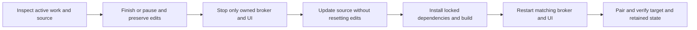

# Run MALT's development from mission control

The source repository can be a delivery target when explicitly selected. This repository uses [Division4Studios/malt](https://github.com/Division4Studios/malt) and [Project 10](https://github.com/users/Division4Studios/projects/10). Other target projects require their own verified connection; they do not inherit this board.

Read [current capabilities](current-status.md) and the [issue audit](issue-audit-2026-10-15.md) before queueing work. Search existing open and relevant closed issues. Reconcile merged work instead of reimplementing it because an old local attempt is blocked. Preserve source edits, histories and native relationships.

## Start and pair

From the intended MALT source revision, after inspecting the checkout:

```powershell
npm ci --ignore-scripts
npm run build:web
node src/cli.ts start --project '<absolute-target-path>' --port 4317
```

In another terminal from the same source folder:

```powershell
node src/cli.ts ui --project '<absolute-target-path>' --port 4318
```

Replace the placeholder with the intended Git root in both commands. Open <http://127.0.0.1:4318/> and use the code printed by the owning UI process. Restarting the UI invalidates the old pairing session. Do not publish codes or private logs.

If another native broker or container owns that target's `.malt`, use it or stop it deliberately first. Closing the browser/chat does not stop the daemon. PWA installation does not install a Windows service.

In **Project**, verify repository/remote identity, the intended Project URL and workflow field, subscription CLI authentication, validation commands and resource policy. Memory must be the target's `.malt`, not a preview directory. This guide assumes no prepared objective, paused state or fixed live job count.

## Direct the queue

1. Inspect **Product queue** and related tickets before **New objective**. Supply an observable outcome, exclusions and relevant issue links.
2. Use **Move first**, **Move up** or **Move down** for durable priority of future planning/development reservations. Existing assignments retain edits and ownership.
3. **Focus only this objective** holds unrelated new assignments. **Work existing deliveries** prioritizes retained tickets while holding new objective work. Neither bypasses dependencies or gates.
4. Inspect **Mission recovery** ("Choose the next safe step.") and **Clear the path** before retrying. Acknowledge records visibility; it does not fix anything. Ask the lead for bounded diagnosis, route a repair, request review/verification or record a precise wait reason.
5. Start dispatch after setup is verified. Roles run short-lived eligible assignments and exit; routine continuation needs no repeated operator prompt.

**Unstarted deliveries** counts delivery tasks; **Pending objectives** counts unfinished product outcomes. Neither promises an immediate launch. Resource/provider policy, dependencies, fixed rework ownership and gates determine eligibility.

Token counts are diagnostic by default. Observed subscription limits/cooldowns and local CPU/memory/process/concurrency policy govern admission. Previously saved numeric token caps remain optional explicit policy until changed. Inspect actual settings rather than assuming a cap of one or two.

## Instructions, scope and review

**Send instruction** supplies durable role/task guidance. Idle roles receive relevant guidance on a later assignment; delivered, acknowledged and applied remain distinct. **Change scope** routes changed acceptance through PO/lead replanning and fences affected work. Worker panes show actual logs/messages and evidence, not an interactive terminal.

Prefer 1–500 changed text lines per PR including meaningful tests/docs, independently useful slices and real dependencies. Configured file/line publication ceilings remain authoritative. An exact human-approved one-delivery size exception is available when splitting is unsuitable; it never waives checks, ownership, independent QA or merge gates.

QA reports defects to the responsible developer. The final gate verifies integration and actual merged main. Local model QA is separate from GitHub's authenticated-review requirements. Inspect live target protections; the source project's documented temporary solo-maintainer exception is not a global bypass.

Native stacked PRs are ordered dependencies. When all layers are ready, merge the complete stack from its top PR. Merging an intermediate layer independently can require restacking the remainder. A stack never excuses unresolved conversations or stale checks.

## Deploy deliberately



Pause before changing policy. Pause stops owned attempts and preserves their edits; it does not certify they finished successfully. Inspect resulting cancellations/blockers before resuming. Settle work, stop the specific owning processes through their terminals, update the intended checkout without overwriting edits, install the lockfile, rebuild and restart both services. Never force-reset the primary checkout or blanket-kill PowerShell/Node/provider processes.

For Docker, follow [container startup/authentication](operator-console.md#docker-startup-and-provider-authentication), rebuild with `docker compose up -d --build --wait`, and verify which runtime owns the project. Never run native and container brokers against one database. Preserve project `.malt` and the separate provider credential volume.

Merged source does not hot-reload a broker. A completed issue, refreshed browser, Docker smoke or published wiki is not deployment evidence. Confirm the running revision and retained project state after restart.
