# Operator console

The operator console is MALT's local web app. You use it to give the factory objectives, answer the decisions only a person can make, watch deliveries move from plan to merged main, and change project policy. It runs on your machine, talks only to your local broker, and keeps no operational state in the browser: the selected repository's private `.malt/` directory holds everything.

This page is a tour of the console in the order the navigation presents it. Each section says what a view is for, what you can do there, and what its important controls change.


To run MALT on a repository of your own from start to finish, follow the console's **Project → Get started** guide, or [Run MALT's development from mission control](operating-malt-on-itself.md) for MALT's own repository. For what is and is not verified yet, see [Verification limits](#verification-limits) and [current capabilities](current-status.md).

## Start the console

### Native startup

Install Node.js 24, Git and at least one subscription-authenticated provider CLI (Claude Code, Codex or GitHub Copilot). Then, from the MALT checkout:

```sh
npm ci --ignore-scripts
npm run build:web
node src/cli.ts doctor --project /path/to/your-repo
node src/cli.ts ui --with-broker --project /path/to/your-repo --port 4318
```

On Windows, use a Windows path such as `"C:\work\app"` for `--project`.

`doctor` checks Node.js, Git, provider logins, the GitHub CLI, ports and a writable `.malt` before anything paid runs. `ui --with-broker` runs the broker and the console in one process. That combined lifetime is required for two operator-only capabilities, the scratch terminals and recommendation decisions, which the broker hands to the console in memory and never serializes. A separately started `ui` still supports the other controls. When you switch from separate services, stop both the existing broker for this store and the UI on port 4318 first.

Installing the console as an app does not install or start the broker. Browser sessions are separate from model sessions, and provider authentication stays in each provider's own credential store.

### Pair this browser


Open `http://127.0.0.1:4318/` and enter the console pairing code. The code is persistent: it is stored owner-only in the console project's `.malt/console-pairing.json`, so restarting the console or recreating its container keeps it.

- Startup prints the code once in the terminal and writes one `console`/`pairing_code` log record. No other log line, API response, error or URL contains it.
- If you lose it, run `node src/cli.ts pairing-code --project <path>`.
- If it may have leaked, run `node src/cli.ts pairing-code --rotate --project <path>`. A running console accepts only the new code from its next pairing attempt; browsers already paired keep their sessions.

The code does not expire and is not single-use, so treat it like a password and avoid publishing terminal captures or logs that contain it. Pairing is rate-limited and produces an expiring HttpOnly, SameSite=Strict session cookie held in backend memory. **Disconnect browser** in the side rail ends this browser's session.

### Docker startup and provider authentication

The container image is `node:24-bookworm-slim` with production dependencies, the compiled console, Git, the GitHub CLI, Codex CLI 0.162.1 and Claude Code 2.1.296. Provider versions are build arguments (`CODEX_VERSION`, `CLAUDE_VERSION`); Claude's binary is checked against its official release manifest. The image does not include the Copilot CLI. Compose runs the broker and console together in one container, so terminals and recommendation decisions work there too.

```powershell
$env:AGENTMESH_HOME_ROOT = 'E:\YourProjects\broker-home'
$env:AGENTMESH_WORKSPACE_ROOT = 'E:\YourProjects'
$env:AGENTMESH_UI_PORT = '4328' # use 4318 if no native console uses it
docker compose up -d --build --wait
docker compose logs broker # the owning console prints the pairing code
docker compose exec broker node src/cli.ts pairing-code --project /data # show it again; add --rotate to re-issue
docker compose exec broker node src/cli.ts doctor --project /data
docker compose exec broker codex login --device-auth
docker compose exec broker claude auth login
docker compose exec broker gh auth login
docker compose exec broker gh auth setup-git
docker compose exec broker git config --global user.name 'Your Name'
docker compose exec broker git config --global user.email 'your-commit-address'
```

On macOS or Linux, set the same variables with `export NAME=value`.

1. Create the host folders first.
2. Open `http://127.0.0.1:4328/` (or your chosen port), pair, and select a repository under the mounted workspace root.
3. Authenticate subscription accounts inside the container. API-key authentication is rejected by factory preflight, and host credentials are not copied into the container.
4. If Git rejects bind-mount ownership, trust only the selected repository's container path: `docker compose exec broker git config --global --add safe.directory /workspaces/your-project`. Do not trust every directory with `*`. Check the commit identity with `docker compose exec -w /workspaces/your-project broker git var GIT_AUTHOR_IDENT`.

What to know about the container:

- It runs Linux agents and Linux validation commands. Windows executable paths do not work inside it.
- The Compose-scoped `provider-home` volume keeps provider and GitHub configuration separately from project `.malt` data. `docker compose down` keeps it; `docker compose down --volumes` deletes it.
- For a Node target, configure Linux preparation explicitly, for example `/usr/local/bin/node` with `["/usr/local/lib/node_modules/npm/bin/npm-cli.js", "ci", "--include=dev", "--ignore-scripts"]`. The broker runs with `NODE_ENV=production`, so a plain `npm ci` can omit the target's validation tooling.
- Validation subprocesses get `TMPDIR=<project>/.malt/cache/validation-tmp` (mode `0700`), so executable test fixtures work while the container's `/tmp` stays `noexec`.
- Published ports bind to `127.0.0.1` only. The internal container bind does not enable remote access or relax Host and Origin checks.
- The image is read-only, so provider self-updates are disabled. Change provider versions explicitly and rebuild.
- `AGENTMESH_GITHUB_TOKEN` is passed to the container as `GH_TOKEN`; it is not saved in `.malt`.

Never run a native broker and a container broker against the same `.malt` store at the same time. Stop one before starting the other.

**Build times.** Layers run from least to most frequently changed, and BuildKit cache mounts keep apt and npm downloads between builds. Measured on 2026-10-17 (Windows 10, Docker Desktop 29.8, 10 logical CPUs): a cold build took 82 s, an unchanged rebuild 0 s, a MALT source change 2 s, and a `package.json` or lockfile change 22 s. Cold builds depend mostly on network speed.

### Install the console as an app

The console is an installable progressive web app (PWA). Where the browser offers it, **Install MALT console** in the side rail installs it as a window of its own. Installing changes nothing about the broker: it must still be running.

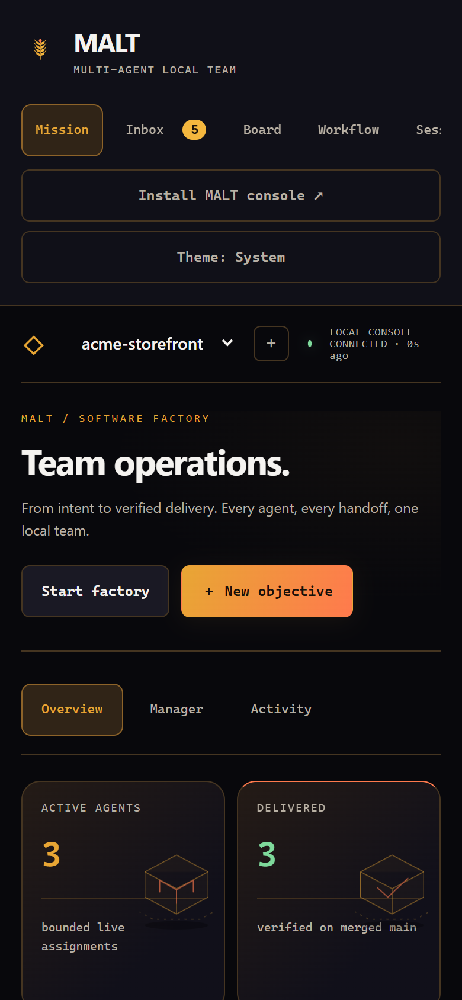

What the app does offline:

- The service worker caches only the public shell (HTML, scripts, styles and icons) in one content-revisioned cache. It never caches authenticated API responses, logs, terminal output or pairing.
- With the broker stopped, the cached console opens, labels itself disconnected and disables controls. Controls are never queued offline or replayed later.
- The status line distinguishes browser offline, connecting, reconnecting and retries stopped, and says whether any state is loaded. After live retries stop, the console keeps polling (every 30 seconds, then every five minutes after five failed reads) and reopens the live stream on the first successful read.
- A window that loaded from the cache keeps loading every module from that same revision, so a page never mixes two versions.

When a new shell is waiting, **Update MALT console** activates it and reloads this browser. Save or cancel an open editor first. Updating the shell never queues or replays an objective, instruction, merge or cancellation. A refreshed browser cannot upgrade an older broker; restart the broker to deploy new backend code.

Install, launch and a real offline and update cycle in an installed window have not yet been verified in a real browser. That audit is [#261](https://github.com/Division4Studios/malt/issues/261); see [Verification limits](#verification-limits).

## Find your way around

The side rail lists seven sections. Selecting one shows its pages in a row under the page heading. The header holds the project picker (with **＋** to open another project folder), **Start factory** or **Pause factory**, and **＋ New objective**.

| Section  | Pages                                                                                              | Use it to                                                        |
| -------- | -------------------------------------------------------------------------------------------------- | ---------------------------------------------------------------- |
| Mission  | Overview, Manager, Activity                                                                        | See the whole mission, clear blockers, talk to the manager       |
| Inbox    | Inbox                                                                                              | Answer every decision waiting on you                             |
| Board    | Board, Objectives, Schedules & triggers, Pipeline list (and each delivery's own page)              | Follow deliveries and objectives; automate objectives            |
| Workflow | Live map, Team & organization, Workflow library, Roles, Pull requests                              | Shape how work flows and who does it; review local pull requests |
| Sessions | Attempts & transcripts, Workers & terminals                                                        | Inspect what each attempt did; instruct roles; open a terminal   |
| Costs    | Costs                                                                                              | See spend and set spend caps and prices                          |
| Project  | Setup & capacity, Settings, Recommendations, Learning & skills, Secrets, Capabilities, Get started | Connect the repository and change project policy                 |

The **Inbox** entry shows how many decisions need you; the **Project** entry shows pending and unread recommendations.

## Mission

### Overview


The overview answers "what is happening and what is in the way". From top to bottom:

- **Choose the next safe step** appears only when an objective is blocked; see [Recover a stopped objective](#recover-a-stopped-objective).
- Metric tiles: **Active agents**, **Delivered** (verified on merged main), **Unstarted deliveries** (ready tickets that may still await dependencies or capacity), **Pending objectives** (product requests not yet delivered) and **Blocked**.
- **Clear the path** lists blocked deliveries; see [Dispatcher decisions](#dispatcher-decisions).
- **Your autonomous team** shows each role and whether it has a model process. Idle roles use none.
- **Product queue** groups every unfinished objective under **Queued**, **In progress** or **Needs attention**, then a collapsed **Completed** section that also holds **Scope replaced (superseded)** records. Blocked objectives offer **Retry resolved request**.
- **Definitions of done** lists each unfinished objective that has a checklist, with its progress; objectives waiting only on their checklist come first. Selecting one opens it under **Board → Objectives**.
- **Provider & local capacity**; see [Read the capacity panels](#read-the-capacity-panels).
- **Latest handoffs and messages** shows the six newest durable reports and peer messages. Each expands to the recorded sender, intended recipient, issue, stage, purpose and a bounded stored body. Opening a preview acknowledges no inbox and fetches no artifact, and a reported outcome is never shown as independent verification.

Keyboard users reach every summary and button with Tab and open details with Enter or Space. Open details, the completed section and focused controls survive live refreshes; switching projects clears them.

### Objective priority and repair focus

**Product queue · Dispatch priority** lists every unfinished objective in dispatch order with its lifecycle state.

- **Move first**, **Move up** and **Move down** change the order. The saved order applies to planning and delivery assignments and survives a broker restart.
- **Focus only this objective** holds new assignments for every other objective, for example while a repair objective lands. Running jobs finish without losing edits, and unpaid GitHub reconciliation continues. **Resume all objectives** releases focus, and completing or superseding the focused objective releases it automatically.

Focus never overrides dependencies, exclusive owners, resource limits, review gates or a blocked status. A focused objective whose prerequisites are unfinished waits; move or release focus to let the prerequisites run.

Each change is checked against the current queue revision. A stale tab gets an error and must refresh; other tabs receive the committed order through the live stream. Reordering needs no model turn.

The same `factory_queue` operation serves MCP, the CLI and the console:

```sh
node src/cli.ts factory-queue --project <path> --file queue.json
```

```json
{
  "expectedRevision": 0,
  "order": ["00000000-0000-4000-8000-000000000001"],
  "focusedFeatureId": "00000000-0000-4000-8000-000000000001"
}
```

Read IDs and `objectiveQueue.revision` from `factory-status`. `order` must contain every unfinished objective exactly once (at most 5,000); use `null` for `focusedFeatureId` to release focus. `factory-reorder-objective` moves one objective and shares the same revision.

### Dispatcher decisions

**Clear the path** turns each blocked delivery into a card. Expand it for the issue, pull request, owner, a concise cause, the latest durable disposition and the full formatted report. Report markup renders as safe native elements; HTML stays literal text.

| Action               | What it does                                                                                                     |
| -------------------- | ---------------------------------------------------------------------------------------------------------------- |
| Acknowledge          | Records that you saw this exact revision. The delivery stays blocked.                                            |
| Ask the lead         | Queues one bounded, read-only diagnosis with evidence and a recommended next step or a precise question for you. |
| Send to owner        | Returns unmerged work to its original developer with your instructions and invalidates prior approvals.          |
| Request fresh QA     | Clears old approvals and schedules independent reviews of the published source.                                  |
| Verify merged main   | Requests final verification of a merge that is already recorded.                                                 |
| Adopt external merge | Records a merge made outside MALT (full SHA required) and queues mandatory merged-main verification.             |
| Wait for decision    | Parks the delivery with your reason or question, with no model process kept open.                                |

Use **Adopt external merge** only with the actual commit on the selected repository's main, and explain how it delivers the issue. It preserves source, clears stale approvals and queues verification rather than completion. If a merge is already recorded, use **Verify merged main** instead.

Decisions carry a stable request ID and the task version you saw. Changed, foreign, finished or actively owned deliveries reject unsafe actions, and repeating a submission returns the original receipt. While the factory is paused, decisions are saved but nothing dispatches until you start it.

The supervisor also inspects parked pull requests before spending another implementation turn: an external merge becomes a verification decision, and a changed head invalidates stale approvals. One automatic lead investigation is queued per blocked revision.

**Closed issues are not developed.** Just before a developer assignment is claimed, the supervisor reads the delivery's GitHub issue state, at no model cost. If the issue is closed, the delivery moves to Blocked with the issue's `state_reason`, its source is preserved, and no developer starts. Recover by adopting the merge that delivered the work, or by reopening or rescoping the issue. If the read fails, nothing launches and the supervisor retries on the next reconcile.

CLI equivalent: `node src/cli.ts factory-triage --file decision.json` with `requestId`, `taskId`, `expectedVersion`, `action` (`acknowledge`, `investigate`, `repair`, `review`, `verify`, `wait`, `approve_size`, `adopt_merge` or `adopt_delivered`) and `note`. Only `adopt_merge` also needs `mergeCommit`.

### Recover a stopped objective

When an objective is blocked, including before any delivery exists, the overview starts with **Choose the next safe step**. Read the diagnosis, then choose:

| Choice                         | Effect                                                                                                                                        |
| ------------------------------ | --------------------------------------------------------------------------------------------------------------------------------------------- |
| **Continue with team lead**    | Resumes lead planning with your instruction and the retained evidence.                                                                        |
| **Clarify with product owner** | Returns the objective to product refinement with your answer. Existing tickets and source stay.                                               |
| **Work existing deliveries**   | Saves "existing deliveries only" mode: tickets across objectives keep running under their normal gates, while new objective planning is held. |

**Return to objective dispatch** releases existing-deliveries-only mode. A paused factory still needs **Start factory**; a recovery decision never resumes it by itself.

Recovery is revision-fenced and idempotent per request, so a resubmission after a lost response cannot create a second instruction. Recovery guidance goes only into that objective's next relevant assignment, not into global role guidance. CLI: `node src/cli.ts factory-recover --file recovery.json` with `requestId`, `featureId`, `expectedUpdatedAt`, `action` (`lead`, `owner` or `existing`) and a non-empty `note`.

#### One-delivery size exceptions

The factory has a configurable publication ceiling for managed deliveries: `maxDiffLines` (default 500 changed lines) and `maxFiles` (default 20 files) in the factory policy, shown as **Maximum changed lines per PR** in **Configure factory policy**. It is a factory setting, not a rule for every pull request in your repository. A validated delivery over that ceiling is parked with reason `over_limit` and its exact measurement for the measured head and base.

**Approve this size exception** on its **Clear the path** card takes your reason and applies only to that measured source pair. Publication resumes without another paid developer turn; tests, both independent reviews, final verification and merge policy still apply. New edits or an advanced main invalidate the exception. The project ceiling itself does not change. Empty diffs (`nothing_to_commit`, `empty_diff`, `already_merged`) cannot be approved this way; reconcile already-delivered work instead. CLI: `factory-triage` with `approve_size`.

### Read the capacity panels

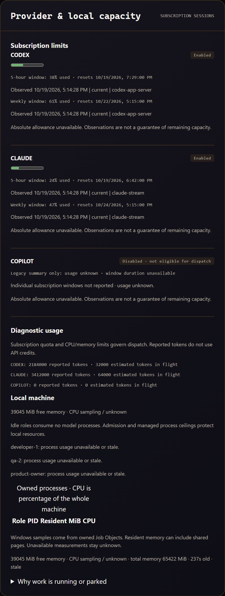

**Provider & local capacity** reads in this order:

1. **Subscription limits.** Each reported window shows its percentage used, reset time, observation time, freshness and source. Unknown usage is never shown as zero, a reached limit says so in text, and no absolute allowance or plan is inferred. Disabled providers stay visible but are not eligible.
2. **Diagnostic usage.** Reported and in-flight token counts. These are diagnostics, not API credits or remaining subscription.
3. **Local machine.** CPU, memory and the owned-process table, plus the **Why work is running or parked** disclosure.

**Why work is running or parked** shows the supervisor's admission evidence: effective resource and provider ceilings, this project's roles and assignment stages, and an anonymous count of other projects' reservations. Each gate names its configuration field (`resources.maxActiveJobs`, `providers.<name>.concurrency`, `resources.maxCpuPercent`, `resources.minFreeMemoryMb` or `resources.minFreeMemoryPercent`). Change them under **Project → Setup & capacity** while the factory is paused. Spare capacity alone never guarantees a launch, and opening the disclosure starts nothing.

Sampling refreshes these figures in place, so focus, an open editor and the scroll position survive.

New scope can also wait on **Project intake**, which collects native issue observations and may name a recommendation needing your decision under **Project → Recommendations**. Intake waiting uses no model session and never holds unrelated development.

### Resource admission and cancellation

Managed pipelines share one machine and provider admission pool across every project in the broker. A larger project policy cannot override a stricter live project's ceiling.

- **Subscription quota.** Codex quota is read through the supported `account/rateLimits/read` interface by a short-lived helper that starts no thread or model turn; the result is shared across projects for five minutes. Claude stream telemetry supports legacy and unified quota windows. A window is current only while its observation is under five minutes old and its reset is in the future. Absent or expired telemetry is unknown, not available.
- **Token budgets.** Subscription-only scheduling defaults to `budgetTokens: null`. A positive token cap is optional project policy, not a subscription entitlement. Observed 100% usage and active cooldowns block dispatch.
- **Machine pressure.** Temporary CPU or memory pressure parks new assignments. Free memory below half the configured floor stops this supervisor's owned pipelines, preserves their work and resumes them when memory recovers.
- **Process ceilings.** Windows Job Objects enforce memory, CPU and `resources.jobProcessLimit` (default 32, range 2–128) and tear down descendants. Other platforms use owned process groups for cancellation. Compose also bounds the container's memory, CPU and process count.

`factory_status.admission` reports the cached sample, effective ceilings and the next blocker; see [the API reference](api.md#managed-factory-controls). Dashboard reads never advance the CPU sampling window. MALT assumes one subscription account per provider family per broker.

Cancel a running job from **Sessions → Workers & terminals** with **Cancel owned job**, or with `factory-cancel-job --file cancel.json` containing `{ "jobId": "<running-job-uuid>" }`. Cancellation blocks the delivery or planning objective until you retry it, and invalidates its approval evidence. A stale cancel against a finished job cannot move delivery state backwards.

### Manager

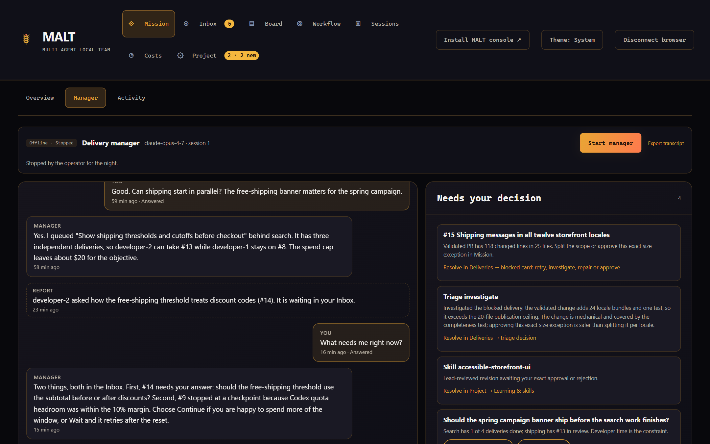

**Mission → Manager** is your conversation with the project's persistent delivery manager: one long-lived model session that every role reports to. Use **Start manager**, **Stop** and **Export transcript** in the status bar; type in the composer (Enter sends, Shift+Enter adds a line). **Needs your decision** and **Mission** summarize what is waiting and what is running. The manager steers only through the same gated operations you use. See [Persistent delivery manager](delivery-manager.md) for its authority, states, efficiency and limits.

### Activity

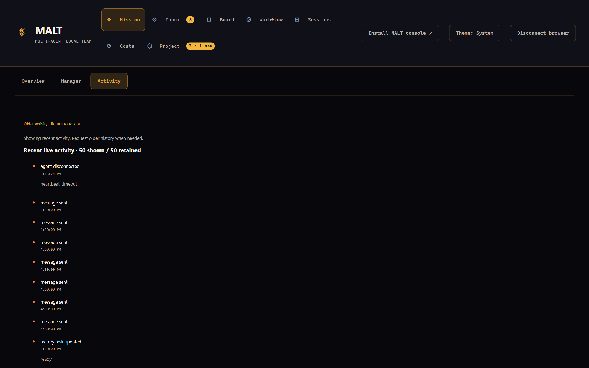

**Mission → Activity** is the committed event story of the project. It keeps up to 200 recent events in browser memory. **Older activity** reads one earlier page of up to 50 durable events, and **Return to recent** restores the live window. While browsing, **Older history page** and **Recent live activity** are shown separately, each event appears once, and intermediate pages are explicitly omitted rather than presented as one timeline. A failed read keeps the page and offers **Retry older activity**. Nothing is stored in browser storage or the service-worker cache. See [event history pages](api.md#event-history-pages).

## Inbox


The **Inbox** lists every decision waiting on you, oldest first, in three lanes:

- **Needs reply**: questions and approvals only you can give.
- **Notices**: blocked deliveries and stopped planning, each with a link to investigate or recover.
- **Answered**: your recent approvals and answers.

| Item                                     | Lane        | Controls                                           |
| ---------------------------------------- | ----------- | -------------------------------------------------- |
| Agent question ("_role_ asks")           | Needs reply | **Answer…**                                        |
| Checkpoint decision ("Continue or wait") | Needs reply | **Continue 30 min**, **Continue 60 min**, **Wait** |
| Step or plan approval                    | Needs reply | **Approve**, **Reject…**                           |
| Definition of done                       | Needs reply | **Review…** opens the objective                    |
| Spend cap reached                        | Needs reply | **Open costs**                                     |
| Skill adoption or retirement             | Needs reply | **Review…** opens the skill comparison             |
| Blocked delivery                         | Notices     | **Investigate…**, **Open**                         |
| Planning stopped                         | Notices     | **Recover…**                                       |

### Answer an agent question

A managed agent that cannot continue without a human decision calls `mesh_factory_ask` with one question, up to six choices, and whether a written answer is allowed. It then ends its assignment. The supervisor sets that attempt aside without counting it as a failure and holds that step while the question is open; other steps and deliveries keep running.

**Answer…** opens a dialog with the offered choices and, when allowed, a text field. The answer is recorded once (a retried request reports the first result), and the step runs again with every answer for it in its context. Each delivery or objective may hold at most three open questions, and each step at most twenty questions in total. A role type can withdraw this permission with **May ask the operator questions in the Inbox** under **Workflow → Roles**.

### Decide at a checkpoint


Long assignments pass checkpoints. Productive work is extended automatically when verified quota headroom and machine headroom allow; stalled work stops; a hard ceiling bounds every attempt. When an attempt that was still making progress is held for lack of headroom, or reaches the ceiling, it stops with its worktree kept and asks you:

- **Continue 30 min** or **Continue 60 min** runs the step once more from the preserved worktree, bounded by those minutes and without the automatic extension gate. The CLI and MCP accept 5 to 240 minutes.
- **Wait** returns the step to the normal retry rules.

The decision is fenced to the attempt, its head and its stage, so a stale click can never extend a replacement attempt. The operation is `factory_checkpoint_decide`. A running delivery's **Elapsed** fact shows how long the attempt has run. Its **Liveness** fact shows the last progress signal, the time to the next checkpoint and how often it was extended, or the stop reason while a checkpoint stops it. **Quota** shows the provider's verified headroom and when it was read, or **quota unknown** (a stale reading counts as unknown). Once an attempt has stopped at a checkpoint, **Last stop** shows the recorded reason, such as `stalled 16 min` or `hard ceiling`, and whether your decision is pending. Sessions shows the same reason on the attempt instead of a plain `interrupted`, and the delivery manager offers the same decision buttons. See [assignment liveness and retries](software-factory.md#assignment-liveness-and-retries).

### Approval gates

Approval gates are part of each workflow and objective:

- The project setting `defaultGates` (`{ "plan": false, "merge": false }` by default, editable in the advanced factory policy) is frozen onto each objective when it is filed.
- The new-objective dialog can override both for one objective: **Approve the plan before deliveries are created** and **Approve each delivery's exact head before it merges**.
- The plan gate asks you to approve the plan before deliveries are created. The merge gate adds a **Merge approval** step, bound to the exact head, before the final check.
- On a delivery's page, **Require merge approval** or **Remove merge approval** changes its gate until it is merge-ready (`factory_gates`).

Changing the project default never changes work already filed. A workflow step marked as a gate also waits here after it succeeds.

### Notifications

**Notify me** turns on browser notifications for this console. While the console is open in the background, each new item that needs a reply raises one notification; clicking it opens that project's Inbox. Notifications come from the console's own live stream through its service worker. Nothing is sent to a push service, so no notification arrives while every console window is closed.

## Board

### Board


**Board → Board** places each delivery by what it needs next:

| Column      | Holds                                                                                                                                                 |
| ----------- | ----------------------------------------------------------------------------------------------------------------------------------------------------- |
| Planning    | Objectives being split into deliveries                                                                                                                |
| Ready       | Deliveries waiting for a free developer                                                                                                               |
| In progress | Being built, reviewed, merged or verified                                                                                                             |
| Needs you   | Deliveries and planning objectives with an open [Inbox](#inbox) item: an approval, a blocker, an agent question, a checkpoint decision or a spend cap |
| Done        | Merged and verified on main                                                                                                                           |

Cards show the objective, the workflow, held state, dependency waits, the pull request and definition-of-done progress. Filter by title or `#issue` and by workflow; **Show done** lists finished cards. **Hold shown** and **Resume shown** hold or resume every delivery the filters show (a held delivery starts no new attempt), and **Archive finished** archives finished cards, which **Archived** lets you restore. Select a card to open its delivery page.

**Board → Pipeline list** shows the same deliveries as a list with owner, attempts, independent QA progress and the pull request, plus **Instruct owner**, **Change scope** and **Retry resolved blocker**.

### Delivery page


A delivery's page shows its pipeline step by step, findings, rulings and source:

- **Facts:** phase, workflow, developer, attempts, head, base, pull request, what is running now with its **Elapsed** time, **Liveness** and **Quota**, the **Last stop** reason, retry state, what it is waiting on, and the blocker or last error. **Customized** summarizes step overrides; **Brief revalidation** shows **Confirmed** or **Needs revising** when `briefRevalidation` is on (retry to implement the brief unchanged, or instruct the lead to replan).
- **Pipeline:** each step with its state, blind review and approval-gate markers, preferred provider and latest result.
- **Findings** and **Rulings on findings** from the independent reviews.
- **Repair rounds:** CI repair and merge-conflict repair rounds ([how repairs work](software-factory.md#repairs)).
- Controls: **Hold** (or **Resume**, **Archive**), **Require merge approval**, **Customize steps**, **View attempts** and **Open pull request**.

**Customize steps** edits this delivery's step overrides. Steps that already started are shown but fixed.

#### Delivery source changes

The **Changes** section compares the delivery's exact head with its base. **Show changes** reads the summary on demand: every changed file with its kind (renames and copies name their source and similarity), line counts, mode changes, binary notes and totals. Private runtime and credential paths are counted but never shown.

Open a file to load its numbered patch. Small changes open by themselves; files with more than 400 changed lines start collapsed; patches over 512 KiB are cut at a line boundary and say so; a file changing more than 20,000 lines is not generated at all; summaries list at most 1,000 files. Each file is a native disclosure, so the keyboard opens and closes it. A new head clears what was loaded, so the section never shows source the delivery no longer has.

### Objectives

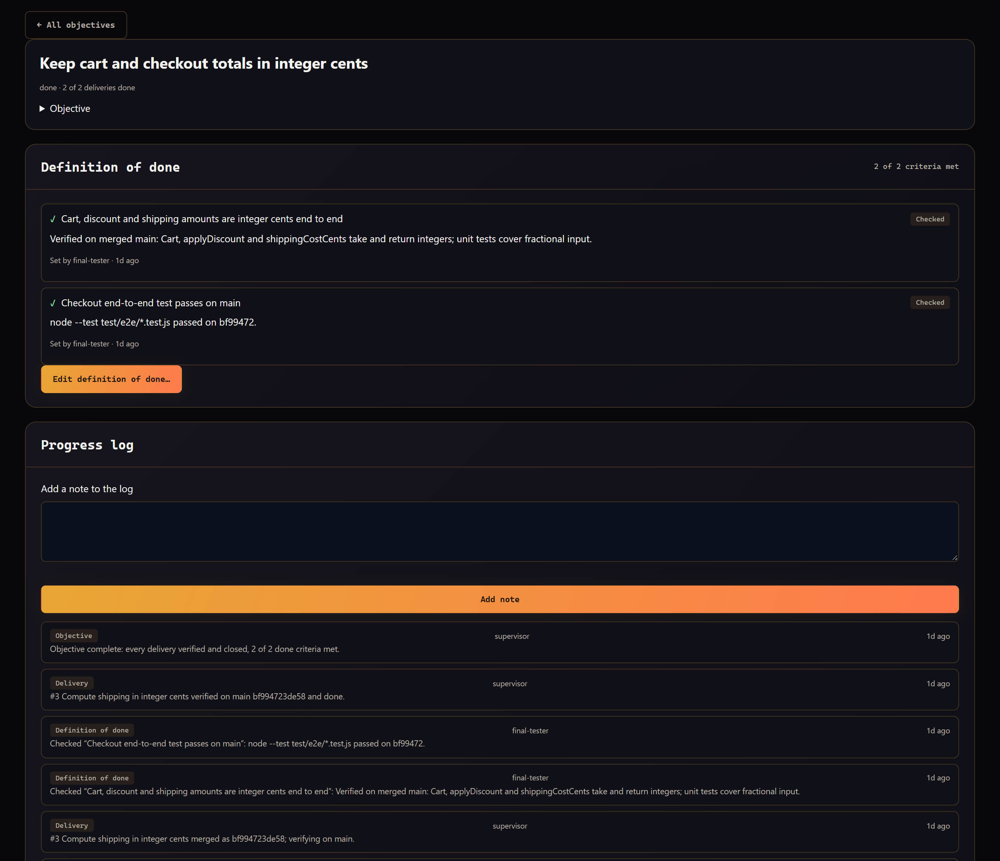

**Board → Objectives** lists every objective with its delivery progress and checklist progress. Opening one shows the objective text, its **Definition of done**, its **Steps** and its **Progress log**.

A definition of done is a checklist that decides when an objective is complete, beyond its deliveries merging.

1. Select **Add a definition of done…** or **Edit definition of done…**.
2. Give each item text, a state (**Open**, **Checked** or **Waived**) and optional evidence or a link. Up to 50 items.
3. Agent proposals appear as dashed rows; choose **Accept as open** or dismiss them.
4. **Save definition of done**. Saving is fenced by the objective's version, so a stale tab cannot overwrite newer decisions.

When every delivery is done but items remain open, the Inbox asks you to check or waive them. Only then does the objective complete and its parent issue close. Without a checklist, the objective completes when its deliveries do.

**Progress log** records what happened to the objective; **Add note** adds your own entry, and **Load older entries** pages back.

**Steps** shows the objective's step overrides until its deliveries exist. **Customize steps** changes them; planning steps that already ran stay fixed. Deliveries copy the overrides when they are created; afterwards, change each delivery instead.

### Schedules and triggers


**Board → Schedules & triggers** files objectives automatically. Every fire files an ordinary objective, so it is planned, reviewed and gated like one you typed.

- A **schedule** fires on a cron expression in an IANA time zone. Its card shows the expression in plain words (for example "At 09:00, on Monday to Friday") and the next three fires. Schedules fire only while the factory runs; runs missed while it was paused file one objective when it resumes.
- A **trigger** is a loopback webhook that a local script or CI runner calls with its secret. Its card shows the broker URL to POST to. Triggers are rate-limited, and an `Idempotency-Key` header makes a retried call file one objective.

Each card has **Edit**, **Enable** or **Disable**, **Run now** and **Delete**; triggers add **Example command** and **Rotate secret**. **New schedule** offers **Common schedules**, describes the expression as you type and suggests time-zone names (the browser's zone by default). **New trigger**, and **Rotate secret**, show the secret exactly once with ready-to-run `curl` and PowerShell commands. Store it in the calling script's own secret store: MALT keeps only a SHA-256 hash, and rotating stops the old secret immediately. Deleting and rotating ask for confirmation inside the console.

See [schedules and triggers](api.md#schedules-and-triggers) for the exact contract.

## Workflow

### Live map

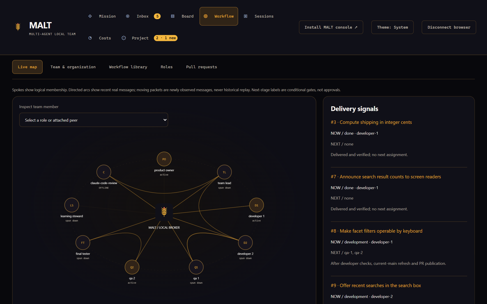

**Workflow → Live map** draws the managed roles and attached peers that the broker reports. Spokes show logical membership, directed arcs show recent real broker messages, and a packet animates once for each newly observed message. Attached peers are distinguished from factory-owned processes. Select a role with the pointer, Enter or Space to inspect it and open its workspace. Reduced-motion settings turn off depth and flight effects.

**Delivery signals** shows real ticket stages and the conditional next gate: Development proceeds to the two independent QA roles only after checks and pull-request publication; Review proceeds to the final tester only after exact-head approvals. On a protected base branch a delivery may wait in Merging with the exact reason; see the [protected-branch merge path](software-factory.md#protected-branch-merge-path). Next-stage labels are plans, not completed checks.

### Team & organization

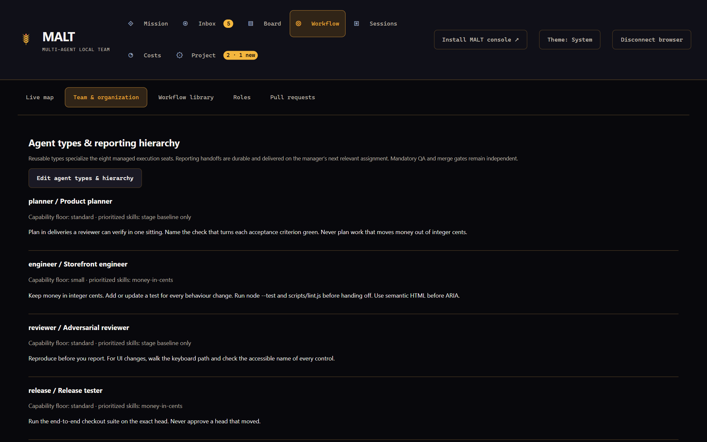

**Workflow → Team & organization** shows the team constellation and **Agent types & reporting hierarchy**. **Edit agent types & hierarchy** opens a backend-validated editor, available while the factory is paused: define reusable agent types with focused instructions, prioritized skills and minimum model tiers, and bind the managed seats to types and reporting parents. Invalid references and cycles are rejected. Each assignment freezes its organization revision, and completed jobs send reporting handoffs to the frozen manager. **Workflow → Roles** is the richer editor for the same types.

### Workflow library


A workflow defines how an objective becomes verified deliveries: its planning steps, delivery steps, the seats that may take each step, gates and reviews. **Workflow → Workflow library** lists built-in and project workflows.

- **View** previews a workflow's pipeline; **Use as default** makes new objectives use it. Running objectives keep the revision they started with.
- **New workflow** and **Edit** open the editor. Each step has an id, title, kind, the steps it runs after, the outputs it reads, seats, a preferred provider, an organization profile, extra instructions and three switches: **Blind review**, **Gate** (wait for your approval in the Inbox after it succeeds) and **Optional** (may be skipped per delivery). The browser checks the draft as you edit and the server checks every rule again on **Save workflow**. If someone saved a newer revision meanwhile, the save is refused and your draft is kept.

**History** opens a workflow's revision history: every saved revision, the current built-in and every revision that running work froze, each with its save time and the objectives and deliveries that run it. **View** previews a revision read-only, **Compare with newer** (or **Compare with older**) lists the steps added, removed or changed field by field, and **Open as draft** starts the editor from that revision. A project workflow is edited at its current revision, so saving makes the old definition current again; a built-in or retired workflow is copied under a new id.

**Step overrides** change one objective's or one delivery's run without editing the workflow. In the new-objective dialog, **Customize steps** lists the chosen workflow's steps: untick an optional step to skip it, or choose another seat, profile or preferred provider. Objectives copy their overrides onto each delivery. Overrides never change the frozen workflow revision, and the broker refuses combinations that break a workflow rule (`factory_step_overrides`).

### Roles


**Workflow → Roles** shows each role type with its model and provider, the seats that use it, skills, tool policy, local MCP servers, granted secrets and whether it may ask questions.

- **Edit** sets the label, instructions, provider, model and effort, capability floor, up to four prioritized skills, the tool policy, local MCP servers and **May ask the operator questions in the Inbox**.
- **New type** and **Duplicate** create types; an unused type can be deleted after an in-console confirmation.
- **Seats** assigns each managed seat a type and the role it reports to.

Edits collect in a draft that survives live updates. **Save organization** sends the whole draft against the revision it started from, and is available only while the factory is paused and no attempt runs. Only models the explicit model policy allows are offered, and a chosen provider is waited for rather than switched. Tool policies only narrow what a seat already has: **Remove the checked tools** or **Keep only the checked tools**. Local MCP servers run one executable with literal arguments; no shell is involved. Running attempts keep the organization they started with.

### Pull requests


**Workflow → Pull requests** is the review surface for the local delivery hub, the GitHub-free mode set with `"delivery": "local"`. **Issues** shows local issues by column (Backlog to Done, plus Blocked), with **New feature**, **Add delivery** and **Mark Ready**. **Pull requests** shows each pull request's checks, discussion (**Comment**) and diff. **Sync my checkout** brings merged work into your working copy. With GitHub delivery the page says **Local delivery is off**.

With local delivery, a delivery's pull request link on the Board or its delivery page opens this page with that pull request selected.


See [Local delivery, Copilot and cloud sessions](local-delivery.md) for setup and behaviour.

## Sessions

### Attempts & transcripts

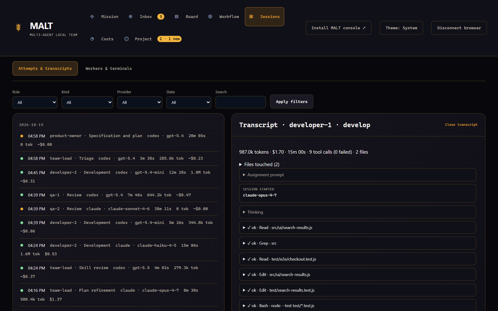

**Sessions → Attempts & transcripts** lists every bounded attempt with filters for role, kind, provider and state, and a search box. Each attempt shows its model, tokens (input, cache read, cache write, output, reasoning), cost source, turns, API time, tool calls and liveness. An attempt that a checkpoint stopped shows its recorded stop reason in the row, marked **awaiting your decision** while a checkpoint decision is pending. **Open transcript** shows what the attempt read, ran and changed as a tree of tool calls with results and exit codes, and the files it touched. Long text is truncated for display; the full text stays in the attempt log.

### Workers & terminals

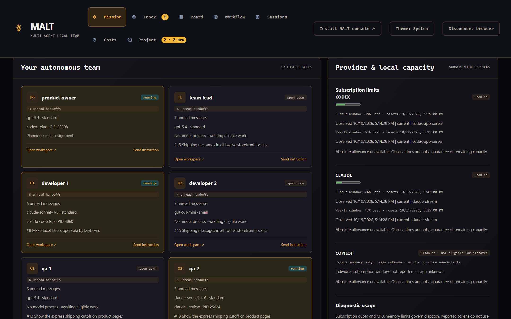

**Sessions → Workers & terminals** has two modes: **Worker logs & handoffs** and **Scratch terminals**.

**Worker logs & handoffs** shows one pane per role with its real captured output, an artifact selector, process state, unread-handoff counts, broker conversation previews and instruction receipts. Panes have adjustable heights. These panes are logs, not interactive terminals.

**Model selection evidence · requested launch** in each pane shows the immutable recorded assignment: the reviewed recommendation, requested provider, model and effort, enforced capability floor, policy revision and the reason for the selection. A requested effort argument is not proof that the provider applied it. Current supervisor diagnostics appear separately.

#### Durable operator instructions

**Send instruction** queues guidance for a role or delivery; **Coordinated scope change** sends a replanning instruction to the team lead; **Cancel owned job** cancels a running job.

Instruction receipts move through four states. `queued` means stored. `delivered` means included in a sealed assignment, not that a model has read it. `acknowledged` and `applied` are explicit agent reports, accepted only for that assignment and stage. A fresh provider session receives outstanding guidance again. Independent review still decides whether the result works.

CLI: `factory-instruct --file instruction.json` with `{ "role": "developer-1", "body": "Preserve the existing export names." }`; add `taskId` for one delivery and `replan: true` for a coordinated scope change. `factory-retry --file retry.json` takes a `taskId` or `featureId`. Coordinated feedback also queues an acceptance clarification for the product owner and a bounded learning investigation.

#### Interactive scratch terminals

**Scratch terminals** opens a real PTY running Claude Code or Codex in its own scratch worktree on a `malt/terminal/<uuid>` branch. It is not attached to any managed role, and its output and commits cannot satisfy any delivery gate. Choose a provider and **Start scratch terminal**; opening the page never starts a process. By default one terminal may run, and it closes after five minutes without input or thirty minutes in total. See [Interactive scratch terminals](interactive-terminals.md) for the controls, limits and tested platforms.

## Costs


**Costs** shows spend and tokens from recorded usage. Choose a window (**Today**, **Last 7 days**, **Last 30 days** or **Last 90 days**, as calendar days in your time zone). Tiles show **Known cost** (reported and estimated), **Attempts** with the unpriced count, **Average per priced attempt**, **Waste** (failed or interrupted attempts) and **Cache hit**. **Daily cost by role** charts cost per day, with a table view. **Breakdowns** group cost **By role**, **By provider and model**, **By objective** and **By delivery**, and **Top attempts** lists the most expensive ones.

### Spend caps

**Spend caps** stop new spending in US dollars:

- **Project cap (USD)** over a rolling **Window (days)** of 1 to 90 days (default 30).
- **Each objective (USD)** and **Each delivery (USD)** set default caps for every objective and delivery.
- **Cap one objective or delivery** sets an override: type an amount, `none` to lift the default for that scope, or leave it blank to use the default.
- **Unpriced attempts**: **Ignore (token caps still apply)**, or **Block capped scopes until priced**.

Each capped scope shows a meter toward its cap. A reached cap stops new attempts on that scope while running ones finish; the Inbox and a notice say which cap and how much was spent. Raise or lift the cap to resume immediately. Attempts that ran no model, such as waits at an unpaid gate, cost nothing. **Save caps** saves all of them.

### Prices

**Prices** sets **Model prices (USD per million tokens)** for input, cached input, cache write and output. Subscription CLIs do not always report a price; until a model is priced its attempts are counted as unpriced, never as free.

## Project

### Setup & capacity


**Project → Setup & capacity** (page heading **Project setup**) has four cards:

1. **GitHub Project** (delivery source): the connected repository, Project and workflow field, with **Configure connection** and **Open connected Project ↗**. With local delivery this card is **Local delivery** instead: the protected hub's remote and base branch, the number of local pull requests and issues, and **Open pull requests**.
2. **Factory & validation** (execution policy): **Edit factory configuration** and **Edit model and effort policy**.
3. **Codex + Claude** (subscription sessions): reminders about where providers are authenticated.
4. **Durable, local, recoverable** (project memory): the `.malt` path.

#### Connect GitHub

**Configure connection** opens **Connect GitHub Project**, prefilled from the saved repository, Project URL and workflow status field. Paste an existing user or organization Project URL; the form derives its owner and number. The backend verifies the repository, Project access and the workflow field's options. Reconnecting keeps the selected field. A renamed repository may keep its older remote URL only when GitHub's repository node IDs agree.

Every factory ticket is attached to the connected Project (`requireProjectAttachment: true`). The connection form itself does not configure labels, milestones, saved views or fields; the GitHub connector operations for those, and connection verification by section, are described in [Project connectors](project-connectors.md). Connector permissions are edited under [Capabilities](#capabilities). A console panel with separate Work tracker and Source control sections ([#84](https://github.com/Division4Studios/malt/issues/84)) is not built yet, and Jira is not yet available in the console or the factory.

#### Configure the factory

**Edit factory configuration** opens **Configure factory policy**: a **Maximum changed lines per PR** field and the advanced policy JSON. A new project's starting template proposes `"delivery": "local"` with `npm` test commands; replace them with your project's real prepare, test and end-to-end commands. Set `"delivery": "github"` to deliver through a connected GitHub Project, `providers.copilot.enabled` to add GitHub Copilot, and `cloud.developers` with `cloud.environment` to route developers to Codex Cloud. Pause the factory before saving. The backend validates and enforces the policy and keeps settings you did not change.

An issue is the underlying ticket. Backlog holds received or unrefined work; Ready holds lead-reviewed actionable deliveries; Development and later states reflect execution. The product owner and lead check for duplicate and related tickets during intake; consolidating existing tickets is a separate human decision under [Recommendations](#recommendations).

#### Model and skill routing

**Edit model and effort policy** opens **Model and effort policy**: the project's allowed native models, declared capability floors, verified effort interfaces with their evidence, and provider and tier defaults. Pause the factory and let owned assignments and terminals settle before saving. Unknown support is shown as unknown and cannot launch an explicit-policy assignment; the editor never invents models or quotas. Saving is fenced by the policy revision and keeps your draft on a conflict. A draft opened for one project cannot be saved to another.

Who decides what:

- The **model policy** decides which models and efforts are allowed.
- The **product owner and team lead** choose a model profile per role for each delivery.
- The **supervisor** freezes the selection on each attempt.

A reviewed choice is honoured exactly while it names an entry of the current policy for the same provider with adequate capability; otherwise the assignment does not launch and the reason is shown, rather than a different model being substituted silently. Without a reviewed choice, the role type's preferred model (**Workflow → Roles**) applies, and its preferred effort can only raise the effort floor; without either, the nearest adequate project default applies. Projects without a model policy keep legacy CLI-profile routing, shown as `Legacy / not recorded`. A stale or inadequate choice costs a lead revision, never an unreviewed paid turn.

Without an explicit model policy, set `providers.codex.models` or `providers.claude.models` with native model identifiers under `small`, `standard` and `advanced`. Unconfigured profiles keep an unverified CLI default. Routing never expands subscription quota. `assignmentSkills` adds up to four adopted skills per stage; workers otherwise receive their lifecycle skill, the relevant stage skill and selected project instructions.

**Reusable factory improvements.** After you approve a skill proposal, **Project → Learning & skills → Reusable factory improvements** can queue that exact adaptation as a separately reviewed maintenance objective in the MALT source repository. Enter the MALT source root, for example `C:\work\malt`. MALT verifies its Git root and package identity, journals the handoff in the origin's `.malt/factory/maintenance/`, and queues one stable objective in the source project's own `.malt`; retrying cannot create a second one. The source project needs its own connection, validation commands and running factory; export creates no board, enables no dispatch and changes no source. CLI: `factory-export-maintenance --file export.json` with `{ "requestId": "<approved-proposal-uuid>", "workspace": "C:\\work\\malt" }`. Agents cannot invoke it.

### Settings

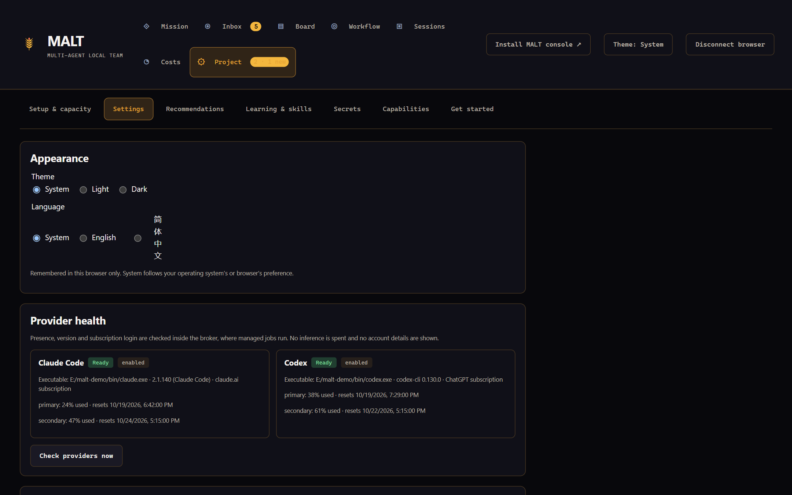

**Project → Settings** holds what no other dialog owns:

- **Appearance**: **System**, **Light** or **Dark**, remembered in this browser and kept in step with the side rail's **Theme** button.
- **Language**: **System**, **English** or **简体中文** (Simplified Chinese), remembered in this browser. See [Language](#language).
- **Provider health**: for Claude Code, Codex and the GitHub Copilot CLI, whether each is enabled, its executable, the preflight result (presence, version, login) with any fix, observed subscription windows, a cooldown in force, the dispatch gate and the latest failed attempt. **Check providers now** reruns the preflight and spends no inference.
- **Delivery checks**: **Recheck a dependent delivery's brief after its predecessors merge** (`briefRevalidation`, off by default). It saves the full factory policy, so it is read-only until the factory is set up and while it runs.
- **Build**: the console's MALT source revision, Node.js runtime and platform, the broker's source (or **not answering**) and the installed offline-shell revision.
- **Project settings**: shortcuts to **Factory & validation**, **GitHub connection**, **Model & effort policy**, **Team & organization**, **Workflow library** and **Get started guide**.

#### Language

The whole console is translated into Simplified Chinese, including the scratch terminal controls. **System** follows the browser's preferred languages: any Chinese preference selects Simplified Chinese, anything else English. Switching translates every open view in place without a reload, and dates and numbers follow the chosen language. Text written by agents or the broker, such as summaries, findings, blocker reasons, objective text and terminal output, is shown as written, and broker error messages stay in English.

### Recommendations


**Project → Recommendations** lists ticket proposals from the product owner and team lead: **Duplicate tickets**, **Related tickets**, **Consolidate tickets**, **Scope change** and **Guidance suggestion**. They are grouped into **Pending**, **Approved**, **Applying**, **Completed**, **Rejected**, **Stale** and **Failed** lanes, each with its tickets, an evidence summary and an **Unread** marker. The Project entry shows pending and unread counts, refreshed at most every 15 seconds.

Opening a proposal records a read receipt for that exact revision and shows its revision, tickets, survivor, transferred acceptance and dependencies, affected assignments, a **Before** and **After** preview and the evidence. While it awaits you, enter a **Rationale (required)** and choose **Approve** or **Reject**. Repeated clicks send one request; a failed request keeps your rationale; a proposal that changed since you opened it asks you to **Refresh** instead.

An approval is executed by the supervisor without a model turn, through its durable effect journal. For duplicates and consolidations it re-reads the issues (any change makes the record **Stale**), then posts marked comments and closes retired tickets as not planned, handing their local dependents to the survivor. An approved guidance suggestion becomes an inactive skill candidate that still needs lead review and your approval under **Learning & skills**. Rejection keeps the tickets separate. Approving **Related tickets** changes no ticket; an objective that intake parked on that proposal then proceeds. A failed duplicate, consolidation or guidance suggestion shows **Retry**, which checks the proposal again and repeats only the effects not done yet. Decisions require the console to own its broker (`ui --with-broker` or Docker). See [Review ticket recommendations](project-management-decisions.md) for the full lifecycle.

### Learning & skills


**Project → Learning & skills** shows **Observed lessons**, **Active & retired skills**, **Candidate proposals**, **Reusable factory improvements** and the pinned research baseline. The learning steward records concrete feedback and outcomes as lessons and proposes tailored skill revisions with provenance and validation evidence.

#### Approve a skill

Independent lead review moves a candidate to awaiting your decision; it does not activate it.

1. Select **Review and approve** or **Review and reject** (also reachable from the Inbox).
2. Compare the current and proposed instructions and the review evidence.
3. Enter a rationale and submit. The control calls `factory_skill_decide` with `{requestId, approve, reason}`.

Approval writes `.malt/skills/<name>/<revision>/SKILL.md` and the manifest, then records your decision in one transaction; recovery recognizes an already published revision rather than activating it twice. Rejection keeps the current instructions. Approved project overrides take precedence over a bundled skill of the same name for new assignments; running assignments keep the context they started with. Agent credentials cannot approve this gate. CLI: `factory-skill-decide --project <folder> --file <decision.json>`.

### Secrets

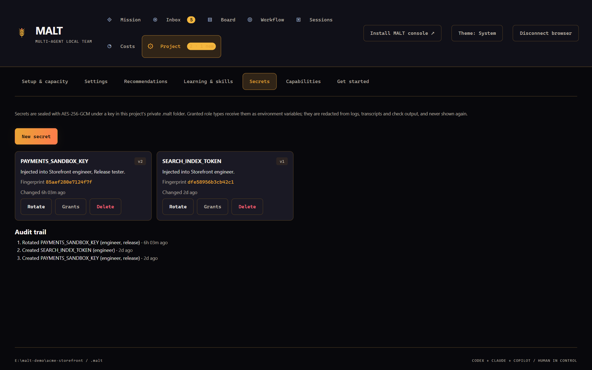

**Project → Secrets** holds API keys and tokens that role types need, such as a test payment key. **New secret** asks for an environment variable name, the value and the role types that receive it. **Rotate** replaces the value, **Grants** changes who receives it and **Delete** removes it after a confirmation. The **Audit trail** records each change without values.

Values are write-only. They are sealed with AES-256-GCM under a random key in `.malt/factory/vault.key` (owner-only on macOS and Linux; on Windows it relies on `.malt` being private to your account) and bound to their name. The console shows a keyed fingerprint that changes on rotation, never the value. Granted secrets reach only the provider processes of granted role types, as environment variables, and are redacted from logs, transcripts, failure records and check output. Attempts already running keep the value they started with. Back up `vault.key` with the project if you need the secrets after a restore.

### Capabilities


**Project → Capabilities** is the connector capability matrix: what people and approved roles may do through connectors, beside what the provider supports. Each row shows the capability, its **Provider support** (**Supported**, **Unsupported by the provider** or **Unverified**), its **Mode** and, for approved roles, the **Approved roles**.


| Mode                 | People  | Agents and the supervisor |
| -------------------- | ------- | ------------------------- |
| Disabled             | denied  | denied                    |
| Human only           | allowed | denied                    |
| Approved agent roles | allowed | allowed for listed roles  |

Change a mode or role list and **Save** that row (`capability_policy_set`). An unsupported capability can only be disabled. A failed save keeps your selection. **Change history** lists every edit with who made it. See [connector capability policy](capability-policy.md).

### Get started


**Project → Get started** is a checklist from an empty project to the first role at work. It opens by itself when a project is first shown in a console session without factory setup, a delivery target (a GitHub connection or the local hub) or any objective, unless you choose **Hide guide**, which hides it for that project in this browser. Each step opens the same dialog you use later:

1. **Check this machine** runs the `doctor` checks inside the broker (Node.js, Git, provider logins, GitHub CLI, writable `.malt`) and lists each as pass, fail or fix-it with its fix.
2. **Connect the GitHub repository and Project** opens the connection dialog. With local delivery this step is **Deliver through the local hub**, already done, and its button **Open pull requests** opens **Workflow → Pull requests**.
3. **Choose providers, checks and model policy** opens factory setup and the model policy.
4. **Pick how objectives are delivered** opens the workflow library and names the default workflow.
5. **Submit a first objective** opens the objective editor.
6. **Start the factory** starts dispatch.
7. **See the first role start** follows the newest objective. It names the role, stage and provider once an attempt starts, or the exact reason none can: factory not set up, factory paused, the objective blocked, a model-policy blocker, the admission gate (job cap, provider cap, cooldown, CPU or memory) or no eligible provider. If nothing is reported and no role has started for two minutes, it points at **Why work is running or parked**.

## Private state and Git

Project setup appends `.malt/` to the project's `.gitignore` and keeps a final `*` rule inside `.malt/.gitignore`. The whole directory is private, including generated READMEs, logs, skill revisions, the pairing code and the secrets vault key. Factory dispatch and publication also reject a Git index that contains `.malt`, including case variants and force-staged files.

Git ignore rules do not untrack files that are already tracked. Before publishing an existing repository, check `git ls-files -- .malt`. If private files were committed, untrack them deliberately and rotate exposed credentials; a new commit does not remove them from history. Back up `.malt` only to a private location while the broker is stopped (`node src/cli.ts backup --dir <folder>`).

## Browser boundary

- The broker rejects browser-origin RPC. The console server binds to loopback and checks Host, Origin and Fetch Metadata. Cross-site API traffic is rejected; ordinary navigation to the public shell is allowed.
- Private responses are `no-store`; shell assets are served `no-cache`.
- Authenticated routes include `/api/projects`, `/api/snapshot`, `/api/history`, `/api/stream`, `/api/artifact`, `/api/control`, `/api/terminals`, `/api/terminal-stream` and `/api/logout`. Raw broker, project and provider credentials never enter browser storage or URLs.
- Artifact reads are confined to known jobs and allowlisted files, including `failure.json`, which records the exact supervisor step and command that failed after a successful agent ([details](software-factory.md)).
- Terminal controls are operator-only and reject every managed-agent credential.

## Bounded subscription smoke tests

```sh
node scripts/smoke-subscription.ts --provider codex --executable /path/to/codex
node scripts/smoke-subscription.ts --provider claude --executable /path/to/claude
```

On Windows, pass the native `.exe` path. Each test spends subscription usage on one read-only structured response, with no tool calls or GitHub changes, and keeps its evidence under `.malt/validation/`. Both providers have passed it. It does not prove a complete delivery.

## Verification limits

MALT is pre-1.0. This section states what has been verified and what has not.

**What the automated suite covers.** The regression suite exercises real MCP transports, SQLite, loopback HTTP, local Git worktrees and validation subprocesses, with fixture inference and fixture GitHub. It covers broker-wide admission, Windows process ceilings and cancellation, credential redaction, instruction receipts, restart recovery and stream cursor replay. Console views are rendered into a text-only DOM in tests such as `test/capacity-panel.test.ts` and `test/admission-panel.test.ts`. `test/service-worker.test.ts` runs the compiled service worker with fake caches and network and checks the real loopback headers, and `test/connection-status.test.ts` covers the offline wording. Two browser fixtures, `test/fixtures/capacity-sample.html` and `test/fixtures/subscription-capacity.html` (served after `npm run build:web`), check reading order, focus retention and hostile text with synthetic data.

**What was checked in a real browser.** Browser inspection against a real backend has verified pairing, worker artifact controls, human skill approval, hostile markup rendered as text and no page-width overflow on compact screens. Stopping the daemon and reloading served the cached shell with a disconnected notice and disabled controls. The Docker smoke covers container pairing, durable objective submission, container recreation and MCP interoperability.

**Live delivery.** On 2026-10-14 the MALT source repository completed one real subscription-backed delivery ([PR #11](https://github.com/Division4Studios/malt/pull/11)) through merged-main proof and Done board states, without administrator bypass. Its developer ran on Claude after early Codex startup failures were repaired. That pilot did not run on a protected branch. A live end-to-end delivery on a protected branch with both a Claude and a Codex developer is still open ([#259](https://github.com/Division4Studios/malt/issues/259)); protected-branch enforcement is covered only by fixtures. Fresh-machine runs are tracked in [#258](https://github.com/Division4Studios/malt/issues/258).

**Installed PWA and accessibility ([#261](https://github.com/Division4Studios/malt/issues/261), open).** A static WCAG 2.2 AA pass on 2026-10-17 covered every stylesheet, the shell and every script-built dialog, and `test/accessibility.test.ts` keeps it from regressing. It fixed light-theme contrast, fixed-colour fields in the light theme, and unnamed workflow dialogs, and confirmed theme contrast, a global reduced-motion rule, visible focus styles, named controls and narrow-screen rules. Not yet verified:

- install and launch in Chrome and Edge on desktop and in one mobile browser;
- a real update and offline cycle in an installed window;
- a keyboard-only walk-through of each view and a screen-reader check;
- visual narrow-layout checks of the capacity, handoff, activity, delivery manager, board and Inbox views.

**Other limits.**

- The delivery manager has been run live with Claude; live Codex manager turns and long missions have not. See [delivery manager verification](delivery-manager.md#verification).
- Scratch terminal startup was inspected with real Claude Code and Codex TUIs, but no full model turn. See [executed support evidence](interactive-terminals.md#executed-support-evidence).
- Subscription quota is shown only as reported; no absolute allowance is known.
- The connector console with separate Work tracker and Source control sections ([#84](https://github.com/Division4Studios/malt/issues/84)) is not built, and Jira is not wired into the console or the factory.
- Release packaging and the v1.0.0 tag ([#260](https://github.com/Division4Studios/malt/issues/260)) and a worktree prune command ([#411](https://github.com/Division4Studios/malt/issues/411)) are open.

The [capability map](current-status.md) lists each boundary in detail.
