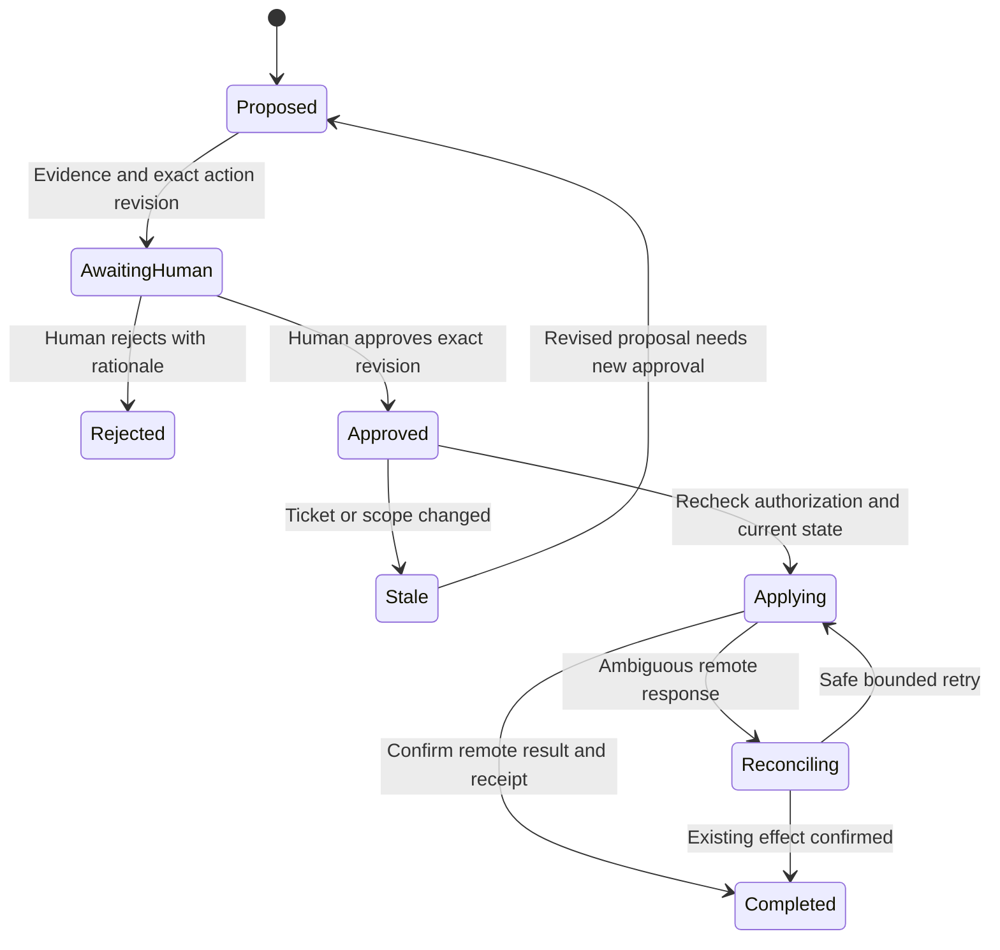

# Human-reviewed project management

This is the accepted delivery scope for the dedicated project-management approval panel. The panel and general ticket-decision executor are not implemented yet. Current human skill decisions approve exact skill revisions only. Product/lead intake guidance already requires duplicate and related-ticket inspection; it does not authorize consolidation.

## Implemented foundations

The [recommendation store](recommendation-store.md) is merged (#51 / PR #93), as is the [deterministic duplicate/related classifier](duplicate-detection.md) (#52 / PR #94). Neither is connected to the complete human decision/execution lifecycle below. The repository-wide observed-revision corpus, scoped submission/read/decision routes, intake hook, executor, notifications and browser pane remain open under [#50](https://github.com/Division4Studios/malt/issues/50). Dispatcher task triage and exact skill approval are separate existing controls; they must not be presented as this recommendation panel. See [current capabilities](current-status.md).

## Intake and recommendation

Before new feature/bug planning, scope changes and ticket creation, search the selected repository's open and relevant closed issues, native parent/child relationships, local objectives and unresolved remote operations. Exact interrupted-operation recovery reuses its existing identity automatically. Semantic similarity produces a recommendation, not automatic closure. Compare behavior, acceptance, reproduction, component and dependencies; retain contrary evidence and distinguish related work from a true duplicate.

Proposals identify the target project, exact issue IDs/links and observed revisions, overlap evidence, proposed survivor, transferred acceptance/dependencies, affected active assignments, proposed labels/status changes and a readable before/after preview. Preserve comments and source history. Consolidation must not silently discard distinct requirements, edits or defects.

## Durable decision queue

This is the queued panel's required behavior. Waiting is durable state, with no resident model process. A ticket decision does not approve a separate reusable skill revision.

Expose pending, approved, rejected, stale, applying, completed and failed recommendations in a project-management pane reachable from the existing Project section. Show unread/pending counts without another permanent top-level navigation section. Read-only discovery and the durable queue require no resident model process. Unaffected deliveries continue; only work actually dependent on clarification is blocked.

Human controls approve or reject an exact proposal revision with a rationale. Agents cannot approve. Check project authorization, current ticket state and proposal freshness at decision time and execution time. Changed tickets, dependencies or affected work invalidate approval rather than silently widening it. Deduplicate repeated clicks, reconnects and retries using stable operation identities and checkpoints. Reconcile ambiguous remote effects without duplicating comments or replaying a paid implementation turn.

Approved decisions queue bounded work for the responsible product owner/lead or execute narrowly authorized deterministic ticket operations through the existing supervisor. The pane owns neither a second scheduler nor a parallel ticket-state database. Preserve the audit trail and notify affected roles durably; spun-down roles read the decision on their next relevant assignment. Rejecting has no proposed side effects and remains visible to future intake to avoid repeatedly presenting unchanged rejected advice.

## Ticket decisions and skill changes

A one-off ticket consolidation is not a skill override. If a decision suggests reusable guidance, create a separate tailored candidate with evidence, provenance and exact content hash. Independent lead review and explicit human approval of that exact revision precede activation in `.malt/skills/`. Preserve prior revisions and adoption history. Notify affected roles; already running assignments retain frozen context. Unknown or conflicting local changes must not be overwritten.

## Verification

Cover true duplicates versus related tickets, differing acceptance, closed duplicates, missing permissions, active/dirty work, stale proposals and approvals, rejected recommendations, double submission, broker restart, ambiguous remote completion, provider switching and durable notifications. Verify real browser approve/reject controls against fixture GitHub operations with no paid inference. Add hostile-text, project-isolation and keyboard tests. Live consolidation requires a concrete approved proposal; do not close real tickets to manufacture a demonstration.
