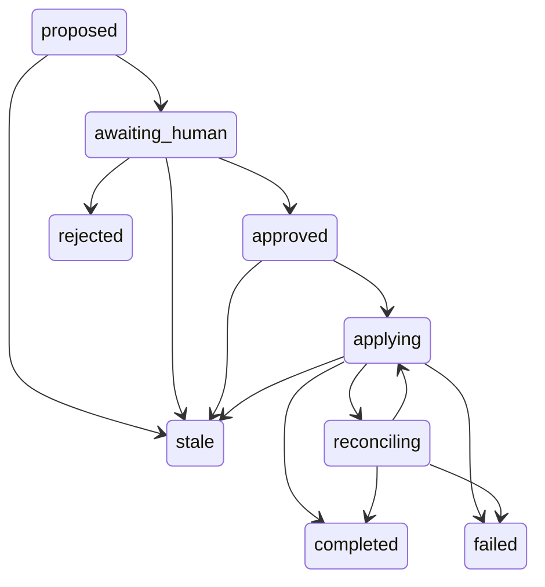

# Recommendation persistence

`FactoryRepository.recommendations` stores private recommendations in the existing SQLite store, bound to its verified project identity. No remote calls or agent decision tools are added. Identity hashes the project, kind and sorted unique ticket set. Revision hashes the validated proposal: action, evidence, observed issue revisions, survivor, transferred acceptance/dependencies, affected assignments and before/after preview. Object key order and ticket order do not change either hash.

`propose` creates `proposed` content. Replaying known content returns its original revision without reactivation. Changed content supersedes proposed or awaiting-human content as stale. Stale or rejected content may have a new current revision while preserving history. Approved, applying, reconciling, completed and failed records cannot be replaced.

Allowed same-revision transitions:

- proposed → awaiting_human or stale
- awaiting_human → approved, rejected or stale
- approved → applying or stale
- applying → completed, reconciling, stale or failed
- reconciling → completed, applying or failed

Rejected, stale, completed and failed revisions have no outgoing transitions. Stale → proposed requires new content. Failure is terminal; a future retry workflow needs explicit authorization. Transitions require the current revision and expected state in a SQLite transaction. Creation/transition audit entries retain time, previous/new state and rationale. Changes set unread; `markRead` is idempotent and fenced by current revision. Text is preserved verbatim, bounded to 32,000 characters per narrative field and 200 per recommendation identifier; the verified project identity follows the nonempty-string configuration contract without an additional length limit; collections are bounded to 100 items. Every ticket requires exactly one observed revision. The store retains observed revisions, never ticket body snapshots.

## Same-revision state diagram

Terminal revisions stay immutable. Re-proposing after stale or rejected creates a new revision; it does not reopen the same revision. This diagram documents the existing store, not an implemented human approval endpoint or ticket executor. See [project management scope](project-management-decisions.md) for the remaining integration.
