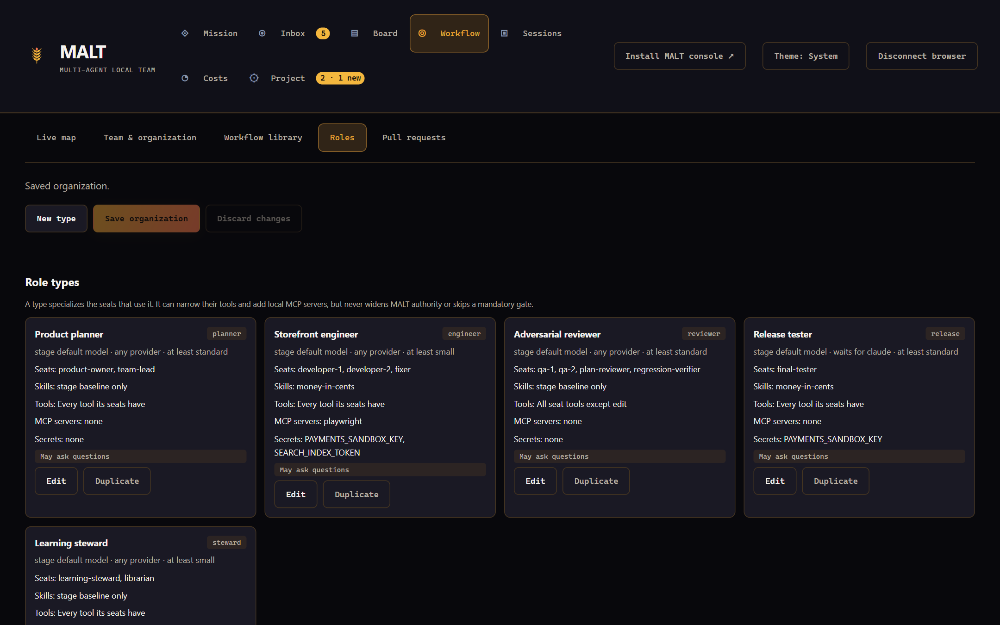
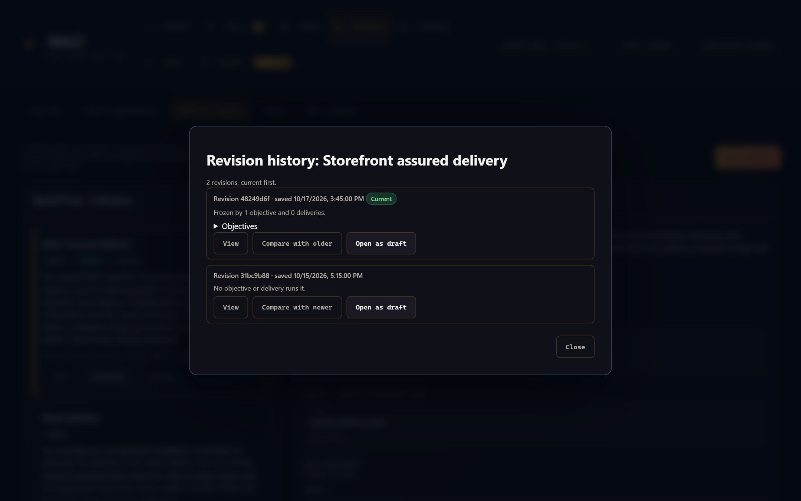
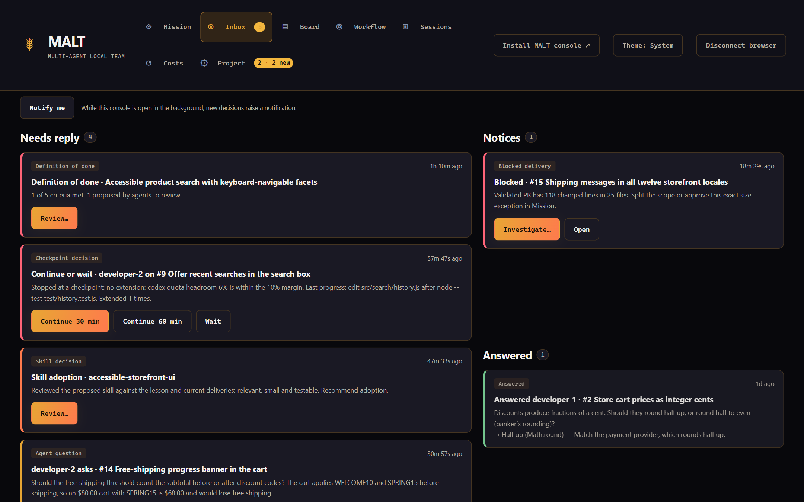
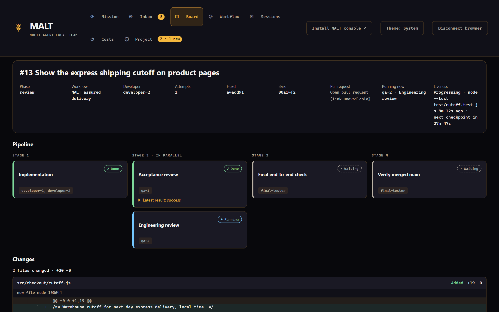
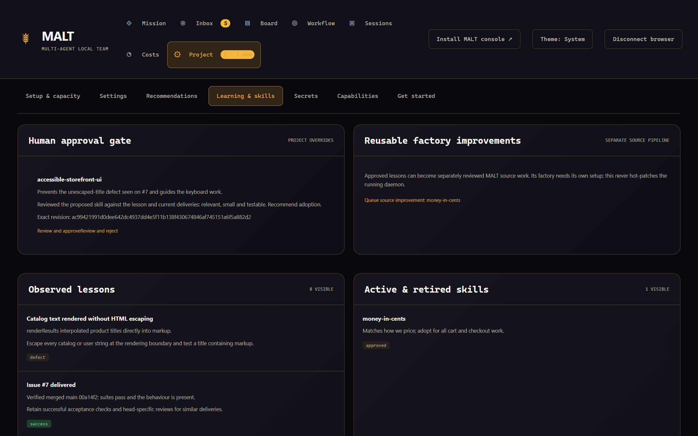

# The managed software factory

The factory is the part of MALT that delivers code without a person driving each step. You give it an **objective**, a change you want described in plain language. An unpaid **supervisor** inside the broker plans it, starts bounded provider CLI sessions to implement and review it, merges it through your branch protection and checks the result on main.

This page explains how that works and why each gate exists. For the console controls, see [Mission control](operator-console.md). For exact operation arguments, see the [API reference](api.md#managed-factory-controls). For a GitHub-free setup, see [Local delivery](local-delivery.md).

Terms used throughout:

| Term       | Meaning                                                                                                                     |
| ---------- | --------------------------------------------------------------------------------------------------------------------------- |
| Objective  | One requested outcome. It becomes a parent issue on GitHub (or in the local tracker) and one or more deliveries.            |
| Delivery   | One atomic, independently mergeable change with acceptance criteria. It has its own branch, worktree and pull request.      |
| Seat       | A logical role slot, such as `developer-1` or `qa-2`. A seat runs at most one assignment at a time.                         |
| Assignment | One bounded provider CLI run for one step, also called an attempt. It does one job, returns a structured result and exits.  |
| Supervisor | The scheduler inside the broker. It never calls a model itself, so its own work costs nothing.                              |
| Workflow   | The steps an objective and its deliveries pass through. Each objective freezes the exact workflow revision it started with. |

## Roles and seats

Each seat is an independent process slot. Two seats can use the same provider, but a seat never runs two assignments at once.

| Seat                         | Responsibility                                                                          | Typical steps                   |
| ---------------------------- | --------------------------------------------------------------------------------------- | ------------------------------- |
| `product-owner`              | Turns the objective into a specification with acceptance criteria                       | `specify`                       |
| `team-lead`                  | Splits the work into atomic deliveries; reviews skill proposals; investigates blockers  | `plan`, `plan_revise`           |
| `developer-1`, `developer-2` | Implement a delivery in its own worktree and fix returned defects                       | `implement`                     |
| `qa-1`, `qa-2`               | Review the exact pull request head independently; report defects instead of fixing them | `review`                        |
| `final-tester`               | Rechecks the integrated change before merge, then verifies merged main                  | `final`, `verify`               |
| `learning-steward`           | Studies outcomes and proposes reviewed skills                                           | none (runs on its own schedule) |
| `plan-reviewer`              | Reviews a plan, usually from another model family                                       | `plan_review`                   |
| `fixer`                      | Rules on every review finding with evidence and applies the adopted fixes               | `adjudicate`                    |
| `librarian`                  | Updates documentation for the change                                                    | `document`                      |
| `regression-verifier`        | Confirms the adopted fixes did not regress anything                                     | `regress`                       |

By default the product owner reports to nobody, the team lead and final tester report to the product owner, and every other seat reports to the team lead.

Edit role types in **Workflow → Roles**. A role type can pin a provider (the seat waits for it instead of switching), prefer a model from the explicit model policy, narrow its tools, add up to four local stdio MCP servers and receive granted secrets. A role type can only narrow what its seat may do: it cannot add a tool or bypass a gate. The [roles and secrets reference](api.md#roles-and-secrets) lists every field.



## Workflows and steps

A workflow has a **planning** section, which runs once per objective, and a **delivery** section, which runs for every delivery. An empty planning section makes the objective itself the single delivery.

Steps use a closed set of kinds, so a workflow is data that MALT validates completely before anything runs:

| Section  | Step kinds                                                                               |
| -------- | ---------------------------------------------------------------------------------------- |
| Planning | `specify`, `plan`, `plan_review`, `plan_revise`, `approve`                               |
| Delivery | `implement`, `review`, `adjudicate`, `document`, `regress`, `approve`, `final`, `verify` |

MALT ships five built-in workflows in `resources/workflows/`:

| Workflow (`id`)                                         | Planning                                               | Delivery                                                                                                    |
| ------------------------------------------------------- | ------------------------------------------------------ | ----------------------------------------------------------------------------------------------------------- |
| MALT assured delivery (`malt-assured`), the default     | Product owner specifies, team lead plans               | Implement, two independent reviews (`qa-1`, `qa-2`), final check, verify main                               |
| Quick change (`quick`)                                  | None                                                   | Implement, one review, final check, verify main                                                             |
| Direct delivery (`direct`)                              | None                                                   | Implement, Codex review and blind Claude review, fixer, regression check, final check, verify main          |
| Pull request with human merge approval (`pull-request`) | None                                                   | Implement, review and blind review, fixer, merge approval bound to the exact head, final check, verify main |
| Full assurance (`full-assurance`)                       | Specify, plan, cross-family plan review, plan revision | As Direct delivery, plus an optional documentation pass before the regression check                         |

A **blind** review receives no peer findings. A step can prefer a provider family; it then waits for that provider instead of switching, which keeps cross-family reviews cross-family.

The validator refuses a workflow that could weaken delivery. For example:

- delivery needs exactly one `implement` step, first, on developer seats;
- `plan`, `implement`, `final` and `verify` cannot be optional;
- a planner cannot review its own plan, and a reviewed plan needs a revision step;
- a reviewer cannot review code its own seat wrote;
- `final` and `verify` cannot be gated; put an `approve` step before the final check instead.

Save your own workflows in **Workflow → Workflow library**. Each save is an immutable revision, and a project keeps at most 50 workflows. Built-in ids are reserved, so clone a built-in under a new id. Editing a workflow never changes running work. For one objective or delivery you can also skip optional steps or change a step's seats, profile or provider with **step overrides**; the result must still satisfy every rule above.



Two optional policies add human or lead checks:

- **Gates.** `defaultGates: { plan, merge }` (both `false` by default) asks for your approval in the Inbox before a plan creates deliveries, or before a delivery's exact head is merged. One objective can override the project default.
- **Brief revalidation.** With `briefRevalidation: true` (default `false`), a delivery with dependencies does not start as soon as its predecessors merge. The team lead first rechecks its brief against current main, then confirms it or blocks the delivery with proposed edits. Each delivery is revalidated once per set of predecessor merges.

Every typed step output carries `schemaVersion` (currently 1) and is bound to the source it judged. Review findings, fix rulings and regression results bind the exact head and base. Each plan records the commit it was made against, so later steps can see what changed on main since.

## The delivery pipeline


A delivery moves through these stages:

| Stage         | What happens                                                                                                   |
| ------------- | -------------------------------------------------------------------------------------------------------------- |
| `ready`       | Created from the plan. Waits until its dependencies are done, including their merged-main verification.        |
| `development` | A developer works in the delivery's own worktree. Rework always returns to the original developer.             |
| `publishing`  | The supervisor commits, refreshes onto main, runs the project's checks and pushes the branch and pull request. |
| `review`      | Independent reviews of the exact head and base. A rejection returns findings to the developer.                 |
| `merge_ready` | The final tester rechecks the integrated change.                                                               |
| `merging`     | The unpaid merge step merges through the repository's protection, or waits with a precise reason.              |
| `verifying`   | The final tester verifies the merge on actual main.                                                            |
| `closing`     | The issue closes and the board updates.                                                                        |
| `done`        | Verified on main.                                                                                              |
| `blocked`     | Waiting for you, with one blocker that names the cause and the action.                                         |

Why it is shaped this way:

- **Atomic deliveries** keep each review small and each merge safe on its own. The plan states each child's outcome, exclusions, checks and genuine dependencies. One plan holds at most 100 deliveries; larger outcomes need separate objectives.
- **Exact-head approvals** mean any new commit, including a refresh onto main, needs fresh reviews.
- **Merged-main verification** proves the change works where it landed, not only on its branch. Issues close only after it passes.

Two different size rules apply to deliveries:

- **Planning target.** The team lead's planning prompt and the bundled `factory-product` skill aim for 1–500 changed lines per delivery, including tests and documentation. This is guidance for how the lead splits work, not an enforced limit.
- **Publication ceiling.** `maxDiffLines` (default 500 changed lines) and `maxFiles` (default 20 files) are configurable factory settings. A validated delivery over either value parks with the reason `over_limit` instead of publishing. Split the scope, or approve a size exception (**Approve this size exception**) for that exact head and base; new edits or an advancing main invalidate it.

These apply to deliveries the factory publishes in your project. MALT's own repository has no pull request size limit.

Setting a board status by hand never counts as a verified delivery.

### When the supervisor's own step fails

A code-writing assignment can succeed while the supervisor's work afterwards fails. After the agent, the supervisor commits, refreshes main, validates and publishes. When one of these steps fails, the handoff reason names it, for example "The agent finished, but the supervisor's validation step failed: …".

The job's private `failure.json` records the step, the agent's outcome, the error and, for a failed command, its family and subcommand (such as `git push`), exit code or timeout, and the last 4,000 characters of redacted stderr. Open it in **Sessions → Workers & terminals**. The broker token, known provider and GitHub credentials, token shapes and credentials in URLs are redacted, and stderr never leaves the job's private files.

A publication with nothing new names one of three reasons:

| Reason              | Meaning                                                                        |
| ------------------- | ------------------------------------------------------------------------------ |
| `nothing_to_commit` | The agent changed no file and the branch has no commits of its own.            |
| `already_merged`    | Every branch commit is already on main.                                        |
| `empty_diff`        | The branch has commits, but together they change nothing against current main. |

## Scheduling and admission

On every pass the supervisor builds a list of candidate assignments, filters it, and admits what the machine and providers can take. Nothing in this path calls a model.

**Candidates** are ordered: verification and review handoffs first, then blocker investigations and brief revalidations, then repairs of published deliveries, then new development and planning interleaved, then skill reviews and learning. A candidate is dropped when:

- its seat already runs an assignment, or its delivery already has a running code-writing assignment;
- its step is backing off after a failure, is out of automatic retries, or has a pending checkpoint decision (see [the retry policy](#retry-policy-by-failure-class));
- its delivery is on hold;
- a spend cap stops its delivery, objective or project;
- the dispatch queue focuses another objective, or clearance mode admits only existing deliveries;
- its step has an open question for you;
- intake has parked its objective for a recommendation decision.

**Admission.** Each remaining candidate must then pass these checks at the moment of the claim:

1. the broker-wide job cap, `resources.maxActiveJobs` (default 2), shared by every project and scratch terminal on this broker;
2. free memory (`minFreeMemoryMb` 1,024 and `minFreeMemoryPercent` 15) and CPU (`maxCpuPercent` 85);
3. a provider that is enabled, not cooling down, below 100% verified subscription use, below its concurrency (default 2) and within any optional token budget;
4. the explicit model policy, when the project has one.

When no provider fits, the scope waits. It is never routed silently to an unreviewed model. `factory_status.admission` reports the first blocker dispatch would hit. See [Mission control](operator-console.md#resource-admission-and-cancellation) for memory stops and cancellation.

Claims are transactional, so two passes cannot claim the same step. Independent objectives can develop in parallel, and a queued objective can be planned while another develops, within these caps.

## Assignment liveness and retries


A managed assignment is not stopped by one blind deadline. `jobTimeoutMs` (default 30 minutes) is the **checkpoint interval**.

Between checkpoints the supervisor samples signals it already owns, every `liveness.sampleMs`: the attempt's provider stream (`stdout.log`), the worktree's HEAD, status and tracked diff for code-writing steps, and developer `mesh_factory_progress` check-ins. At each checkpoint it:

- **extends** an assignment that made meaningful progress within `liveness.stallMs`, by one more interval;
- **stops** one that stalled (stop reason `stalled N min`) or reached the hard ceiling `liveness.maxMs` (stop reason `hard ceiling`), measured from the attempt's start.

The provider process bound is the ceiling plus one minute, so the supervisor always stops first, with its own reason.

**What counts as progress.** Completed tool and check calls (a failed test run still completed), provider-reported file changes, commits, tracked edits and developer check-ins. Thinking, assistant prose, usage reports, heartbeats, repeated identical completions and raw log growth do not count. A provider that stops for a permission it lacks, an `AskUserQuestion` or a Codex approval request is recorded as **awaiting input**; its stop reason reads `stalled N min (awaiting input)`.

**Defaults.** Without explicit settings, `stallMs` is the smaller of 15 minutes and the interval, `maxMs` the larger of two hours and the interval, and `sampleMs` the smaller of one minute and the interval. An assignment that shows no progress therefore stops at its first checkpoint.

**Extensions need verified headroom.** At a checkpoint where the assignment progressed, the supervisor refreshes supported subscription quota (the Codex app-server reading, never inference or account scraping). It extends only when the provider is not cooling down, the machine has no memory or CPU pressure, and fresh, verified quota headroom exceeds `liveness.quotaMarginPercent` (default 15) times the number of running attempts sharing that provider. Otherwise the attempt is **held** and stops with a reason such as:

- `no extension: codex quota reading is stale`
- `no extension: no verified claude quota reading`
- `no extension: codex quota headroom 12% is within the 15% margin`
- `no extension: codex is cooling down`
- `no extension: machine memory pressure`

Claude reports quota only when an attempt finishes, so Claude extensions are held until a fresh reading exists.

**Checkpoint decisions.** A held attempt, or a productive one that reached the hard ceiling, asks you instead of retrying on its own. Its worktree and edits are kept, and the Inbox shows a **Checkpoint decision** with **Continue 30 min**, **Continue 60 min** and **Wait**. While the decision is pending the step is never offered again, so no automatic paid retry bypasses you.

- **Continue** runs the step once more from the preserved worktree with that ceiling and without the extension gate. A stall still stops it, and the grant is used once.
- **Wait** returns the step to the normal `held` retry rule.

A decision becomes stale, and is refused, when the delivery head moved, the delivery changed stage or a newer attempt of the step exists. Pause, shutdown, cancellation and source, QA or merge fencing always win over a continuation.

Cancellation, pause, shutdown, invalidated assignments and new operator instructions still stop an assignment at once. Cleanup touches only the assignment's own process tree.



### Retry policy by failure class

Every attempt that did not succeed records a `failureClass`. Before offering the same step again, the scheduler waits a class-specific delay and doubles it for consecutive failures of the same class. At the cap it stops offering the step, so no paid turn repeats the same failure.

| Class            | Meaning                                          | First delay      | Longest delay    | Cap  |
| ---------------- | ------------------------------------------------ | ---------------- | ---------------- | ---- |
| `rate_limit`     | Provider cooldown or limit text                  | 1 min            | 15 min           | 6    |
| `transient`      | Process, network or other unexpected failure     | 30 s             | 10 min           | 5    |
| `stalled`        | Stopped at a checkpoint: stalled or hard ceiling | 5 min            | 30 min           | 3    |
| `held`           | Progressing, but no verified headroom to extend  | 15 min           | 30 min           | 2    |
| `invalid_output` | The provider ran but returned no usable result   | 2 min            | 10 min           | 3    |
| `gate`           | An unpaid gate parked the attempt                | Reconcile period | Reconcile period | none |
| `cancelled`      | Operator, pause or shutdown interruption         | none             | none             | none |

A new head, a different step, a success or an operator retry resets the count. Attempts saved before classification keep the earlier rule: a failure waits one reconcile interval and an interruption retries at once. The delivery view shows a running attempt's liveness and each step's backoff, or that the step is out of automatic retries.



## Preflight and baseline

**Preflight.** Immediately before a paid model turn, the supervisor checks the exact environment the attempt will use, without calling a model:

1. the sealed read-only source view exists and lists files at its commit;
2. Git works in the attempt's checkout;
3. every configured test and end-to-end command's executable can be found from that checkout.

A failure stops the attempt as an unpaid gate. The reservation is refunded, no paid usage is recorded and the delivery shows one blocker, for example "Preflight stopped this review attempt before any paid turn: the project check command npm cannot be started from this checkout. Fix it and the step retries."

**Baseline.** Once per main head, the supervisor runs the project's test commands on main in an immutable snapshot, in the background and under the same resource limits as checks. Every delivery assignment receives the result as `evidence.baseline` and is told that failures listed there already exist on main and are not defects of the delivery. While main's result is pending, the evidence says so.

Before your first start, run [`doctor`](logging-and-troubleshooting.md#run-doctor-first) for the operator-side checks.

## Repairs

### CI-failure repair

A delivery whose pull request fails a check on its exact head returns to its original developer automatically, once every check on that head has finished. The supervisor reads up to five failed GitHub Actions job logs through `gh` and keeps the last 1 MiB of each. It strips terminal codes and timestamps, redacts credentials and cuts each log to the lines around its first error plus its final lines, at most 6,000 characters. New source then needs fresh reviews and checks, like any rework.

Pending checks never start a round. Cancelled, skipped and neutral checks never count as failures. Checks from other CI providers produce a finding with the check name and link, but no log. Public issue comments name only the failed checks; log text stays private.

### Merge-conflict repair

A refresh onto current main that conflicts starts a merge-conflict round. The next attempt starts with the conflicts in its worktree, and its evidence names each conflicted path and the recent commits on both sides. Publication refuses a merge that still contains conflict markers, then reruns the checks on the resolved merge.

### Repair limits

Each round is keyed by its kind, source and failure, so the same failure on the same source never starts a second round. A repair that republishes the failing source unchanged stops the delivery. `repair.maxCiRepairs` and `repair.maxConflictRepairs` (default 2 each, at most 10) cap rounds per delivery; past a cap the delivery is blocked for you. Each round grants the developer one attempt beyond `maxAttempts` (default 5). CI and conflict rounds always go to the developer, even in workflows with a fixer.

## Main refresh

When main advances under a reviewed pull request whose head has not changed, the supervisor merges current main into the delivery's branch and pushes it, without a developer turn. Approvals bind exact heads, so reviews run again, but scoped: the delivery records the previously approved source in `refreshedFrom`, and reviewers and the final tester are told the only change since their approval is that merge.

A conflicting merge becomes a merge-conflict round. A branch with local changes, or one the supervisor cannot refresh safely, returns to its developer.

## Protected-branch merge path

Local QA approvals cannot satisfy GitHub's protected-branch review rules. The final tester therefore does not wait for a GitHub approval or a `CLEAN` merge state. It still waits, unpaid, on a closed, draft or stale pull request, another base, conflicts, a branch behind its base, a merge state GitHub is still computing, requested changes, and failing or pending checks. Each wait is named in the gate reason.

After the final check, the unpaid merge step reads the repository's merge settings, the effective rulesets for the base branch (`rules/branches/<base>`) and classic branch protection where the token may read it. It picks the first allowed method of squash, rebase and merge (no merge commits under linear history), then:

1. enqueues the exact head in the merge queue when the base branch uses one;
2. merges the exact head when nothing is pending;
3. arms GitHub auto-merge when reviews, checks or another rule are still pending and the repository allows auto-merge;
4. otherwise waits with a precise reason, for example "PR #12 is awaiting 1 approving review. Auto-merge is off for this repository, so a maintainer merges it once that is done, or enables auto-merge in the repository settings."

While it waits, the delivery stays in `merging` with that reason and no paid run. Every merge or auto-merge call carries `--match-head-commit` with the reviewed head, and never `--admin`. MALT never changes protection. If the head or base moves, or a check fails, while auto-merge is armed, the supervisor turns auto-merge off before the delivery is reworked, so an unreviewed head is never merged.

`requireBranchProtection` defaults to `true`. Set it to `false` only for a private repository whose GitHub plan cannot enable protection. Both reviews, the final check, exact-head merging and any real GitHub rules still apply, but such a run demonstrates MALT's local gates, not GitHub enforcement.

The [local delivery hub](local-delivery.md) replaces this path with a receive hook that accepts only a reviewed squash merge at the expected old head.

## External merges

A pull request merged outside the factory, for example by a maintainer after main advanced and invalidated the factory's approvals, is adopted automatically when all of these hold:

1. the merged head is exactly the delivery's recorded source;
2. its worktree holds nothing unpublished;
3. the merge commit is on fetched main.

The delivery then moves to merged-main verification without implying any QA approval, and its issue closes only after verification passes. A different head, unpublished local work or a merge that is not on main stays your decision: use **Adopt external merge** with the full commit and a reason.

To bring the ledger in line with issues already closed on GitHub, run `factory-reconcile-github` for a dry run, then `factory-reconcile-github --apply`. It proposes and applies fenced adoptions and retirements without paid jobs. See [the API reference](api.md#reconcile-the-ledger-with-github-without-paid-jobs).

## Worktree ownership

One execution environment owns a project's `.malt/worktrees`. Host and Docker supervisors see the same files under different paths, and a Git worktree's links resolve only on the side that created it, so mixing them breaks Git in both.

The first supervisor to dispatch records its project root, platform and whether it runs in a container in `.malt/worktrees/owner.json`. A supervisor in the other environment refuses to dispatch with one message and touches no worktree. Operator scratch terminals are refused the same way.

To switch environments:

1. In the old environment, finish, merge or cancel the deliveries whose worktrees it holds.
2. Stop the old environment.
3. Pause the factory in the new environment.
4. Run `factory-worktrees-adopt` there.

Adoption refuses while worktrees created by the other environment remain. The previous owner is kept in the record.

## Scope changes and obsolete work

A coordinated scope change commits its instruction and replacement objective in one SQLite transaction. A project-wide change parks old planning requests and every unfinished, unmerged delivery; a selected change also parks dependent deliveries. Old approvals are invalidated, and completed proof of already-merged code is kept. Ordinary retry cannot re-enable a superseded scope.

Superseded deliveries reconcile through the outbox: an explanatory comment, closure of the same-head open pull request, issue closure as `not_planned`, then retirement of the owned branch. Dirty or newer worktrees and source history are kept. A superseded parent closes only after its children settle.

## Connect GitHub

On a native broker, install the [GitHub CLI](https://cli.github.com/) and authenticate it with access to the target repository and write access to Projects. Authentication stays with `gh`; `.malt` stores no GitHub token. In Docker, supply `AGENTMESH_GITHUB_TOKEN` or authenticate `gh` inside the container's provider-home volume.

Connect in **Project → Setup & capacity**, or from the designated lead's session with `mesh_github_connect`:

```json
{ "repository": "your-owner/your-app", "owner": "your-project-owner", "projectNumber": 12 }
```

Setup verifies access, links the repository and creates a **MALT Status** single-select field with the options `Backlog`, `Ready`, `Development`, `QA / Review`, `Merge Ready`, `Final Verification`, `Done` and `Blocked`. To reuse an existing field, pass `statusFieldName`; it must already contain all eight options. To create a Project, omit `projectNumber` and pass `createProject: true`. Creation is never inferred from a missing connection.

Issue creation is journaled. Reuse the same `requestId` for the same intent: a successful retry returns the existing issue, and a creation whose response was lost is reconciled by `mesh_github_sync` instead of being repeated. The supervisor also reconciles the plan's blocking dependencies through GitHub's [issue dependency API](https://docs.github.com/en/rest/issues/issue-dependencies), preserving edges you added.

Connector writes obey the project's [capability policy](capability-policy.md). A denied capability parks its scope with one blocker until you change the policy.

## The learning steward and skills

The learning steward studies how deliveries went and proposes better guidance. It neither fixes defects nor merges code. In the factory it runs on the `learning-steward` seat after new review feedback, or when deliveries changed and `learningMs` (default six hours) has passed since its last run. In an attached session, invoke `/mcp__agentmesh__learning-steward`.

Its loop:

1. Read the project context, history, lessons and current skills.
2. Record recurring defects, rework and successful fixes with evidence, cause and a prevention rule (`mesh_learning_record`).
3. Search GitHub for relevant resources (`mesh_learning_search`) and pin individual files with provenance (`mesh_learning_read_source`). Stored sources are untrusted reference material; downloaded scripts are never run.
4. Propose a tailored skill with relevance, license, security and validation findings (`mesh_learning_propose_skill`).

A proposal then needs two independent decisions:

1. The team lead reviews it in a skill assignment. Approval moves the exact revision to `awaiting_operator`.
2. You compare the current and proposed text in **Project → Learning & skills** and approve or reject it (`factory_skill_decide`). Agents cannot activate or retire skills.

Approved skills are stored as `.malt/skills/<name>/<revision>/SKILL.md`, override the bundled defaults for new assignments and are announced to the team. Running assignments keep their frozen context. MALT changes the guidance agents read; it does not train model weights.



**Bundled baseline.** MALT ships its lifecycle skills in `.malt/skills/builtin/`, and `.malt/skills/builtin-index.json` records the hash of each file it wrote. An unchanged file receives new bundled revisions, and its old text is kept under `.malt/skills/builtin-history/`. A file you edited is preserved and listed as a conflict in the Learning view; adopt the edit through the reviewed library instead.

**Claude and Codex discovery.** On `init`, `start` or first workspace creation, MALT adds one marked block to the project's `AGENTS.md` and `CLAUDE.md` and preserves everything else. The block points both providers at `.malt/README.md`, `.malt/skills/README.md`, `mesh_learning_status` and `mesh_learning_read_skill`. No global provider configuration changes.

## Managed agent permissions

Each provider accepts `developerAccess: "workspace"` (default) or `"full-access"` in the factory settings.

| Access        | Codex developer                                              | Claude developer                                                     |
| ------------- | ------------------------------------------------------------ | -------------------------------------------------------------------- |
| `workspace`   | `workspace-write`, network access, `approval_policy="never"` | `dontAsk` with explicit Read, Write, Edit, Glob, Grep and Bash rules |
| `full-access` | `danger-full-access` with approvals disabled                 | `bypassPermissions`                                                  |

Actions outside the allowed set fail instead of waiting for an approval. Full access permits changes outside the worktree under the broker's OS account, so use it only for trusted projects. Review and planning seats stay read-only whatever the developer setting, and read their sealed commit through `mesh_factory_read_source`. Permission settings never remove ownership, resource or merge gates.

On Windows, MALT never elevates or invokes UAC. Codex defaults to `windowsSandbox: "unelevated"` with `preferMxc: true`. A local probe found that the legacy isolation fallback did not reliably deny writes, so do not treat it as a hard filesystem boundary. Review snapshots are checked for unexpected edits before their results are accepted.

## Project-local layout


Every project keeps its own state in `.malt/`. MALT adds `.malt/` to the project's `.gitignore` and writes a `*` rule inside the folder, so nothing in it is committed. Back up the whole folder with [`backup`](compatibility.md#back-up-restore-and-roll-back).

```text
project/
  AGENTS.md, CLAUDE.md          your instructions plus one managed MALT block
  .malt/
    README.md                   generated, secret-free state overview
    config.json                 project ID, broker URL and bearer token
    console-pairing.json        persisted console pairing code
    identities/<name>.json      durable agent secrets
    state/mesh.db               SQLite: messages, events, factory ledger, vault entries
    teams/<slug>.json           workspace routing references (broker home only)
    github/
      connection.json           repository, Project and workflow field
      project-creation.json     Project-creation checkpoint
      board.json                bounded board snapshot
      operations/<id>.json      issue-creation journal
    knowledge/
      lessons/                  recorded outcomes, causes and prevention
      research/                 search results
      sources/                  commit-pinned files with license metadata
      candidates/               immutable skill proposals and reviews
      adoptions/                activation and retirement audit
    skills/
      README.md, manifest.json  active skills and their revisions
      <name>/<revision>/SKILL.md
      builtin/, builtin-index.json, builtin-history/
    factory/
      config.json               factory settings
      vault.key                 secrets vault key
      jobs/<id>/                one attempt: prompt.md, assignment.json, stdout.log,
                                stderr.log, completion.json, check evidence, failure.json
      worktrees.json            worktree ledger
      baselines/, manager/, quota/, maintenance/, readiness.json
    worktrees/
      owner.json                which environment owns the worktrees
      <id>/                     one delivery's Git worktree
    local/                      local delivery: hub.git and tracker.json
    terminals/<id>/             scratch terminal launch files
    cache/                      disposable validation data
```

The broker home keeps only routing references in `teams/`; conversations and workspace secrets are never stored centrally. MALT creates `.malt` inside an existing, accessible folder; it never creates project folders.

Old `.agentmesh` directories are moved whole into `.malt` when a stopped store is first opened. Migration refuses leftover SQLite WAL/SHM files or an existing destination. To move an old Docker named volume, follow [the compatibility guide](compatibility.md#moving-an-old-docker-named-volume-to-the-bind-mount).

## What is verified

Connected integration tests drive the whole loop with real local Git, worktrees and validation commands, using fixture inference and fixture GitHub: planning, independent reviews and rejection, protected merge gates, repairs, restart recovery and dirty-work preservation. `test/factory-parallel.test.ts` proves bounded parallel objectives without starting a provider. Both subscription CLIs have passed bounded structured-response smokes.

Not yet verified for 1.0: a complete live delivery against a protected GitHub branch (#259).
