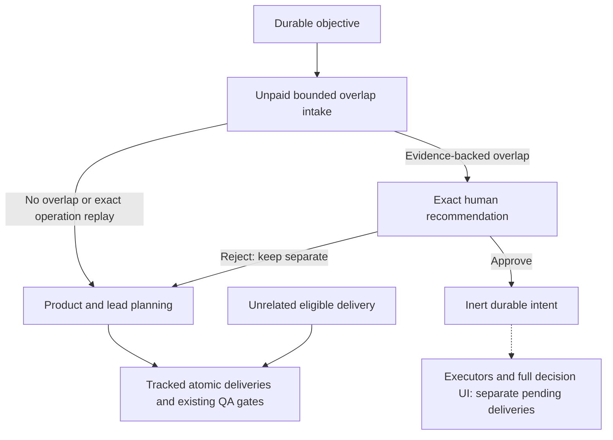

# Project coordination and learning

Claude's supported completed-stream rate-limit observations retain unified windows and an explicit `legacy-reported` window for scalar utilization. Legacy duration and missing reset deadlines remain unknown; zero usage is an actual observation. Observations use completion-read time, not inferred live-event time. Credit/API balances never become subscription quota. Expired or malformed windows cannot refresh allowance; persisted observation timestamps age independently of token accounting.

The [current capability map](current-status.md) and [95-issue audit](issue-audit-2026-10-15.md) distinguish implemented foundations from unfinished integrations.

MALT is an MCP server used by independent Claude and Codex sessions. Its own source repository is not the project those sessions are delivering. The session's workspace selects the team, its local `.malt` directory, its GitHub Project connection and its skill library.

## What is implemented

The prepared capacity/model-policy/intake batch is in [Stack #251](https://github.com/Division4Studios/malt/stack/251), pending operator merge and matching deployment. Unpaid intake inspects native/local behavioral overlap before new planning/provisioning, reuses interrupted operation identities, and parks only scopes that need human disposition. Exact human decisions use the paired owner capability; agents can propose but cannot decide. Approval is an inert intent until the separately tracked executors exist.



The intake queue does not close tickets or modify skills. Native/local revisions are checked again at human decision time; a changed scope becomes stale. Running assignments retain frozen context, fresh relevant assignments receive at most ten compact durable notices, and full private corpus/history stays in `.malt`. See the [API contract and remaining boundaries](api.md#supervisor-overlap-intake).

- Durable workspace-local conversations, identities, assignments and event history, with a generated `.malt/README.md`.
- Workspace-scoped MCP tools for connecting GitHub Projects, creating native parent/sub-issues, setting delivery statuses and caching board snapshots.
- Durable lessons, GitHub discovery and commit-pinned source snapshots.
- Reviewed skill proposals, independent lead review and human-approved activation, replacement and retirement with preserved history.
- Managed references in project `AGENTS.md` and `CLAUDE.md`, so both providers discover the same `.malt/skills` library.
- A `learning-steward` participation prompt for an independent side session.

Managed provider launching, transactional claims, worktree automation, independent QA/PR gates, merge serialization and merged-main verification have connected integration coverage using real local Git/checks with fixture inference and GitHub. Both native subscription interfaces have passed bounded structured-response smokes; a complete live protected-board run remains unvalidated. Setting a board value manually still does not establish a verified delivery. See [Operator console](operator-console.md) for startup, model routing, resource limits and human-approved project-local skill overrides.

The operator explicitly selected this source repository and [Project 10](https://github.com/users/Division4Studios/projects/10) for a self-improvement pilot. [PR #11](https://github.com/Division4Studios/malt/pull/11) added only private-memory Git exclusions. Real subscription sessions completed product planning, lead review, development, two independent QA assignments, final approval and verification of actual merged main. Native child #10 and parent #9 were closed and their board states reconciled to Done. The source checkout's existing uncommitted implementation was preserved. That historical private-repository pilot used an operator-approved `requireBranchProtection: false` exception. The repository is now public; inspect current protections and the documented temporary solo-maintainer review exception rather than treating the pilot setting as current or global. This proves a narrow live delivery, not completion or publication of the whole factory implementation.

## Project-local layout

```text
project/
  AGENTS.md                         existing instructions + managed MALT reference
  CLAUDE.md                         existing instructions + managed MALT reference
  .malt/
    README.md                       generated public state overview
    .gitignore                      excludes private runtime artifacts
    config.json                     local broker credentials
    identities/                     durable bridge credentials
    state/mesh.db                   conversations, events, presence, work decisions
    teams/<slug>.json               routing references only, in the broker home
    github/
      connection.json               repository, owner, project and workflow field
      project-creation.json          explicit Project-creation checkpoint
      board.json                    bounded remote snapshot and completeness
      operations/<requestId>.json   checkpointed issue creation and attachment
    knowledge/
      lessons/                      observed outcomes, causes and prevention
      research/                     search results and retrieval timestamps
      sources/                      commit-pinned content and license metadata
      candidates/                   immutable tailored skill proposals and reviews
      adoptions/                    adoption/retirement audit records
    skills/
      README.md                     active/retired skill discovery index
      manifest.json                 authoritative active revision per skill
      <name>/<revision>/SKILL.md     retained skill versions
```

The broker keeps a small routing index to reopen teams; conversations and workspace secrets are not stored centrally. A workspace must already exist and be accessible. MALT creates `.malt`, not phantom project folders. Opening the broker's own home workspace reuses its existing store.

The generated README updates after committed state changes and includes public agent presence, unread messages, pending requests, GitHub connection, learning counts and active skills. A failed README refresh cannot roll back a committed message or make its sender resend it. Runtime data is ignored by Git; selectively publish only reviewed non-secret project artifacts. Back up the whole `.malt` directory after clean broker shutdown.

## Connect the target project's GitHub Project

On a native broker, install an up-to-date [GitHub CLI](https://cli.github.com/) and authenticate it with access to the target repository and write access to Projects. Authentication stays with `gh`; `.malt` stores no GitHub token.

Once joined as this workspace's lead, inspect `mesh_github_status`, then call:

```json
{
  "repository": "your-owner/your-app",
  "owner": "your-project-owner",
  "projectNumber": 12
}
```

Use this input with `mesh_github_connect`. Repository and Project owners can differ. To explicitly create a Project, omit `projectNumber` and supply `createProject: true` and optionally `title`. Creation is never inferred from a missing connection. Setup verifies access, links the repository and creates an **MALT Status** single-select field with these options:

`Backlog → Ready → Development → QA / Review → Merge Ready → Final Verification → Done`, plus `Blocked`.

Existing Project fields are preserved. To reuse an existing workflow field, add `statusFieldName: "Status"` (or its exact name) to the connection input. It must already contain all eight required options; a missing field or missing options fails clearly instead of creating a duplicate or overwriting it. Without an explicit selection, setup reuses MALT Status or legacy MLT Status, or creates MALT Status. Group a GitHub board view by the selected field to display these columns; MCP field setup does not currently change the project's saved view layout. In the operator console, **Configure connection** shows labelled fields for the repository, an existing GitHub Project URL (`https://github.com/users/OWNER/projects/N` or `/orgs/OWNER/projects/N`) and the workflow field, prefilled from the saved connection. Owner and number are derived from the URL, which must be https on github.com without port, credentials, query or fragment; it never creates a Project.

The integration uses GitHub's [Projects API](https://docs.github.com/en/issues/planning-and-tracking-with-projects/automating-your-project/using-the-api-to-manage-projects).

Board reads use native cursor pagination, at most 100 items per request, with only the content and single-select values needed for coordination. The selected field's ID determines the workflow value even when names overlap. Automatic Ready imports reuse sufficient, connection-matched snapshots for at most two minutes; explicit `github_sync` reads are fresh by default. Snapshot completeness and fetch time are retained. PR, head/base, check and merge gates always inspect current evidence rather than using this board cache.

Create a parent with `mesh_github_create_issue`:

```json
{
  "requestId": "feature-checkout",
  "kind": "feature",
  "title": "Checkout supports saved addresses",
  "description": "Define the observable outcome and boundaries with the product owner.",
  "acceptanceCriteria": ["A returning customer can select a saved address."]
}
```

Create each atomic delivery with its own stable `requestId`, `kind: "delivery"`, the parent issue number in `parent`, a focused scope and explicit acceptance criteria. Native sub-issue linkage and board attachment are checkpointed. The lead moves work through `mesh_github_set_status` and refreshes remote data through `mesh_github_sync`.

The managed supervisor additionally reconciles the reviewed plan's blocking dependencies through GitHub's native [issue dependency API](https://docs.github.com/en/rest/issues/issue-dependencies). It uses native database IDs, preserves existing user edges and reads actual relationships before retrying an ambiguous mutation. Unsupported APIs or missing write permissions leave provisioning blocked; they do not silently drop the dependency. Local dependency gates still control dispatch.

`github_sync` returns `totalCount` and `complete`; a truncated snapshot never claims to represent the entire board. It is an explicit pull, not a webhook subscription or automatic bidirectional scheduler.

### Interrupted operations

Reuse the same request ID for the same issue intent. An ID cannot be reused for changed input or another connection. A successful retry returns the existing issue. When issue creation may have succeeded but its response was lost, MALT refuses a second creation. `mesh_github_sync` scans the repository's actual issue pages for the project's unique marker and repairs known progress. Then retry the original request. If no single matching issue is visible, the journal remains unresolved; absence is not proof that creation failed.

Interrupted attachment or native parent linking resumes from saved issue details, checking prior remote linkage before retrying. An ambiguous Project creation also refuses blind retry; identify the created Project and reconnect with its existing number. Pending issue operations must be reconciled before switching a connection. This is durable coordination, not a claim of an atomic transaction spanning GitHub and SQLite.

## The learning steward

Open an independent model session in the target project and invoke `/mcp__agentmesh__learning-steward`, or explicitly join with role `learning-steward` and follow that participation routine. It participates beside delivery workers. It neither fixes QA defects nor merges code.

Its loop is:

1. Read project context, event history, recorded lessons and current skills.
2. Identify recurring defects, stale reviews, returned tickets, failed checks and successful fixes. Record evidence, root cause and a concrete prevention rule through `mesh_learning_record`.
3. Search for resources relevant to the project's actual stack, tests, failure modes and delivery standards through `mesh_learning_search`.
4. Inspect individual files through `mesh_learning_read_source`. MALT pins content to the latest commit touching that file, records provenance and repository-level license metadata, and stores the source as untrusted reference material. Check file-specific licenses separately.
5. Review relevance, compatibility, maintenance, dependencies, license, security and concrete validation. Rewrite concise project-specific instructions instead of copying a whole collection.
6. Propose a skill using `mesh_learning_propose_skill`, referencing stored sources or observed lessons and providing all four review findings: relevance, license, security and validation.
7. Send the proposal to the lead for independent review. A successful review moves the exact revision to `awaiting_operator`. The human compares current and proposed instructions in the PWA Learning view and approves or rejects through `factory_skill_decide`. Managed agents cannot activate or retire skills themselves. Approved overrides are stored as `.malt/skills/<name>/<revision>/SKILL.md`, supersede bundled defaults in new assignments, and are broadcast to the team. Rejection preserves the existing version.
8. Revisit standards when the stack, architecture or recurring mistakes change. Retain historical evidence and versions instead of deleting the learning trail.

Research starting points include the requested [GitHub cheat sheet](https://github.com/tiimgreen/github-cheat-sheet), the [Agent Skills specification](https://agentskills.io/specification), [Anthropic's skills](https://github.com/anthropics/skills) and [awesome skill collections](https://github.com/VoltAgent/awesome-agent-skills). The cheat sheet is a Git/GitHub reference; catalogs are discovery sources. Neither stars nor a recent update proves that a skill is appropriate or safe for this project. Sources are not endorsements, and downloaded scripts are never executed by these tools.

MALT retains operational memory and changes the guidance agents retrieve. It does not train model weights. Its skill-review fields record the agents' findings; they are not an automatic security scanner or proof that tests actually ran. The independent lead checks the evidence before a separate human decision approves adoption.

### Claude and Codex discovery

On `init`, `start`, or first workspace creation, MALT adds or refreshes one marked block in `AGENTS.md` and `CLAUDE.md`, preserving all other instructions. It points both providers to `.malt/README.md`, `.malt/skills/README.md`, `mesh_learning_status` and `mesh_learning_read_skill`. The manifest selects the active revision; archived or proposed versions are not loaded implicitly. These files remain project-local; no global provider configuration changes.

Sessions already running may need to read the updated discovery files explicitly. MCP tools provide the current library without depending on whether a host automatically scans hidden skill directories. The library does not itself install dependencies, MCP servers or executable tooling. Changes to project dependencies or tools still belong in a small delivery ticket with tests and review.

## Intended factory team and gates

| Role                                  | Responsibility                                                                    | Human contact                           |
| ------------------------------------- | --------------------------------------------------------------------------------- | --------------------------------------- |
| Product owner                         | Refine outcomes and acceptance criteria with the user and lead                    | Product questions                       |
| Team lead                             | Split parents, coordinate dependencies, assign work and maintain states           | Exceptional scope blockers              |
| Developer 1 / 2                       | Implement focused deliveries in separate worktrees; fix returned defects          | Through lead                            |
| QA / reviewer 1 / 2                   | Independently test and review the current PR head; send evidence to its developer | Through lead                            |
| Final tester / merger / scrum manager | Verify end to end, serialize merge, broadcast updated main and reconcile tickets  | Final outcomes and exceptional blockers |
| Learning steward                      | Study evolution, research resources, tailor and prune reviewed guidance           | Through lead                            |

The managed supervisor verifies the repository/GitHub connection before dispatch, claims dependency-ready atomic deliveries transactionally, launches bounded native provider jobs, and preserves compact project-local assignments. Two independent reviews cover the exact PR head and base; rejection returns work to its original developer. Final integration checks and GitHub's actual protected-branch requirements gate an expected-head merge. Confirmed merges are broadcast; actual merged-main verification precedes child and parent closure. Worktree cleanup preserves dirty or newer work and source history.

### Atomic planning and PR size

The product/lead `factory-product` skill targets **1–500 changed text lines per PR**, including additions and deletions in tests and documentation. Every child includes a narrow observable outcome, exclusions, acceptance/regression checks, estimated diff range and merge safety. Large features may have 20+ children; the validated plan and provider output schema allow up to 100. Larger outcomes need separately scoped parents, not silently omitted children. Ticket count is not a target: preserve meaningful behavior, readable code and testing.

Independent children have no blocking dependencies. Genuine chains name the actual prerequisite contracts; dependent implementation waits until those deliveries are done, including merged-main verification. Compatible scaffolding and expand/migrate/contract steps keep main usable at each merge. This is ordered delivery from current main, not stacked PR support.

New factory configurations default to a hard `maxDiffLines: 500` publication ceiling. Existing explicit policies are preserved (this source project's current ceiling is 700). The 500-line planning target still applies: the lead must split oversized scopes or describe why an indivisible exception, with an estimate and review strategy, is necessary. Both product-owner and team-lead assignments receive the actual configured line and file ceilings in their deliveryLimits evidence, including limits below 500 lines. That explanation does not bypass the configured ceiling. Changes exceeding it require rescoping, an operator-approved exception bound to one validated head/base pair, or an explicit project-policy change while paused. A size exception resumes publication without replaying a paid implementation turn; new edits or advancing main invalidate it. See [size exceptions](operator-console.md#one-delivery-size-exceptions). Existing active assignments retain their frozen context; updated skills and durable operator guidance apply to subsequent assignments.

Cooperative attached MCP sessions use check-in/wait; managed factory jobs instead finish one bounded assignment and exit. The unpaid supervisor waits and starts the next eligible role. Subscription-only scheduling defaults to `budgetTokens: null`, so diagnostic token counts do not use API credits or block dispatch. Positive numeric caps remain optional policy; previously persisted numeric values stay in force until changed, with no saved-settings migration. Actual subscription quota stays unknown without supported telemetry; observed 100% usage and verified cooldowns prevent dispatch, and concurrency, CPU, memory and process ceilings remain enforced. Broker-wide concurrency admission and critical memory stops are documented in [Mission control](operator-console.md#resource-admission-and-cancellation).

When a code-writing step's agent succeeds but the supervisor's own work afterwards fails, the job says exactly where. The steps are commit, main refresh, validation and publication. The failure is written to the job's private `failure.json` (readable in Workers & terminals) with the step, the agent's outcome, the typed publication reason and, for a failed Git or other command, its family and subcommand (such as `git push`), exit code or timeout, and a redacted stderr tail of at most 4,000 characters; the broker token, known provider and GitHub credentials, token shapes and credentials in URLs are redacted. The handoff reason names the step, for example "The agent finished, but the supervisor's validation step failed: …". A publication with nothing new names one of three reasons: `nothing_to_commit` (the agent changed no file and the branch has no commits of its own), `already_merged` (every branch commit is already on main) or `empty_diff` (the branch's commits change nothing against current main); `over_limit` is the size gate above. Public GitHub comments keep their public-safe text; stderr never leaves the job's private artifacts.

Regression evidence covers the connected loop with real local Git/worktrees and validation commands, fixture inference/GitHub, ambiguous publication/creation recovery, independent QA rejection, native protected-review gates and retried parent closure. Windows tests execute actual owned-descendant cancellation and hard process-count ceilings. Durable instructions, restart recovery, advancing-main invalidation and post-merge repair with dirty-work preservation are covered. Docker smoke verifies the PWA control path and MCP persistence across recreation; native provider executables are included. Approved reusable learning can be exported idempotently to a separate source factory with human authorization and its own setup; no hot patch or implicit board creation occurs. A complete browser installation/offline/update/accessibility audit and complete live protected-board delivery remain unverified.

### Typed step outputs

Every typed step output carries `schemaVersion` (currently 1; records saved before the field existed read as version 1) and is bound to the source it judged or produced. Review findings, fix dispositions, documentation and regression results bind the exact head and base. Planning reviews and revisions record their verdict and dispositions on the objective. Each specification, plan and revision also appends a `planOutputs` record naming its step, role, attempt, the number of deliveries it produced and the exact source commit the attempt was sealed to, so later steps can tell what changed on main since the plan was made.

### Brief revalidation for bound predecessors

A plan is made against one version of main. When `briefRevalidation` is `true` in the factory policy (default `false`), a delivery with dependencies does not start implementation the moment its predecessors finish. The team lead first rechecks its brief on current main, using the small capability tier: evidence names each predecessor with its merge commit and merged summary, plus the source the plan was made against. A confirmed brief is recorded on the delivery, bound to the exact main the lead read and to the predecessor merges it judged, and implementation starts. A brief that no longer holds stops the delivery as blocked, with the lead's findings and proposed brief edits as its reason; the operator retries it unchanged (`factory_retry`) or replans its scope through an operator instruction. Each delivery is revalidated once per set of predecessor merges, deliveries without dependencies are never revalidated, and failed revalidation attempts follow the normal per-class retry backoff.

### Protected-branch merge path

Local QA approvals cannot satisfy GitHub's protected-branch review rules, so final testing does not wait on GitHub approval or a `CLEAN` merge state. It still waits, unpaid, on a closed, draft or stale PR, another base, conflicts, a branch behind its base, a merge state GitHub is still computing, requested changes, and failing or pending checks, each named in the gate reason. A delivery entering `merge_ready` carries a provisional gate reason until the reconcile pass has inspected its PR, so no final tester starts before that inspection.

After the final check, the unpaid merge step reads the repository's merge settings, the effective rulesets for the base branch (`rules/branches/<base>`) and classic branch protection when the token may read it. It picks the first allowed method of squash, rebase and merge (no merge commits under linear history), then:

- merges the exact reviewed head when nothing is pending;
- enqueues it in the merge queue when the base branch uses one;
- arms GitHub auto-merge when reviews or required checks are still pending and the repository allows auto-merge;
- otherwise waits with a precise reason, such as "PR #12 is awaiting 1 approving review. Auto-merge is off for this repository, so a maintainer merges it once that is done, or enables auto-merge in the repository settings."

While it waits, the delivery stays in `merging` with that reason and no paid run. When GitHub merges the PR, the next reconcile pass adopts the merge and verifies main. Every merge or auto-merge call carries `--match-head-commit` with the reviewed head and never `--admin`; MALT never changes protection. If the head or base moves, or a check fails, while auto-merge is armed, the supervisor turns auto-merge off before the delivery is reworked, so an unreviewed head is never merged.

### CI-failure and merge-conflict repair

A delivery whose pull request fails a check on its exact head does not wait for a human by default. Once every check on that head has finished, the unpaid supervisor reads the failed GitHub Actions job logs through `gh` (at most five checks per round, keeping the final 1 MiB of each log). It strips terminal control codes and timestamps, and redacts the mesh token, known provider credentials, common token shapes, `Bearer` values and URL credentials. Each log is cut to the lines around its first error plus its final lines, at most 6,000 characters. The round returns the delivery to its original developer with those findings bound to the failing head. New source then needs fresh reviews and the project's checks, exactly like other rework. Pending checks never start a round. Cancelled, skipped and neutral checks never count as failures, so a run cancelled because a newer one superseded it cannot start one. Checks from other CI providers produce a finding with the check name and link but no log. Public issue comments name only the failed checks; log text stays private.

A refresh onto current main that conflicts, either while publishing or while preparing the next attempt, starts a merge-conflict round. Publication aborts the failed merge, so the delivery's committed work stays on its branch. The next attempt starts with the conflicts in its worktree. Its evidence names each conflicted path and the recent commits on both sides that touched it. Prepare commands are skipped while conflicts remain. Publication refuses a merge whose changed paths still contain conflict markers, then reruns the project's checks on the resolved merge.

Each round's key names its kind, the failing source and the failure, so the same failure on the same source never starts a second round. If a repair republishes the failing source unchanged, the delivery stops instead. `repair.maxCiRepairs` and `repair.maxConflictRepairs` (default 2 each, at most 10) cap rounds per delivery. Past a cap the delivery is blocked with the reason for the operator; retrying it starts the caps and the extra attempts afresh, while earlier rounds stay in its history. Every round grants the developer one attempt beyond `maxAttempts`, so a repair never exhausts the ordinary rework budget. CI and conflict rounds go to the developer even in workflows with a fix step: the fixer rules on review findings, and the reviews that follow the repair feed it as usual. The delivery view lists the latest four rounds with their redacted evidence.

## Docker and legacy storage

Docker now uses host bind mounts. Set `AGENTMESH_HOME_ROOT` to a writable broker-home folder and `AGENTMESH_WORKSPACE_ROOT` to an absolute host folder containing the projects. Compose maps that host workspace root to `/workspaces`; the broker rejects paths outside it. Windows paths reported by Claude or the Codex launcher are translated through this mapping. Add another mount and mapping strategy before serving unrelated host roots, or use a native broker for arbitrary accessible folders.

The image includes Git, the official GitHub CLI and pinned native Codex/Claude executables. Supply `AGENTMESH_GITHUB_TOKEN` through the environment for Docker GitHub operations, or authenticate `gh` inside the private provider-home volume. Environment tokens are passed as `GH_TOKEN`, not saved in `.malt`. Native mode uses the host's existing authentication. Both setups require repository access and Project write permission. See [container setup](operator-console.md#docker-startup-and-provider-authentication); installing the PWA alone does not install the daemon or authenticate providers.

Old `.agentmesh` directories are moved as whole stopped stores into `.malt`, preserving credentials and SQLite history. Old centrally stored workspace teams relocate on the next workspace open. Migration refuses leftover WAL/SHM files or an existing destination instead of combining or dropping stores. Stop the old broker cleanly first; an unclean database may need recovery and checkpointing with the old broker before migration.

An old Docker named volume is not mounted by the new Compose file. Preserve it, stop the old container, and explicitly copy its stopped `.agentmesh` directory into the new broker-home bind mount before starting this version. Keep that volume until migration and history are verified. Do not run old and new brokers against the same store. Docker `down --volumes` does not erase new host bind-mounted project data.

## Managed agent permissions on Windows

Windows elevation and model tool approvals are separate. Ordinary project work does not require an administrator terminal. MALT starts owned subprocesses under the broker's existing OS identity; it never invokes UAC or automatically elevates. OS-denied operations remain blockers. Unattended approval does not grant administrator privileges or override provider-managed policies.

Each provider accepts `developerAccess: "workspace"` (default) or `developerAccess: "full-access"` in `factory_setup` settings. Workspace Codex developers use `workspace-write`, network access and `approval_policy="never"`. Workspace Claude developers use `dontAsk` with explicit Read/Write/Edit/Glob/Grep/Bash allow rules. Unallowed actions fail instead of waiting for interactive approval. Full-access developers use Codex `danger-full-access` with approvals disabled, or Claude `bypassPermissions`. Full access permits operations outside the worktree under the broker's OS identity; configure it deliberately for trusted projects.

Review and planning roles retain Codex read-only or Claude read-only tool lists with `dontAsk`, regardless of developer settings. Permission settings do not remove ownership, resource or protected-merge gates. Launch regression tests use fixtures without paid model turns.

Managed Codex launches explicitly trust the owned assignment directory and approve the scoped MALT MCP tools while retaining `approval_policy="never"`. Windows defaults to `windowsSandbox: "unelevated"` and `preferMxc: true`; supported MXC isolation is preferred, with the configured legacy mode as fallback. These modes have different OS guarantees. A local probe found that legacy isolation did not reliably deny writes, so do not treat that fallback as a hard filesystem boundary. Review snapshots are also checked for unexpected edits before their results are accepted.

Planning and review jobs receive `mesh_factory_read_source` for bounded, authenticated inspection of their sealed Git commit, including a supplied base revision. It excludes private runtime paths and does not provide a shell or accept arbitrary revisions. This allows inspection when native read commands are denied without granting reviewers developer access.

Developers also receive a sealed view of the committed source at assignment start. It does not reflect their later uncommitted edits; native tools and supervisor checks still inspect those edits. An unavailable base revision is reported explicitly. Managed Claude environments disable provider auto-memory, background tasks, cron, agent view and bundled lifecycle skills, so MALT restores focused context from `.malt` instead of an unrelated provider memory directory. Subscription credentials remain in their supported store. See [Claude environment controls](https://code.claude.com/docs/en/env-vars).

`requireBranchProtection` defaults to `true`. An operator may explicitly set it to `false` for a private-repository pilot whose GitHub plan cannot enable protections. This exception retains both independent QA approvals, final verification, current head/base checks, expected-head merging and any actual GitHub rules. It never uses administrator bypass. Such a pilot demonstrates local merge gates, not GitHub protected-branch enforcement.

```json
{
  "providers": {
    "codex": { "executable": "codex", "developerAccess": "full-access" },
    "claude": { "executable": "claude", "developerAccess": "full-access" }
  }
}
```

This is a settings fragment: also supply the selected target project's validation commands and verified GitHub connection. See the [Codex CLI reference](https://learn.chatgpt.com/docs/cli/reference) and [Claude permissions documentation](https://code.claude.com/docs/en/permissions).

## Local console workspace selection

The operator console displays the actual selected project's `.malt` path. Disposable validation workspaces may live under the OS temporary directory, but normal use should initialize and start the broker in the selected repository:

```powershell
node src/cli.ts start --project "C:\work\malt" --port 4319
# In another terminal:
node src/cli.ts ui --project "C:\work\malt" --port 4318
```

For another delivery repository, select/open that repository in the console. Its operational state is stored in its own `.malt`, not in the broker-home repository. The MALT source repository is not automatically connected to a GitHub delivery board. Subscription credentials remain in provider-supported credential stores.

## Bundled baseline upgrades

Configured projects reconcile bundled lifecycle guidance before the first execution context of each broker lifetime. `.malt/skills/builtin-index.json` records exact ownership hashes. An unchanged managed skill can receive the distribution's new revision; its previous text is retained under `skills/builtin-history/<hash>/`. Already-frozen assignments keep their original prompt and hash evidence.

A manually edited file or an older index without a matching ownership receipt is preserved and listed in `conflicts`. The Learning view surfaces this condition. Adopt intentional edits through the independently reviewed, human-approved project skill library, or explicitly reconcile the baseline after inspection. MALT does not silently claim ownership of unknown local changes. Active project overrides continue to take precedence over the upgraded baseline.

## Scope changes and obsolete work

A coordinated scope change is committed with its durable instruction and replacement objective in one SQLite transaction. Project-wide changes park old planning requests and every unfinished, unmerged delivery; selected changes also park dependent deliveries transitively. `scopeReplacement` links the parked record to the new product-owner/lead objective. Old approvals are invalidated, while completed proof and verification of already-merged code are retained. Ordinary retry cannot re-enable a superseded scope. Worktrees and source history are preserved for the replacement plan to inspect.

Superseded child deliveries reconcile through stable outbox identities: explanatory comments, same-head open-PR closure, issue closure with `not_planned`, then owned-source retirement. Remote receipts precede cleanup; dirty or newer worktrees and source history are retained. Parked work is not represented as delivered. Superseded parents wait for settled local children and closed actual native children before checkpointed `not_planned` closure. When GitHub completes a merge during scope replacement, retained exact-head/base QA and final evidence from a historical merging revision restore actual-main verification; obsolete pending close effects are retired with audit events. An unexpected merge without that proof preserves its actual commit and blocks for investigation. Changed PR heads remain gated rather than deleting their source.

## Assignment liveness and retries

A managed assignment is no longer stopped by one blind deadline. `jobTimeoutMs` is the **checkpoint interval**. Between checkpoints the unpaid supervisor samples progress signals it already owns, every `liveness.sampleMs`: the attempt's own provider stream (`stdout.log`), the owned worktree's HEAD, status and tracked diff for code-editing steps, and `mesh_factory_progress` check-ins. At each checkpoint it extends an assignment that made meaningful progress within `liveness.stallMs` by one more interval, and stops one that stalled or reached the hard `liveness.maxMs` ceiling, measured from the attempt's start. The provider process bound is the ceiling plus one minute, so the supervisor always stops first with its own reason.

Only **meaningful** events count as progress: completed tool and check calls (a failed test run still completed), provider-reported file changes, commits, tracked edits and developer check-ins. Thinking, assistant prose, usage reports, heartbeats, repeated identical completions and raw log growth do not. A provider that stops for a permission it was not granted, an `AskUserQuestion`, or a Codex approval request is recorded as **awaiting input**, never as progressing. The stream is decoded incrementally with the transcript viewer's own decoders: at most 4 MiB per sample, partial lines are carried to the next read and lines over 1 MiB are skipped without being held.

Without explicit settings, `stallMs` defaults to the smaller of 15 minutes and the interval, `maxMs` to the larger of two hours and the interval, and `sampleMs` to the smaller of one minute and the interval. An assignment that shows no progress therefore still stops at its first checkpoint, exactly as before; only productive ones are extended, within the ceiling. Saved configurations parse unchanged. Each attempt records `liveness` (`state`, `extensions`, `lastProgressAt`, `lastSignal`, `awaiting`, `nextCheckpointAt`, `ceilingAt`, `stopReason`), and a stopped attempt's handoff reason reads `stalled N min` or `hard ceiling`. Cancellation, pause, shutdown, invalidated assignments and operator instructions still abort immediately, and cleanup touches only the owned process tree.

Every settled attempt that did not succeed also records a `failureClass`. The scheduler waits a class-specific delay before offering the same step again, doubling it for consecutive failures of the same class, and stops offering the step once the class cap is reached so no paid turn repeats the same failure:

| Class            | Meaning                                        | First delay      | Longest delay | Cap  |
| ---------------- | ---------------------------------------------- | ---------------- | ------------- | ---- |
| `rate_limit`     | Provider cooldown or limit text                | 1 min            | 15 min        | 6    |
| `transient`      | Process, network or other unexpected failure   | 30 s             | 10 min        | 5    |
| `stalled`        | Stopped at a checkpoint: stalled or ceiling    | 5 min            | 30 min        | 3    |
| `invalid_output` | The provider ran but returned no usable result | 2 min            | 10 min        | 3    |
| `gate`           | An unpaid gate parked the attempt              | Reconcile period | —             | none |
| `cancelled`      | Operator, pause or shutdown interruption       | none             | —             | none |

A new head, a different step or a success resets the count. Attempts saved before classification keep the earlier rule: a failure waits one reconcile interval and an interruption retries at once. The delivery detail shows a running attempt's liveness and a step's retry backoff, or that it is out of automatic retries; the attempts view shows each attempt's liveness and failure class.

## Bounded parallel objectives

The unpaid supervisor can overlap development for independent objectives and product planning for a queued objective while another is developing. Logical roles remain exclusive; owned worktrees isolate developers. Effective broker-wide job/provider caps, resource pressure, cooldowns and dependency gates still govern admission. With a single job slot, a successor waits until the entire previous pipeline releases its reservation; a completed model response alone does not release it. Default provider concurrency is two and default local limits remain configurable; this does not create extra execution seats.

`test/factory-parallel.test.ts` drives explicit supervisor passes over disposable real Git repositories/worktrees with deferred injected inference, fixture GitHub and controlled OS counters. It proves developer/developer and developer/product overlap, repeated-pass claim uniqueness, one-slot release ordering and CPU/cooldown recovery. These tests start no provider process or paid turn and clean up their own stores, worktrees and pending fixture assignments. They complement cross-project admission tests rather than certifying live provider concurrency or bypassing review gates.
