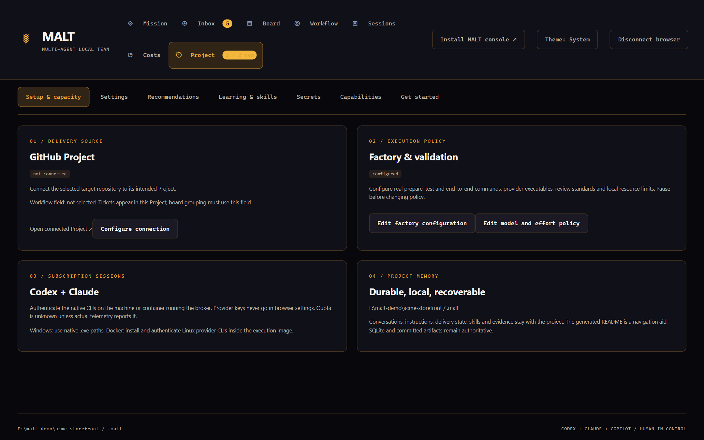
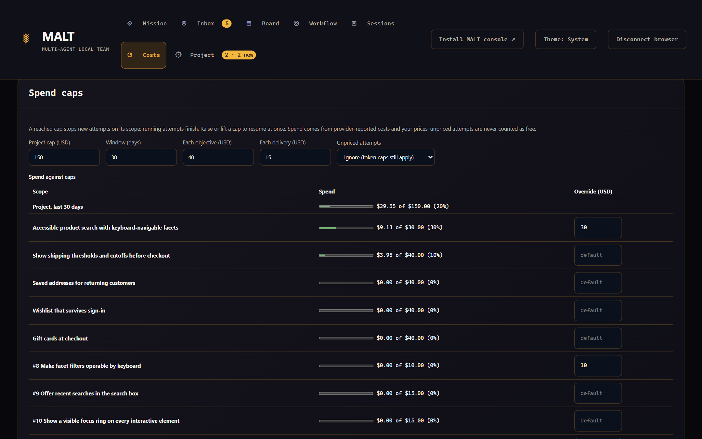
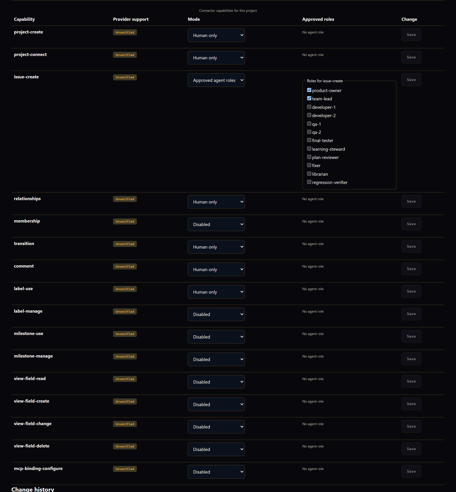
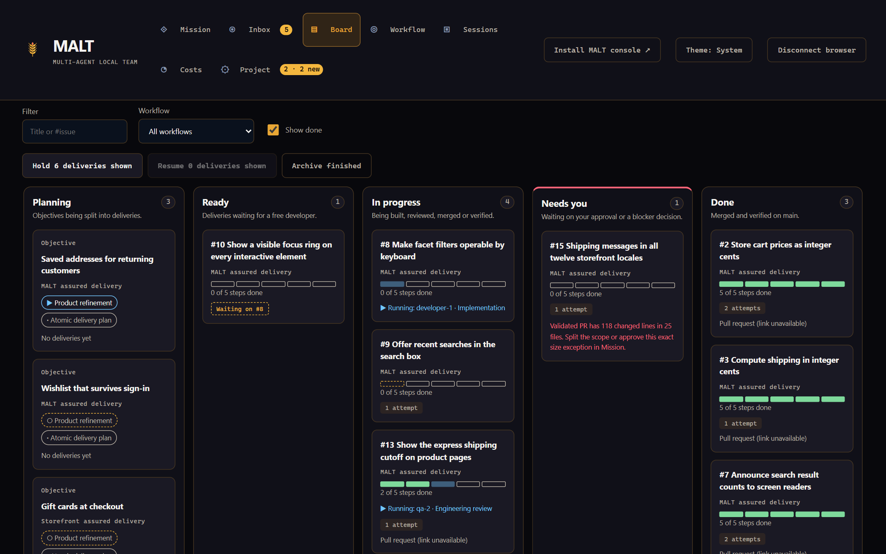
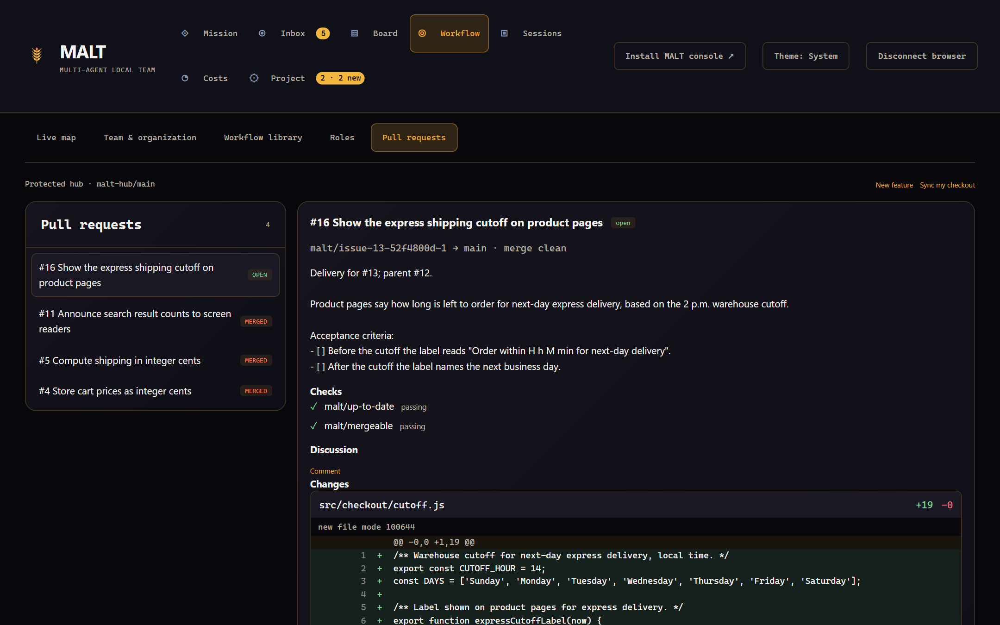
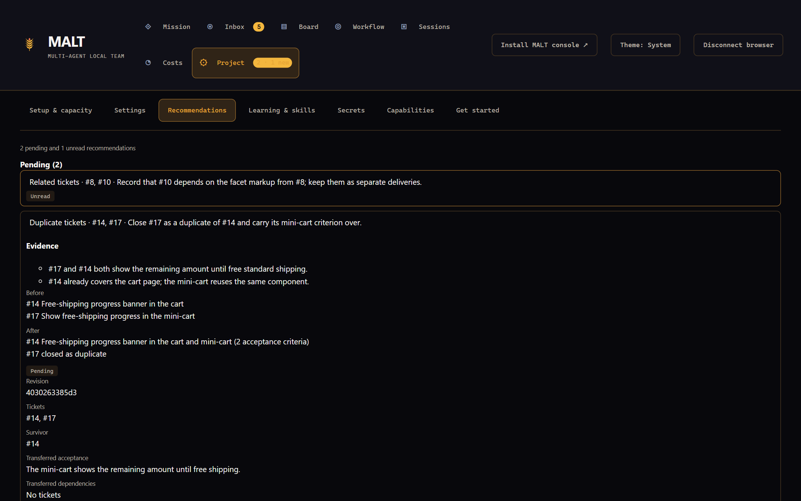
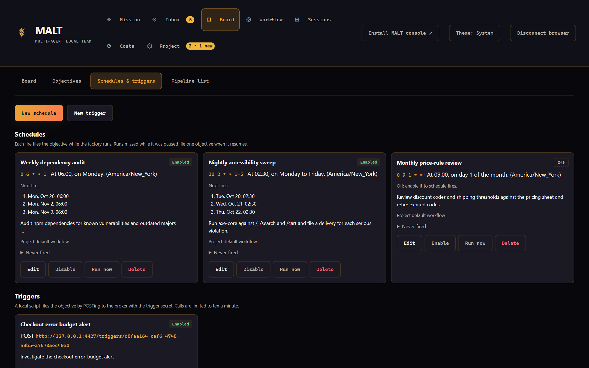

# Use MALT on your own project

This guide takes you from an existing repository to MALT's agent team delivering reviewed, merged and verified changes to it. It assumes you have never run MALT before. Read it once from start to finish before you point MALT at a repository you care about. If you only want to see MALT run on a throwaway project first, follow [Getting started](getting-started.md).


MALT is pre-1.0. It runs real subscription CLIs with the permissions you grant on your machine. The limits that still apply are listed in [Known limits before 1.0](#known-limits-before-10).

## Terms used in this guide

| Term               | Meaning                                                                                                                                            |
| ------------------ | -------------------------------------------------------------------------------------------------------------------------------------------------- |
| **Broker**         | The local service that owns the project's SQLite state, coordination and the supervisor.                                                           |
| **Console**        | The paired browser app (an installable PWA) at `http://127.0.0.1:4318/`.                                                                           |
| **Supervisor**     | The unpaid scheduler inside the broker. It starts one bounded model assignment at a time per role and runs checks, merges and verification itself. |
| **Factory policy** | The project's validated configuration: commands, delivery mode, providers, limits and gates. It is saved in `.malt/factory/config.json`.           |
| **Objective**      | An outcome you ask for, such as "Customers can save a delivery address". It is planned into deliveries.                                            |
| **Delivery**       | One atomic, independently mergeable change with acceptance criteria. It becomes one issue, one branch, one owned worktree and one pull request.    |
| **Role**           | A managed seat such as `product-owner`, `team-lead`, `developer-1`, `qa-1` or `final-tester`. A role runs no process while idle.                   |
| **Attempt**        | One run of one provider CLI for one step of one delivery or objective. It ends when the step is done.                                              |
| **Workflow**       | The ordered steps an objective and its deliveries go through. Five are built in; see [Choose a workflow](#choose-a-workflow).                      |
| **Delivery mode**  | Where issues, pull requests and merges live: GitHub, or the local hub inside `.malt/`.                                                             |

## Check that your project fits

MALT fits a repository where:

- the work can be split into small changes that each leave main usable;
- tests, lint and build run from the command line without prompts, accounts or a display;
- a failing check means the change is wrong, not that the environment is flaky;
- you can review pull requests yourself, at least while you build trust.

It fits less well when every change needs manual QA on hardware, when checks need production credentials, or when main is regularly red.

Before you use it on a real repository:

1. **Try a disposable repository first.** Clone or copy a small project, or create a new one with a few tests. Run one objective end to end there. You will see every gate, blocker and screen without risk.
2. **Review the permissions you grant.** Managed developers run with the provider CLI's workspace sandbox by default (`developerAccess: "workspace"`). Review and planning roles are read-only. `"full-access"` lets a developer act outside its worktree as your OS user; use it only for trusted projects. The prepare, test and end-to-end commands you configure run as your OS user in every owned worktree. See [managed agent permissions](software-factory.md#managed-agent-permissions).
3. **Use subscription logins only.** Managed jobs use the Claude Code, Codex and Copilot CLIs on your subscription. MALT strips API-key variables from their environment and never falls back to API billing.

## Prepare the repository

### Start from a clean main

MALT branches every delivery from your base branch (default `main`) and merges back into it. Before you start:

1. Commit or stash local work. Agents work in their own worktrees, but **Sync my checkout** (local mode) and your own merges need a clean checkout.
2. Make sure main is green: run your tests, lint and build on main and fix any failure. MALT records main's test results (see [the main baseline](#the-zero-model-preflight-and-the-main-baseline)), but a red main slows every review.
3. Remove anything secret from tracked files. Agents read the whole repository.

### Make checks run non-interactively

The factory policy needs at least one **test command** and one **end-to-end command**. **Prepare commands** are optional. Each command is an executable and its arguments, run without a shell:

```json
{ "file": "npm", "args": ["test"] }
```

Rules that follow from how MALT runs them:

- **No shell syntax.** `&&`, pipes, globs expanded by a shell and environment assignments do not work. Put compound steps in a script in your repository and run that script. On Windows, `npm` is run through its Node entry point; other tools need their `.exe` path or a name on `PATH`.
- **No prompts.** Commands get empty standard input. Anything that waits for input stalls until the checkpoint stops it.
- **Leave the checkout clean.** Review and verification run in a clean snapshot, and MALT rejects the result if `git status --porcelain --untracked-files=all` is not empty afterwards. Add build output, caches and reports to `.gitignore`.
- **Stay within the limits.** Each command is bounded by `jobTimeoutMs` and the per-job memory, CPU and process limits (see [Set safety limits](#set-safety-limits)).
- **Use project-local temporary data.** On POSIX, commands receive `TMPDIR=<project>/.malt/cache/validation-tmp`.

### How MALT uses each command

These are fields of `factoryConfigSchema` in `src/factory/schema.ts`.

| Field              | Required          | Where it runs                                                                                                                       |
| ------------------ | ----------------- | ----------------------------------------------------------------------------------------------------------------------------------- |
| `prepareCommands`  | No (default `[]`) | First, in every developer worktree and every review or verification snapshot. Use it to install dependencies, for example `npm ci`. |
| `testCommands`     | Yes, at least one | In the developer's worktree before publication, in each QA and regression review snapshot, and once per main head for the baseline. |
| `endToEndCommands` | Yes, at least one | In the final check on the exact reviewed head, and again on merged main during verification.                                        |

A failing command blocks that step with its exit code and a log in the attempt's private artifacts. It never counts as an approval.

### The zero-model preflight and the main baseline

Two unpaid checks protect your subscription:

- **Zero-model preflight.** Just before each paid model turn, the supervisor checks the exact environment the attempt will use: the sealed source view is readable, Git works in its checkout, and every test and end-to-end executable can be found. A failure stops the attempt before any model runs, refunds its reservation and shows one blocker naming the check, for example "the project check command npm cannot be started from this checkout".
- **Main baseline.** Once per main head, the supervisor runs your test commands on main in an immutable snapshot, in the background. Each assignment receives the result for its base, so failures that already exist on main are reported as known failures, not as defects of the delivery.

The console's **Project → Get started → Check this machine** runs the broader [`doctor`](#install-malt-and-check-the-machine) checks inside the broker.

### Add CI

MALT runs your checks itself, but keep a CI configuration that runs the same commands on every pull request:

- In GitHub mode, final testing waits until every check on the pull request's head has finished, and each name in `requiredChecks` must succeed. A failed check starts a [repair round](#repair-rounds) with the failed GitHub Actions log excerpts. Checks from other CI providers produce a finding with the check name and link, but no log.
- In local mode there is no hosted CI. The hub's built-in checks are `malt/up-to-date` and `malt/mergeable`; your configured commands already run on the exact head.

## Install MALT and check the machine

Requirements: Git, Node.js 24.15.0 or newer in the 24.x line, npm, and at least one of the Claude Code, Codex or GitHub Copilot CLIs logged in with your subscription. GitHub delivery also needs the GitHub CLI (`gh`).

```sh
git clone https://github.com/Division4Studios/malt.git
cd malt
npm ci --ignore-scripts
npm run build:web
node src/cli.ts doctor --project /absolute/path/to/your/project
```

`doctor` checks Node.js, Git, each provider CLI and its subscription login, GitHub CLI authentication, the broker and console ports and whether the project is writable. Each line is **PASS**, **FAIL** or **FIX-IT** with one fix. It exits non-zero on a failure, prints JSON with `--json` and changes nothing.

Windows: quote absolute paths, for example `--project "C:\work\your-project"`. The commands in this guide work the same in PowerShell.

## Initialize the project and pair the console

```sh
node src/cli.ts attach --project /absolute/path/to/your/project
```

`attach` creates `.malt/` on first use, registers MALT as the `agentmesh` MCP server for Claude Code and Codex sessions in the project, and starts the broker and the console together in the background. It prints the console URL and a pairing code. Open the URL and enter the code. A session opened in the project later starts the runtime again if it stopped, and `node src/cli.ts stop --project <path>` stops it. To run in the foreground instead, use `ui --with-broker --project <path> --port 4318`. See [Attach MALT to the project](getting-started.md#4-attach-malt-to-the-project). The code is kept in `.malt/console-pairing.json` and survives restarts. `node src/cli.ts pairing-code --project <path>` shows it again and `--rotate` replaces it. `node src/cli.ts init --project <path>` only creates `.malt/`, if you want to inspect it before starting anything.

A console started with plain `ui`, without its own broker, can inspect and control the factory, but not open scratch terminals or decide recommendations. `attach` and `ui --with-broker` both own the broker.



Select **Project → Setup & capacity** to see the repository, delivery source, factory policy and project memory. **Project → Get started** walks the same steps as this guide and opens each dialog for you.

### What `.malt/` contains


| Path                                  | Holds                                                                       |
| ------------------------------------- | --------------------------------------------------------------------------- |
| `config.json`                         | Broker URL and the project token (a secret).                                |
| `console-pairing.json`                | The console pairing code.                                                   |
| `identities/`                         | Credentials of named agent identities.                                      |
| `state/mesh.db`                       | Messages, events, objectives, deliveries, attempts and decisions (SQLite).  |
| `factory/config.json`                 | The saved factory policy.                                                   |
| `factory/jobs/<attempt>/`             | Each attempt's prompt, logs, check output and `failure.json`.               |
| `factory/vault.key`                   | The key that seals [secrets](#give-roles-the-secrets-they-need).            |
| `github/`                             | GitHub connection, board snapshot and checkpointed issue operations.        |
| `local/hub.git`, `local/tracker.json` | The local delivery hub and its issues and pull requests (local mode only).  |
| `knowledge/`, `skills/`               | Lessons, research sources, skill candidates and the approved skill library. |
| `worktrees/`                          | Owned worktrees, one per delivery, plus `owner.json`.                       |
| `cache/`                              | Disposable data such as validation temporary files.                         |
| `README.md`                           | A generated overview of the team and its state.                             |

All of `.malt/` is private. `init`, and every later configuration load, makes sure your `.gitignore` excludes `.malt/` and the legacy `.mlt/`, and that `.malt/.gitignore` ends with a `*` rule. An equivalent rule you already have counts: `.malt`, `/.malt` or `/.malt/`, with trailing spaces or Windows (CRLF) line endings. Setup appends only the rules that are missing or that a later `!` rule negates, using the file's own line endings. Git ignores cannot untrack files you already committed: run `git ls-files -- .malt` and remove any tracked file deliberately. The factory refuses to dispatch or publish while `.malt` is in the Git index.

### The managed `AGENTS.md` and `CLAUDE.md` block

Setup adds one marked block to `AGENTS.md` and `CLAUDE.md` in the project root, creating them if needed. The block sits between `<!-- malt:project-context:start -->` and `<!-- malt:project-context:end -->`. It points Claude Code and Codex at `.malt/README.md`, the shared skill library and the MALT learning tools, and tells them to check for duplicate work before starting. Text outside the markers is yours and is never changed.

Commit the new block and the `.gitignore` change to main. Agents work in worktrees made from main, so they only see the block once it is committed.

## Choose a delivery mode


| Mode      | `delivery` | Issues and pull requests                         | Needs                                         |
| --------- | ---------- | ------------------------------------------------ | --------------------------------------------- |
| Local hub | `"local"`  | `.malt/local/`, shown in **Pull requests**       | Nothing beyond Git and a provider CLI         |
| GitHub    | `"github"` | GitHub issues, sub-issues and PRs; Project board | `gh` login, a repository and a GitHub Project |

Optional [Codex Cloud tasks](#optional-codex-cloud-tasks) can run developer assignments in either mode.

`delivery` defaults to `"github"` when the field is absent. The console's starting template for a new project proposes local delivery.

### Local hub

Local mode keeps the whole loop on your machine. Only model turns leave it, through each CLI's own subscription login.

```json
{
  "delivery": "local",
  "remote": "malt-hub",
  "baseBranch": "main",
  "prepareCommands": [{ "file": "npm", "args": ["ci", "--ignore-scripts"] }],
  "testCommands": [{ "file": "npm", "args": ["test"] }],
  "endToEndCommands": [{ "file": "npm", "args": ["run", "test:e2e"] }]
}
```

Saving this policy creates the bare hub `.malt/local/hub.git`, pushes your base branch into it, registers it as the `malt-hub` remote and installs a hook that rejects every push to the base branch. Set `remote` to a name that is not already used: if `malt-hub` points somewhere else, setup fails and saves nothing. MALT squash-merges reviewed heads into the hub with an expected-base check, so the base only moves if it is still exactly what was reviewed.

Bring merged work into your own checkout with **Workflow → Pull requests → Sync my checkout**, or `git pull malt-hub main`. See [local delivery, Copilot and cloud sessions](local-delivery.md) for the full flow.

### GitHub

GitHub mode files a parent issue for each objective and a sub-issue for each delivery, moves them through a Project workflow field, opens a pull request per delivery and merges through your branch protection.

1. **Authenticate `gh`** on the machine that runs the broker, with access to the repository and write access to Projects. `.malt` stores no GitHub token.

   ```sh
   gh auth login --scopes project
   gh auth setup-git
   ```

2. **Create or choose a GitHub Project** (user or organization). MALT never creates one unless you ask it to.
3. **Connect** in **Project → Setup & capacity → Configure connection**: the repository, the Project URL (`https://github.com/users/OWNER/projects/N` or `/orgs/OWNER/projects/N`) and the workflow field. From a terminal, the same connection is:

   ```json
   {
     "repository": "your-org/your-app",
     "owner": "your-org",
     "projectNumber": 12,
     "statusFieldName": "Status"
   }
   ```

   ```sh
   node src/cli.ts github-connect --project /absolute/path/to/your/project --file connect.json
   ```

   The workflow field must be a single-select field with the eight options `Backlog`, `Ready`, `Development`, `QA / Review`, `Merge Ready`, `Final Verification`, `Done` and `Blocked`. Omit `statusFieldName` and MALT creates a **MALT Status** field instead. Group your board view by that field; MALT does not change saved views.

4. **Protect the base branch.** `requireBranchProtection` defaults to `true`: the final merge checks that the base branch is protected by a ruleset or classic protection. Require pull requests and your CI checks there.
5. **List required checks** in `requiredChecks` with their exact GitHub check names.

**Issue structure.** Each objective becomes a feature issue; each delivery becomes a sub-issue with its own acceptance criteria, linked with native sub-issues and native issue dependencies for real prerequisites. Issue creation is checkpointed, so a lost response never files a duplicate.

**The merge path.** Local QA approvals cannot satisfy GitHub's review rules, so after the final check the unpaid merge step reads the repository's merge settings, rulesets and protection, picks the first allowed method of squash, rebase and merge, and then:

- merges the exact reviewed head when nothing is pending;
- enqueues it when the base uses a merge queue;
- arms auto-merge when reviews or checks are pending and the repository allows it;
- otherwise waits in **Merging** with a precise reason, such as "PR #12 is awaiting 1 approving review", for you or a maintainer to merge.

When GitHub merges the PR, the next reconcile adopts the merge and verifies main.

**What MALT does on GitHub:** creates issues and sub-issues, sets the workflow field, adds dependency edges, comments progress, opens pull requests, merges with `--match-head-commit` set to the reviewed head, closes issues only after verifying merged main, and deletes its own delivery branches when they are unchanged.

**What MALT never does:** use `--admin`, change branch protection or rulesets, merge a head that was not reviewed, reopen an issue you closed, store a GitHub token, or create a Project without an explicit request. If auto-merge is armed and the head or base moves or a check fails, MALT turns auto-merge off before the delivery is reworked.

Connecting grants the `team-lead` role the five connector capabilities it needs to plan and deliver (`project-connect`, `issue-create`, `relationships`, `membership`, `transition`). Everything else starts disabled. See [capability policy](#control-what-agents-may-change-on-github).

If work was merged outside the factory, pause and run `node src/cli.ts factory-reconcile-github --project <path>` to propose unpaid adoptions. See [reconcile with GitHub](operating-malt-on-itself.md#reconcile-with-github-before-unpausing).

### Optional Codex Cloud tasks

The supervisor can send developer assignments to Codex Cloud on your ChatGPT subscription, while review, merge and verification stay local:

```json
{ "cloud": { "developers": "advanced", "environment": "your-codex-cloud-environment-id", "remote": "origin" } }
```

`developers` is `off` (default), `advanced` (only deliveries planned at the advanced tier) or `all`. Codex Cloud clones a hosted repository, so `cloud.remote` must be one, usually your GitHub `origin`. This path is covered by tests with a fixture backend but has not run a paid cloud task. Details are in [cloud developer sessions](local-delivery.md#cloud-developer-sessions).

## Write the factory policy

The factory policy is one JSON document validated by `factoryConfigSchema`. Only `testCommands` and `endToEndCommands` are required; every other field has a default. A complete example for a Node project on GitHub:

```json
{
  "delivery": "github",
  "baseBranch": "main",
  "remote": "origin",
  "requireBranchProtection": true,
  "requiredChecks": ["build"],
  "prepareCommands": [{ "file": "npm", "args": ["ci", "--ignore-scripts"] }],
  "testCommands": [
    { "file": "npm", "args": ["run", "lint"] },
    { "file": "npm", "args": ["test"] }
  ],
  "endToEndCommands": [{ "file": "npm", "args": ["run", "test:e2e"] }],
  "reviewStandards": [
    "Check correctness, regressions, security boundaries, maintainability and acceptance criteria adversarially.",
    "Public functions keep their JSDoc and every behaviour change has a test."
  ],
  "providers": {
    "claude": { "executable": "claude", "concurrency": 2 },
    "codex": { "executable": "codex", "concurrency": 2 },
    "copilot": { "executable": "copilot", "enabled": false }
  },
  "defaultGates": { "plan": true, "merge": false },
  "resources": { "maxActiveJobs": 2 },
  "liveness": { "stallMs": 900000, "maxMs": 7200000 }
}
```

Apply it in one of two ways:

- **Console:** **Project → Setup & capacity → Edit factory configuration** opens the **Configure factory policy** editor with your saved policy.
- **Terminal:** `node src/cli.ts factory-setup --project <path> --file policy.json`.

Pause the factory first; setup refuses while assignments or terminals run. Setup replaces the whole policy, so start from the saved one (`.malt/factory/config.json` or the console editor) rather than sending a fragment. Assignments already running keep the policy they started with.

`reviewStandards` are given to every reviewer. Write them as checkable rules for your project.

## Connect providers

### Log in to the provider CLIs

| Provider       | Install                                    | Log in                       |
| -------------- | ------------------------------------------ | ---------------------------- |
| Claude Code    | `npm install -g @anthropic-ai/claude-code` | `claude auth login`          |
| Codex          | `npm install -g @openai/codex`             | `codex login`                |
| GitHub Copilot | `npm install -g @github/copilot`           | run `copilot`, then `/login` |

Log in as the same OS user that runs the broker. In Docker, log in inside the container ([Docker startup](operator-console.md#docker-startup-and-provider-authentication)). On Windows, set `providers.<name>.executable` to the native `.exe` path if the name is not on `PATH`.

Copilot is off by default. Enable it with `"copilot": { "executable": "copilot", "enabled": true }`. It reports premium requests rather than tokens, has no unpaid login check and cannot be used for scratch terminals; see [Copilot as a provider](local-delivery.md#github-copilot-as-a-provider).

**Project → Settings → Provider health** shows each provider's executable, version, login, subscription windows and cooldown, and **Check providers now** re-runs the check without spending inference.

### Choose models and effort

Two layers decide which model an attempt uses:

- **Tier defaults per provider.** `providers.<name>.models` maps `small`, `standard` and `advanced` to model identifiers your account can use. Without them, the CLI's own default applies and is recorded as unverified.
- **An explicit model and effort policy.** **Project → Setup & capacity → Edit model and effort policy** lists the allowed models with their capability floor and effort support. With a policy, the team lead's reviewed per-role choice is honoured exactly, and an assignment whose choice is no longer allowed does not launch rather than silently using another model.

Each attempt records the requested provider, model and effort as evidence. MALT never claims a provider applied an effort or that a subscription allows a model; unknown support stays unknown.

### Edit roles


**Workflow → Roles** lists each role type: its provider and model, the seats that use it, its skills, tool policy, local MCP servers, granted secrets and whether it may ask you questions. **Edit** changes these. Tool policies only narrow what a seat already has; they can never add merge or approval authority. **Save organization** sends the whole draft while the factory is paused. See [Roles](operator-console.md#roles).

### Give roles the secrets they need

**Project → Secrets → New secret** stores an environment variable, such as a test payment key, for chosen role types. Values are write-only, sealed with AES-256-GCM under `.malt/factory/vault.key`, passed only to the granted roles' provider processes and redacted from logs and transcripts. Names used by the runtime, the provider CLIs, Git and GitHub (`PATH`, `GH_*`, `ANTHROPIC_*` and similar) are refused. Back up `vault.key` with the project. See [Secrets](operator-console.md#secrets).

## Set safety limits

Every limit below is a factory policy field unless noted. Change them while paused.

### Resource limits and parallel capacity

```json
{
  "resources": {
    "maxActiveJobs": 2,
    "minFreeMemoryMb": 1024,
    "minFreeMemoryPercent": 15,
    "maxCpuPercent": 85,
    "jobMemoryMb": 2048,
    "jobCpuPercent": 50,
    "jobProcessLimit": 32
  },
  "providers": { "claude": { "executable": "claude", "concurrency": 2 } }
}
```

| Field                                                       | Default           | Effect                                                                                           |
| ----------------------------------------------------------- | ----------------- | ------------------------------------------------------------------------------------------------ |
| `resources.maxActiveJobs`                                   | 2 (1–12)          | Attempts running at once in this project.                                                        |
| `providers.<name>.concurrency`                              | 2                 | Attempts at once per provider.                                                                   |
| `resources.minFreeMemoryMb` / `minFreeMemoryPercent`        | 1024 MB / 15 %    | No new attempt below this free memory; below half of it, running ones stop and keep their edits. |
| `resources.maxCpuPercent`                                   | 85                | No new attempt above this CPU use.                                                               |
| `resources.jobMemoryMb`, `jobCpuPercent`, `jobProcessLimit` | 2048 MB, 50 %, 32 | Per-attempt ceilings, enforced by Windows Job Objects; other platforms use process groups.       |
| `maxAttempts`                                               | 5                 | Developer attempts per delivery before it blocks for you.                                        |

Limits are shared across every project in one broker; the strictest live project's ceiling wins. The **Provider & local capacity** panel on **Mission → Overview** shows **Subscription limits**, **Local machine** and a **Why work is running or parked** disclosure naming the gate that would stop the next attempt.

`providers.<name>.budgetTokens` is `null` by default: token counts are diagnostic and do not block dispatch. Observed subscription usage at 100 % and verified cooldowns do.

### Spend caps



**Costs → Spend caps** sets USD caps: a project cap over a rolling window, a default cap for every objective and every delivery, and per-scope overrides. Each attempt's cost is the provider-reported cost or an estimate from **Prices** (USD per million tokens). A reached cap starts no new attempt on that scope; running attempts finish. Raise or lift the cap to resume at once.

Attempts with no price are never treated as free. The unpriced policy decides what happens to them:

- `ignore` (default): unpriced attempts are counted but do not stop a capped scope; token caps still apply.
- `block`: a capped scope with unpriced attempts stops until you price their model.

Caps are saved through the operator-only `factory_spend_caps` control (fields in [the API reference](api.md#definitions-of-done-progress-logs-and-spend-caps)), not the factory policy.

### Control what agents may change on GitHub



**Project → Capabilities** sets one mode per connector capability (issue creation, relationships, labels, milestones, views and so on):

| Mode                     | Human operator | Agent role or supervisor |
| ------------------------ | -------------- | ------------------------ |
| **Disabled**             | denied         | denied                   |
| **Human only**           | allowed        | denied                   |
| **Approved agent roles** | allowed        | allowed for listed roles |

A denied call makes no remote request and parks the affected delivery or objective once, with one blocker naming the capability and the human action; unrelated work continues. From a terminal:

```json
{ "capability": "label-use", "policy": { "mode": "approved-agent-roles", "roles": ["team-lead"] } }
```

```sh
node src/cli.ts capability-set --project <path> --file capability.json
node src/cli.ts capability-status --project <path>
```

Every change is recorded with who made it. Pull request creation, merges and comments made by the delivery adapter are not yet capability-gated. See [capability policy](capability-policy.md).

### Default approval gates

`defaultGates` is copied onto each new objective when you file it:

- `plan: true` asks you to approve the plan in the Inbox before any delivery is created.
- `merge: true` adds a **Merge approval** step, bound to the exact head, before the final check.

The **New objective** dialog can override both for one objective, and a delivery's view has **Require merge approval** and **Remove merge approval**. Changing the default never changes work already filed. For a new repository, start with `"plan": true`, or use the **Pull request with human merge approval** workflow.

### Assignment liveness and checkpoints

An attempt is not stopped by one blind deadline. `jobTimeoutMs` (default 30 minutes) is the **checkpoint interval**. At each checkpoint, an attempt that made meaningful progress (completed tool calls, file changes, commits, developer check-ins) is extended by one interval; one that stalled, or reached the hard ceiling, stops with its worktree kept.

```json
{
  "jobTimeoutMs": 1800000,
  "liveness": { "stallMs": 900000, "maxMs": 7200000, "sampleMs": 60000, "quotaMarginPercent": 15 }
}
```

| Field                         | Default                                             | Meaning                                                                                  |
| ----------------------------- | --------------------------------------------------- | ---------------------------------------------------------------------------------------- |
| `liveness.stallMs`            | smaller of 15 minutes and the interval              | Quiet time that counts as stalled.                                                       |
| `liveness.maxMs`              | larger of 2 hours and the interval                  | Hard ceiling from the attempt's start, however productive.                               |
| `liveness.sampleMs`           | smaller of 1 minute and the interval (at least 1 s) | How often unpaid progress samples are taken.                                             |
| `liveness.quotaMarginPercent` | 15                                                  | Verified subscription headroom an extension needs, per running attempt on that provider. |

An extension also needs no provider cooldown, no memory or CPU pressure and a fresh, verified quota reading. Without them the attempt is **held**. A held attempt, or a productive one that reached the ceiling, asks you in the Inbox: **Continue 30 min**, **Continue 60 min** or **Wait**. Nothing retries it automatically while the decision is open. See [assignment liveness](software-factory.md#assignment-liveness-and-retries).

### Publication size and repair caps

- When planning, the team lead aims for 1–500 changed lines per delivery, including tests and documentation. This is a planning target from the bundled `factory-product` skill, not a limit.
- `maxFiles` (default 20) and `maxDiffLines` (default 500) are configurable publication ceilings for one delivery's validated diff. A larger delivery is parked with reason `over_limit`; split it, raise the ceiling while paused, or use **Approve this size exception**, which applies only to that exact head and base.
- `repair.maxCiRepairs` and `repair.maxConflictRepairs` (default 2 each, at most 10) cap [repair rounds](#repair-rounds) per delivery.

## Run your first objective

### Choose a workflow

The **New objective** dialog has a **Workflow** picker. The built-in workflows are:

| Workflow                                    | Planning                                               | Each delivery                                                                    |
| ------------------------------------------- | ------------------------------------------------------ | -------------------------------------------------------------------------------- |
| **MALT assured delivery** (project default) | Product owner, then team lead                          | Implementation, two independent QA reviews, final check, merge, verify main.     |
| **Pull request with human merge approval**  | None: the objective is one delivery                    | Two reviews (one blind), a fixer, your merge approval in the Inbox, final check. |
| **Quick change**                            | None                                                   | One review, final check, merge, verify main.                                     |
| **Direct delivery**                         | None                                                   | Two cross-family reviews, a fixer, a regression check, final check.              |
| **Full assurance**                          | Specification, plan, independent plan review, revision | Two reviews, fixer, documentation pass, regression check, final check.           |

For a first run on a real repository, **Pull request with human merge approval** keeps you in control of every merge. **Workflow → Workflow library** shows each workflow's steps and lets you save project workflows.

### Write a good objective

Select **＋ New objective**. Describe an observable outcome and its boundaries. The editor starts from this outline:

```markdown
# Area: what exists after this change

## Goal

One sentence describing the outcome.

## Changes

1. Each change can be checked against the diff.

## Acceptance

- A mechanically checkable result.

## Out of scope

- What this delivery must not touch.
```

Good objectives name the user-visible result, the acceptance checks, what must not change and links to related issues. Avoid "improve" or "clean up" without a measurable end. From a terminal: `node src/cli.ts factory-request --project <path> --body "..."`.

### Set a definition of done

Open the objective under **Board → Objectives** and select **Add a definition of done…**. Each item is a check you will mark **checked** or **waived**, with optional evidence. Planning roles may propose items, which appear as dashed rows you accept or dismiss; the final tester may check items it verified. An objective completes, and its parent issue closes, only when every delivery is done and every item is checked or waived. The objective's **progress log** records plans, merges, check-ins and your notes.

### How the product owner and lead plan it

1. The **product owner** refines the objective into a specification with acceptance criteria. If something essential is missing, it asks you in the Inbox instead of guessing.
2. The **team lead** splits it into atomic deliveries. Each has a narrow observable outcome, acceptance criteria, real dependencies and a capability tier. Independent deliveries have no dependencies and can run in parallel; genuine chains wait for their predecessors to merge and be verified.
3. With a plan gate, you approve the plan in the Inbox before deliveries are created.
4. In GitHub mode the deliveries become sub-issues; in local mode, local issues. They enter **Ready** and the supervisor starts them under the limits above.

Start dispatch with **Start factory** (or `node src/cli.ts factory-start --project <path>`). **Project → Get started → See the first role start** names the first role, stage and provider, or the exact reason nothing can start.

### Follow it on the Board



**Board → Board** places each delivery by what it needs next. Open a card for its pipeline, liveness, findings, repair rounds and **Changes**, a diff of the exact head against its base. **Sessions → Attempts & transcripts** shows what each attempt read, ran, changed and cost.

### Answer questions in the Inbox


The **Inbox** has three lanes. **Needs reply** holds agent questions, plan and merge approvals, checkpoint decisions and skill decisions. **Notices** holds blocked deliveries and stopped planning, each with a link to recover. **Answered** lists what you decided. An agent that asks a question ends its attempt without counting against the delivery; its step waits for your answer while other work continues. **Notify me** turns on browser notifications while the console is open.

### Review pull requests



In local mode, **Workflow → Pull requests** lists pull requests with their checks, discussion and a line-numbered diff, next to the issue board. In GitHub mode, review on GitHub; the delivery view links to the pull request.

Read the diff as you would a colleague's. MALT's model reviews are independent of each other and bound to the exact head, but they are not your review. Comment, or send guidance with a delivery's instruction control; rework returns to the original developer and needs fresh reviews.

### Merge

- **Local mode:** after the final check, MALT squash-merges into the hub and records `MALT-Pull` and `MALT-Head` trailers. With a merge gate, it waits for your **Merge approval** first.
- **GitHub mode:** MALT follows the [merge path](#github). If it waits for an approving review, approve and merge on GitHub, or enable auto-merge; the next reconcile adopts the merge.

### Verify main

After the merge, the final tester runs your end-to-end commands on actual merged main. Only then does the delivery close, its issue close and its worktree retire (dirty or newer work is preserved). In local mode, select **Sync my checkout** to fast-forward your own checkout. Run your own checks on main as well before you trust the next objective to the same settings.

## Day-to-day operation

### Set objective priority and focus

On **Mission → Overview**, **Product queue · Dispatch priority** lists unfinished objectives in dispatch order. **Move first**, **Move up** and **Move down** change the order of future planning and development. **Focus only this objective** holds new assignments for other objectives; **Resume all objectives** releases it. Neither bypasses dependencies, ownership, limits or review gates. The CLI equivalents are `factory-queue` and `factory-reorder-objective` ([details](operator-console.md#objective-priority-and-repair-focus)).

### Recover a blocked objective or delivery

- A blocked objective shows **Choose the next safe step.** on Mission: **Continue with team lead**, **Clarify with product owner** or **Work existing deliveries**, each with your instruction ([details](operator-console.md#recover-a-stopped-objective)).
- A blocked delivery appears under **Clear the path.** with **Acknowledge**, **Ask the lead**, **Send to owner**, **Request fresh QA**, **Verify merged main**, **Adopt external merge** and **Wait for decision** ([details](operator-console.md#dispatcher-decisions)).
- **Hold** on a delivery stops new attempts until you resume it. **Retry** resumes a resolved blocker.

Read the blocker first. When a code-writing attempt succeeded but a supervisor step after it failed, the attempt's `failure.json` (in **Sessions → Workers & terminals**) names the step (commit, main refresh, validation or publication), the command and a redacted error tail.

### Repair rounds

When a pull request fails CI on its exact head, or refreshing it onto main conflicts, the supervisor records a **repair round** and returns the delivery to its original developer with the evidence: redacted failed-job log excerpts, or the conflicted paths and the commits that touched them. The same failure on the same source never starts a second round. Each round grants one extra developer attempt. Past the cap, the delivery blocks for you; **Retry** restarts the caps. When main advances under an unchanged reviewed PR, the supervisor merges main into the branch itself and the reviews re-run, scoped to that merge. See [CI-failure and merge-conflict repair](software-factory.md#repairs).

### Decide on duplicate tickets



During intake, the product owner and team lead check for duplicate or related tickets. They cannot close or merge tickets themselves; they file a **recommendation**. **Project → Recommendations** lists them by state. Open one to read the evidence, the survivor and what transfers, then **Approve** or **Reject** with a rationale. An approved duplicate or consolidation is executed by the unpaid supervisor: marked comments and not-planned closures through its effect journal, re-checked against the observed issue revisions first. Rejecting keeps the request separate. A pending recommendation never holds unrelated work.

### Schedule recurring work



**Board → Schedules & triggers** files objectives automatically:

- A **schedule** runs on a five-field cron expression in an IANA time zone, for example a weekly dependency review. It fires only while the factory runs; slots missed while paused file one objective on resume.
- A **trigger** is a loopback webhook. A script posts to `http://127.0.0.1:4317/triggers/<id>` with `Authorization: Bearer <secret>`; the console shows the secret once, with ready-made `curl` and PowerShell commands. An `Idempotency-Key` header stops a retry from filing twice.

Every fire files an ordinary objective, planned and gated like one you typed. See [schedules and triggers](api.md#schedules-and-triggers).

### Talk to the delivery manager

**Mission → Manager → Start manager** runs one long-lived Claude Code or Codex session per project on your subscription. It reads the mission brief, queues and steers objectives through the same gated controls you use, and brings blocked work to you as decisions. It cannot set up the factory, start or pause it, approve skills, merge or sync your checkout. See [delivery manager](delivery-manager.md).

### Attached sessions and managed jobs

You can also connect your own Claude Code or Codex sessions to the project's team through the MCP bridge.

|               | Managed jobs                                   | Attached sessions                                           |
| ------------- | ---------------------------------------------- | ----------------------------------------------------------- |
| Started by    | The supervisor                                 | You, in your own terminal or IDE                            |
| Lifetime      | One bounded assignment, then the process exits | As long as your session stays open                          |
| Coordination  | Workflow steps, gates and the Inbox            | Cooperative lead and worker: check in, wait, assign or idle |
| Gate evidence | Counts toward reviews and merges               | Does not satisfy delivery gates                             |

Use attached sessions for exploratory or pair work beside the factory. Set them up with [Connect an attached Claude Code or Codex session](getting-started.md#connect-an-attached-claude-code-or-codex-session), and read [the work and wait loop](workflow.md). **Sessions → Workers & terminals → Scratch terminals** offers interactive provider terminals in their own worktrees; they also cannot satisfy delivery gates.

## Teach it your conventions

MALT improves the guidance agents receive, not model weights.

- **Shared skill library.** Claude and Codex read the same project library in `.malt/skills/`. `manifest.json` selects the active revision of each skill; approved project revisions override the bundled baseline in `.malt/skills/builtin/` for new assignments. Running assignments keep the context they started with.
- **Lessons.** The learning steward role studies defects, returned work and failed checks, and records lessons with cause, prevention and evidence.
- **Skill revisions need your approval.** The steward proposes a tailored skill with relevance, license, security and validation findings. The team lead reviews it independently. Then you decide in **Project → Learning & skills** with **Review and approve** or **Review and reject**, comparing current and proposed text. Agents can never activate or retire skills themselves. The CLI equivalent is `factory-skill-decide --file`.
- **Stage skills.** `assignmentSkills` adds up to four adopted skills per stage, for example `{ "develop": ["your-test-style"] }`.
- **Instructions now.** A worker or delivery instruction control (`factory-instruct`) gives durable guidance to the next assignment of a role, without waiting for a skill.

Put stable conventions in `reviewStandards` and in your repository's own `AGENTS.md` or `CLAUDE.md` text outside the managed block. See [the learning steward](software-factory.md#the-learning-steward-and-skills).

## Run several projects on one machine

One broker serves many projects. Each project keeps its own `.malt/`, team, GitHub connection or hub, factory policy and skill library; nothing is shared between them except machine and provider admission.

1. Start the console on one project with `ui --with-broker --project <path>`.
2. Use **＋** (**Open a project folder**) in the top bar to add another repository. MALT creates its `.malt/`.
3. Switch with the project selector. Each project needs its own setup and connection.

Rules:

- Never run two brokers against the same `.malt/`, for example a native and a Docker broker. One environment owns `.malt/worktrees`; to switch, finish or cancel its deliveries, pause, and run `factory-worktrees-adopt` from the new one.
- Resource and provider limits are shared broker-wide, and the strictest live project's limits apply.
- A broker assumes one subscription account per provider. For separate accounts, run separate brokers with separate home folders and ports.

Attached MCP sessions join the team of the folder they start in; see [how a session joins a team](workflow.md#how-a-session-joins-a-team).

## Upgrade, back up and remove MALT

### Back up `.malt`

```sh
node src/cli.ts backup --project /absolute/path/to/your/project --dir /private/backups/app-2026-10-19
```

`backup` writes a new folder: each SQLite database is snapshotted consistently with `VACUUM INTO`, even while the broker runs, and other files are copied. Worktrees and caches are left out. A backup holds the project token, identities and the vault key; keep it as private as the project.

To restore, stop the broker, then run `restore --dir <folder>`. The current `.malt` is moved aside to `.malt.before-restore-<time>`, never deleted.

### Upgrade MALT

1. Pause the factory and let running attempts settle. Stop the delivery manager if it is running.
2. Back up `.malt` as above.
3. Stop the console with Ctrl+C.
4. In the MALT checkout: `git pull`, then `npm ci --ignore-scripts` and `npm run build:web`.
5. Start `ui --with-broker` again, pair if asked, and check **Project → Settings → Build** for the new version.

Database migrations only go forward; an older MALT cannot open a migrated database, so roll back by restoring the backup. Unchanged bundled skills are refreshed before the first assignment after the restart; bundled skill files you edited by hand are kept and listed as conflicts in **Learning & skills**. A browser refresh does not upgrade a running broker.

### Remove MALT from a project

1. Finish, merge or cancel open deliveries. Pause the factory and stop the manager.
2. In local mode, sync your checkout, then `git remote remove malt-hub`.
3. Stop the console and broker.
4. Inspect owned worktrees with `git worktree list`. Copy out any work you want, then remove them with `git worktree remove <path>`.
5. Delete MALT's branches and archive refs if you no longer need them: `git branch --list "malt/*"` and `git for-each-ref refs/malt/`.
6. Delete the block between `<!-- malt:project-context:start -->` and `<!-- malt:project-context:end -->` in `AGENTS.md` and `CLAUDE.md`, or the files if they hold nothing else.
7. Remove the `.malt/` and `.mlt/` lines from `.gitignore`.
8. Delete the `.malt/` folder, after a final backup if you may need its history. Run `git worktree prune`.
9. Remove the MCP registrations you added to Claude Code or Codex.

GitHub issues, pull requests, the Project and its workflow field stay as they are.

## Troubleshooting checklist

Work through these in order:

1. **`doctor` passes?** `node src/cli.ts doctor --project <path>`; fix every **FAIL** and **FIX-IT**.
2. **Is the factory set up and started?** **Project → Get started → See the first role start** names the reason when no role starts.
3. **What is the gate?** **Why work is running or parked**, in the **Provider & local capacity** panel on **Mission → Overview**, names job cap, provider cap, cooldown, CPU or memory.
4. **Anything waiting on you?** Check the **Inbox**: questions, plan or merge approvals, checkpoint decisions, reached spend caps and capability denials.
5. **A preflight blocker?** "Preflight stopped this … attempt before any paid turn" means a check executable cannot start from the worktree: fix the command or `PATH`.
6. **Is main red?** The main baseline lists failures that already exist on main. Fix main first.
7. **A failed step after the agent?** Read the attempt's `failure.json` in **Sessions → Workers & terminals**.
8. **A review rejected for changed files?** A check left files behind; add them to `.gitignore`.
9. **Stuck in Merging?** Read the reason: an approving review, a pending check or a disabled auto-merge needs you on GitHub.
10. **"Remote already points elsewhere" or a missing hub hook?** Pick another `remote` name, or pause and re-apply the policy to restore the hub.
11. **Worktree ownership refused?** Another environment owns `.malt/worktrees`; see [Run several projects](#run-several-projects-on-one-machine).
12. **`.malt` in the index?** `git ls-files -- .malt`, then untrack those files.

For logs, verbose diagnostics and coordination errors, see [Logging and troubleshooting](logging-and-troubleshooting.md).

## Known limits before 1.0

- A complete live delivery on a protected GitHub branch with paid agents has not yet been proven end to end (#259).
- The installed-PWA audit (install, offline and update in a real browser, plus a keyboard and screen-reader pass) is open (#261).
- Fresh-machine runs on clean installs are open (#258). There is no published release yet (#260).
- There is no worktree prune command yet (#411); clean up with Git as described above.
- A Jira Cloud tracker can be checked, saved and verified on **Project → Connections**, but the factory does not deliver through Jira yet (#265).

See [current capabilities](current-status.md) for the full map.
