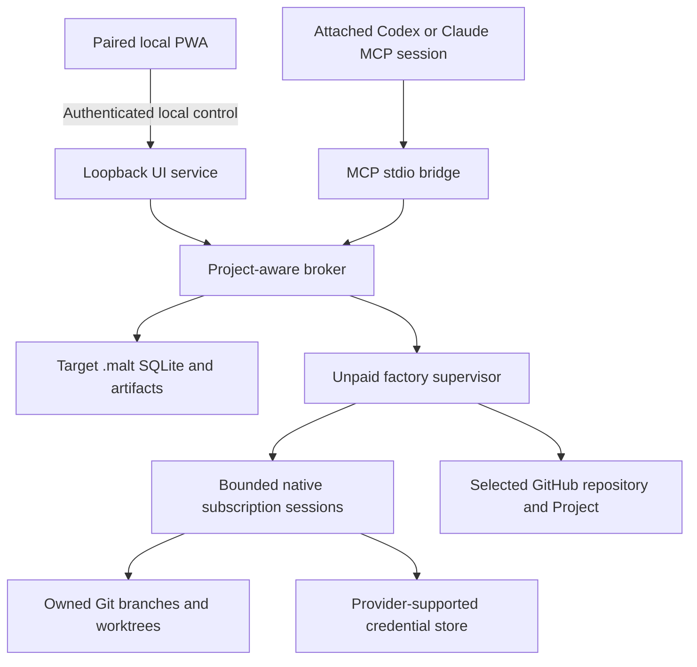

# Architecture and trust boundaries

The browser has no project bearer token or provider secret. Its session is separate from an attached MCP agent and from a managed model job. All mutations go through backend invariants; the PWA is not another scheduler.

Each target project is isolated. Private messages, claims, handoffs, evidence, skills and resource accounting live under that target's `.malt`. Atomic/transactional persistence fences stale claims and late output. The generated README is derived navigation; it does not replace authoritative SQLite or source history.

Managed development is trusted local execution, not a hostile-agent sandbox. Windows Job Objects and platform process groups clean up owned processes; aggregate admission limits protect capacity. Do not confuse a resource admission threshold with a hard kernel memory/CPU ceiling on every OS.

See [the source architecture guide](https://github.com/Division4Studios/malt/blob/main/docs/architecture.md) for modules, protocol boundaries and recovery behavior.
