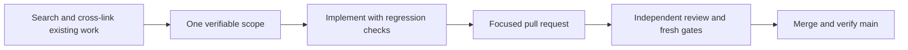

# Contributing and finding your way

Start with the repository's contribution policy and issue chooser. Search open and relevant closed issues before proposing work. Use Q&A for setup, Ideas for substantial proposals and private reporting for security. Do not include credentials, model transcripts or private runtime state in a public example.

## Useful GitHub features

- Press `?` to discover available keyboard shortcuts and `t` to find a file. Use a commit permalink for reproducible code references rather than a moving branch.
- Link the actual issue/PR and relevant line ranges in a review. Task lists describe verification, not evidence that a checkbox was truly exercised.
- Use rendered prose/image diffs for documentation and artwork. A whitespace-ignoring diff can help review, but still inspect the complete original diff for meaningful whitespace or hidden changes.
- Keep acceptance, exclusions, dependency edges and evidence in native issues so filtered Project views reference the same tickets.
- Use fenced language-tagged code, Mermaid diagrams with text explanations, tables for comparisons and collapsible details for long technical evidence. Do not hide blocking facts or essential instructions inside decoration.

These practices draw on [GitHub Cheat Sheet](https://github.com/tiimgreen/github-cheat-sheet); platform behavior must be verified against current official documentation. No extension installation, destructive cleanup shortcut or third-party script is required to contribute.

## Current checks and documentation

Human-facing Markdown-only changes use trusted-base classification, formatting/security and explicit successful platform/Docker fast paths. Executable changes, agent instructions, skills, prompts or uncertain classification run full checks. Required check names remain present; Quality gate and Security gate are required alongside platform/Docker and the separate CodeQL rule.

Keep [current status](Current-status), source guides and wiki mirrors consistent. Mark acceptance only with supporting evidence, link the implementing PR and preserve historical/partial scope notes. A passing model fixture is not a live-provider, real-terminal or installed-PWA certification.
