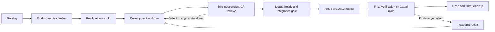

# Delivery workflow

An issue is the underlying ticket; Backlog is a workflow status on the selected Project. Unrefined bugs and ideas belong in Backlog. Ready scopes are actionable, but genuine dependencies still need completion. Every managed parent/child belongs to the intended Project.

Prefer 1–500 added/deleted text lines per PR, including tests and documentation. Features can have 20+ meaningful children. Avoid artificial ticket counts and invented blocking edges. Independent slices can proceed in parallel. For real chains, verify prerequisites on merged main before dependent work starts. Main must remain usable after every merge.

QA reports and reproduces defects without implementing the fix. The responsible developer repairs its own returned work. Approvals cover exact source/base identities and become stale when those identities change. Model QA approval does not satisfy GitHub's requirement for distinct authenticated reviewer identities.

Duplicate/related-work inspection precedes intake. Consolidating distinct existing tickets requires a human decision. The general recommendation/approval pane is a planned capability; current skill-revision approval is a separate implemented flow. See [the source factory guide](https://github.com/Division4Studios/malt/blob/main/docs/software-factory.md).

## Reconciliation and PR stacks

The [2026-10-15 audit](Issue-audit-2026-10-15) links completed scopes to actual merged PRs and leaves partial integrations open. An unchecked historical review clause is not silently converted into a new approval. A parent cannot be treated as delivered merely because its first child merged. Actual open native prerequisites distinguish Blocked from dependency-ready work; retain those edges rather than deleting them for appearance.

For deliberately prepared native GitHub stacks, inspect every layer and merge the complete ready stack from its top PR. Merging an intermediate layer separately can require restacking the remainder. The managed factory still delivers independent slices against refreshed main; its scheduler does not automatically turn every prerequisite chain into a GitHub stack.
