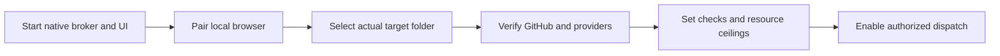

# Getting started

Use Git, Node.js 24.15.0+ in the 24.x line, and npm. Managed jobs additionally require installed Codex/Claude Code CLIs with subscription authentication. GitHub delivery requires GitHub CLI access to the intended repository and Project.

```sh
git clone https://github.com/Division4Studios/malt.git
cd malt
npm ci --ignore-scripts
npm run check
node src/cli.ts ui --with-broker --project /absolute/path/to/target --port 4318
```

This combined owner starts the native broker and paired UI together. Ordinary separately attached UIs can inspect/control their authorized project, but project-token access does not grant scratch-terminal or prepared recommendation-decision authority. Those human controls require the owning process's memory-only capability. The combined Docker deployment also provides that owner boundary.

Open `http://127.0.0.1:4318/` and enter the pairing code printed by that UI process. It is a credential, not something to paste into a public report. On Windows, quote target paths such as `"C:\work\target"`.



In Project setup, verify the repository and intended GitHub Project, workflow field, real validation commands and resource ceilings. No model process should be launched solely to make the dashboard appear busy. Install the app using the compatible browser's install control; offline mode is a stale app shell, not offline agent execution.

For container configuration, provider authentication and exact controls, follow [the operator guide](https://github.com/Division4Studios/malt/blob/main/docs/operator-console.md). Do not run native and container brokers against the same `.malt` database. The provider credential volume is private and is not a project backup.
