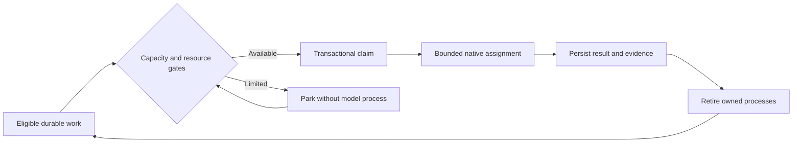

# Operations and recovery

Project setup verifies repository identity, GitHub access and intended Project. Keep subscription authentication in the provider's supported store and configure actual validation commands. Admission uses provider cooldown/verified utilization plus local CPU, memory and process policy. Unknown subscription quota must remain unknown; diagnostic token counts are not API credits.

Logical roles are not permanent model processes. The supervisor waits without spending model tokens; roles start only for bounded eligible assignments. Stop or cancel only owned jobs through the console. Never blanket-kill PowerShell, Node, Codex or Claude processes.

Use Mission for overview/Activity, Workflow for delivery state, Workers for actual logs/handoffs and Project for connection, policy and learning decisions. Do not mistake logs for an interactive terminal. An unchanged page can mean genuine dependency, capacity or approval waiting; inspect the recorded blocker rather than manufacturing work.

Pause before changing policy. Restart recovery restores durable claims/handoffs and checks actual Git state. Preserve dirty or newer worktrees; never delete them merely because a job ended. Stop the broker before a private backup and restore the entire coherent `.malt` store. See [troubleshooting](https://github.com/Division4Studios/malt/blob/main/docs/logging-and-troubleshooting.md).
