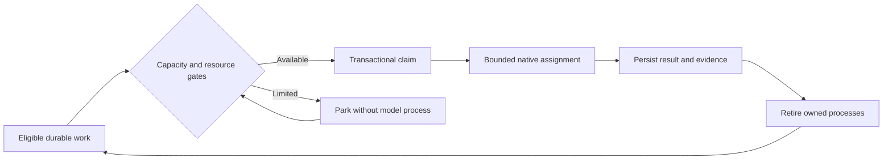

# Operations and recovery

Project setup verifies repository identity, GitHub access and intended Project. Keep subscription authentication in the provider's supported store and configure actual validation commands. Admission uses provider cooldown/verified utilization plus local CPU, memory and process policy. Unknown subscription quota must remain unknown; diagnostic token counts are not API credits.

Logical roles are not permanent model processes. The supervisor waits without spending model tokens; roles start only for bounded eligible assignments. Stop or cancel only owned jobs through the console. Never blanket-kill PowerShell, Node, Codex or Claude processes.

Use Mission for overview/Activity, Workflow for delivery state, Workers for actual logs/handoffs and Project for connection, policy and learning decisions. Do not mistake logs for an interactive terminal. An unchanged page can mean genuine dependency, capacity or approval waiting; inspect the recorded blocker rather than manufacturing work.

Pause before changing policy. Restart recovery restores durable claims/handoffs and checks actual Git state. Preserve dirty or newer worktrees; never delete them merely because a job ended. Stop the broker before a private backup and restore the entire coherent `.malt` store. See [troubleshooting](https://github.com/Division4Studios/malt/blob/main/docs/logging-and-troubleshooting.md).

## Priority, blockers and deployment

Product queue shows all unfinished objectives; completed/superseded work is collapsed. Move first/up/down changes durable order for future reservations. Focus only this objective holds unrelated new assignments without preempting running work.

Mission recovery offers Continue with team lead, Clarify with product owner, and Work existing deliveries. The last permits retained tickets across objectives while holding new product planning. Clear the path provides exact-revision acknowledge/diagnose/repair/review/verify/wait decisions. Acknowledge is not a fix. A validated source-specific size exception never waives QA, tests or protected merge.

Before retrying, inspect actual PR/main state and the [audit](Issue-audit-2026-10-15). Old failed attempts can describe code already merged. Do not replay implementation or force the private factory ledger to Done merely to match a board label.

Pause stops owned attempts and preserves edits; it does not certify success. Settle work and stop the specific owning broker/UI, update the intended source without overwriting edits, install locked dependencies and build the web shell, then restart matching services and pair again. A browser refresh or a merged PR does not hot-reload a broker. Never run native and container brokers against the same .malt.
