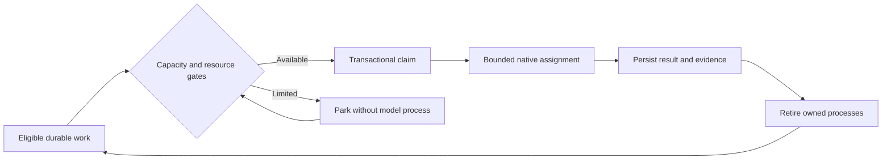
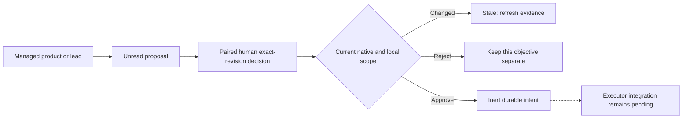

# Operations and recovery

For native scratch terminal control, run `node src/cli.ts ui --with-broker --project "<target-folder>" --port 4318`. When switching from separate services, stop both the older broker for this store and the UI occupying port 4318 first. Docker already shares this lifetime; a separately launched UI supports factory/log inspection but cannot grant terminal authority.

Project setup verifies repository identity, GitHub access and intended Project. Keep subscription authentication in the provider's supported store and configure actual validation commands. Admission uses provider cooldown/verified utilization plus local CPU, memory and process policy. Unknown subscription quota must remain unknown; diagnostic token counts are not API credits.

Logical roles are not permanent model processes. The supervisor waits without spending model tokens; roles start only for bounded eligible assignments. Stop or cancel only owned jobs through the console. Never blanket-kill PowerShell, Node, Codex or Claude processes.

Use Mission for overview/Activity, Workflow for delivery state, Workers for actual logs/handoffs and Project for connection, policy and learning decisions. Workers also has a separate **Scratch terminals** mode: explicitly start an enabled native provider in an owned worktree, capture keyboard or apply/fit geometry, reconnect output or close the session. This is not a managed developer/QA attachment. An unchanged page can mean genuine dependency, capacity or approval waiting; inspect the recorded blocker rather than manufacturing work.

Scratch terminal defaults are one live process session, five minutes without operator input and thirty minutes total, sharing the real broker-wide admission pool. Windows applies configured Job ceilings; native POSIX process groups provide cleanup without equivalent hard CPU/memory ceilings. Escape releases capture, Tab follows browser focus, and dedicated buttons send native Tab/Escape. Hidden/offline/rescoped views stop input/readers; reconnect never resends input.

Terminal transcripts stay in bounded redacted RAM, while metadata/counters survive in private project SQLite. Pause/shutdown closes owned trees; restart starts none and marks replay unavailable. Dirty scratch edits are retained. Neither scratch commits nor terminal output can satisfy managed delivery gates. See [limits and executed support](https://github.com/Division4Studios/malt/blob/main/docs/interactive-terminals.md), including the token-free three-minute browser fixture and the limited Windows provider startup smokes. No full provider inference turn or universal installed-PWA behavior is implied.

Pause before changing policy. Restart recovery restores durable claims/handoffs and checks actual Git state. Preserve dirty or newer worktrees; never delete them merely because a job ended. Stop the broker before a private backup and restore the entire coherent `.malt` store. See [troubleshooting](https://github.com/Division4Studios/malt/blob/main/docs/logging-and-troubleshooting.md).

## Reading Activity and handoffs

Activity keeps recent live events separate from bounded older pages. Use Older, Retry or Return to recent; reading a page never changes an agent inbox. Mission previews show up to six real reports/conversations with route, issue, stage and time. Expand a preview with its native disclosure control; unknown or stale associations are labeled rather than inferred. An agent-reported result is not independent delivery verification. Workers retain the actual logs and full relevant artifacts.

## Priority, blockers and deployment

Product queue shows all unfinished objectives; completed/superseded work is collapsed. Move first/up/down changes durable order for future reservations. Focus only this objective holds unrelated new assignments without preempting running work.

Mission recovery offers Continue with team lead, Clarify with product owner, and Work existing deliveries. The last permits retained tickets across objectives while holding new product planning. Clear the path provides exact-revision acknowledge/diagnose/repair/review/verify/wait decisions. Acknowledge is not a fix. A validated source-specific size exception never waives QA, tests or protected merge.

Before retrying, inspect actual PR/main state and the [audit](Issue-audit-2026-10-15). Old failed attempts can describe code already merged. Do not replay implementation or force the private factory ledger to Done merely to match a board label. For a merge already recorded locally, use Verify merged main. If no merge is recorded, Adopt external merge requires the actual full commit SHA and a reason, then queues actual-main verification; neither action invents missing QA.

Pause stops owned attempts and preserves edits; it does not certify success. Settle work and stop the specific owning broker/UI, update the intended source without overwriting edits, install locked dependencies and build the web shell, then restart matching services and pair again. A browser refresh or a merged PR does not hot-reload a broker. Never run native and container brokers against the same .malt.

## Capacity reading order

The subscription-first panel is prepared in the #21 delivery stack, pending merge and deliberate runtime update. It separates **Subscription limits**, **Diagnostic usage** and **Local machine**. Disabled providers remain identifiable and ineligible for dispatch. Window percentages, resets, observation times, freshness and sources are observations; unavailable values remain unknown, including absolute allowances. Legacy summaries do not invent window durations. Token diagnostics are not API credits. Locally launched subscription CLI sessions still use provider-hosted models.

## Prepared model-policy controls

[Stack #251](https://github.com/Division4Studios/malt/stack/251) contains prepared source for revisioned model policy, frozen native arguments, supported-provider admission, a native model/effort editor and independently reviewed role choices. These PRs require operator review/merge and a deliberate matching runtime update; this section does not certify a deployed feature or paid provider capability.

The editor is under **Project setup → Edit model and effort policy**. Pause and settle owned work before saving. Declare only subscription-available models and retain exact CLI-version/interface evidence; unknown support remains ineligible. A stale save preserves the draft. A model-policy gate preserves a ticket's current reviews, final proof and triage revision: correct the policy and resume to recheck the same stage, rather than resetting completed gates with a generic delivery retry.

Product-owner model choices remain proposals. The independent lead's final role-specific choice is persisted into delivery tasks. Current choices are honored; changed policy or inadequate capability blocks with a reason. Rework, security and organization floors remain binding. Requested CLI model/effort arguments do not prove the provider actually applied them, and unavailable subscription quota remains unknown. Historical assignments retain their original evidence.

## Prepared recommendation intake

[Stack #251](https://github.com/Division4Studios/malt/stack/251) also prepares bounded recommendation reads, managed product/lead proposals, paired human decisions, scoped notices and unpaid overlap intake. These are source awaiting owner review/merge and a matching runtime update. The native `--with-broker` startup and combined Docker runtime provide memory-only human decision authority; an agent or separately attached UI cannot acquire it from a project token.

New planning/provisioning first checks observed native/local behavioral overlap. Exact interrupted operation IDs resume automatically. Other evidence-backed overlap waits on an exact recommendation; unrelated development continues. Pending objective cards explain collection progress or name the recommendation requiring disposition. Cursor progress survives restart; no model session waits on this queue. Existing bounded planners keep frozen context and finish before their next stage is inspected.

Confirmed creation receipts are retained before dependency linking. A failed link can therefore recover after restart without treating the factory's own created issues as external duplicates. Receipts are fenced to the verified repository; tasks remain unadmitted until dependencies reconcile.

Read and explicitly acknowledge the exact recommendation through the [documented API](https://github.com/Division4Studios/malt/blob/main/docs/api.md); the dedicated Project-management pane is still pending. Human decisions reread current native/local scope and become stale when it changed. Reject means keeping the request separate and releases only that objective. Approve persists an inert follow-up intent: remote effects, graph transfer and recommendation-to-skill adoption remain #59–#61, with UI/full-loop delivery in #62–#64. Approval never silently closes a ticket or changes an active skill.

