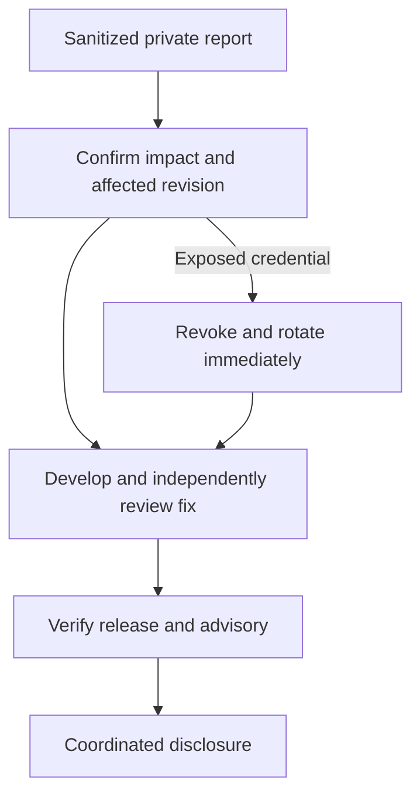

# Security and privacy

The [verified GitHub controls](https://github.com/Division4Studios/malt/blob/main/docs/github-controls.md) distinguish enabled scanning and required checks from the temporary solo-maintainer review exception. Both Dependabot auto-dismissal presets are disabled. Existing scan findings remain subject to investigation; configured scanning is not a clean-security certificate. A second trusted maintainer and dedicated private conduct contact are still needed. Sponsorship never changes the private reporting route or security gates.

Report vulnerabilities through [GitHub private vulnerability reporting](https://github.com/Division4Studios/malt/security/advisories/new). Do not publish a reproduction with live secrets or attach a `.malt` archive. See the repository Security tab for the current policy.

- Keep `.malt`, `.mlt`, provider credential homes, `.env` and private keys out of source, images, exports and public logs.
- Pair only with the local daemon you started. Do not expose its control ports publicly or put pairing codes in URLs.
- Inspect permissions and project commands before dispatch. Developer full-access mode permits native execution under your OS account.
- Scan current files and all reachable Git history before release. Ignoring a file does not remove a historical leak; revocation takes priority.
- Review third-party skills/tools for license, provenance, compatibility and security. Human adoption is for an exact revision; downloaded instructions are not authority.

The project uses the OpenSSF Baseline and best-practices criteria as review frameworks. It has not claimed a badge, penetration-test certification or complete absence of defects. See the merged [release-readiness ledger](https://github.com/Division4Studios/malt/blob/main/docs/open-source-readiness.md).

On 2026-10-15, API readback verified private reporting, secret scanning/push protection and the active CodeQL rule. Required checks include all three OS checks, Docker, Quality gate and Security gate. The temporary solo-maintainer authenticated-review exception remains documented; no audit note substitutes for runtime QA or GitHub approvals.
